# RFC-LLM: Formal Cryptographic Protocol Synthesis & MoE Post-Training Roadmap

**RFC-LLM** is an end-to-end formal methods synthesis engine and synthetic training data factory. It translates informal IETF RFC security protocol specifications into mathematically verified **MITRE CPSA 4.4.9** (Cryptographic Protocol Shapes Analyzer) models, generating compiler-verified trajectories and `<think>` reasoning traces to post-train a Mixture-of-Experts (MoE) model using **AMD ROCm Megatron-LM**.

> [!IMPORTANT]
> **Living Roadmap Invariant**: Every retrieval mechanism, prompt template, and intermediate agentic loop in this repository is subject to iteration and replacement **except the core thesis**: using strictly structured, compiler-verified CPSA code and test trajectories generated from real RFCs to post-train an MoE model via **ROCm Megatron-LM** to natively master formal cryptographic protocol modeling.

---

## 1. Project Evolution & Master Roadmap

```mermaid
flowchart LR
    subgraph P1["Phase 1: Context & Grounding (Built / Fluid)"]
        R1["MITRE CPSA 4.4.9 Corpus\n(1,426 Enriched Chunks)"] --> R2["Hybrid RAG (BM25 + Dense + RRF)\n300-Query Golden Benchmark"]
        R2 -. "Under Evaluation:\nFast Lookup / Prefix Cache / Weights?" .-> P2
    end

    subgraph P2["Phase 2: Agentic Synthesis & Verification Engine (Active)"]
        A1["Stage 1: Document Intake\n(Filter + TOC + Verbatim Slicer)"] --> A2["Stage 2: JSON CPSA Generation\n(Scoped Pydantic AST)"]
        A2 --> A3["Stage 3 & 4: CPSA4json -> scm\n& Roletran Check (15s)"]
        A3 -->|Compiler Reject| A4["Stage 5: Self-Healing Loop\n(SHA-256 Cycle Check + RAG)"]
        A4 --> A3
        A3 -->|Compiler Pass| A5["Stage 6: CPSA Compilation (60s Cap)\nVerified .scm + Trajectory JSON"]
    end

    subgraph P3["Phase 3: Hindsight Reasoning & Dataset Factory (Active)"]
        A5 --> D1["./rfc-think Synthesizer:\n<protocol>_think.json + sft_train.jsonl"]
        A4 --> D2["Contrastive DPO / RLVR Pairs:\ndpo_pairs.jsonl"]
    end

    subgraph P4["Phase 4: MoE Post-Training (Target)"]
        D1 & D2 --> M1["AMD ROCm Megatron-LM\nMoE Post-Training (SFT + RLVR)"]
        M1 --> M2["Domain-Specialized CPSA MoE\n(Zero-Shot Formal Verification)"]
    end
```



---

## 2. Roadmap Phases & Current Status

### Phase 1: Domain Knowledge & Context Retrieval `[BUILT — ARCHITECTURE SUBJECT TO CHANGE]`
To bridge the gap between natural language RFCs and MITRE CPSA's order-sorted S-expression grammar, the repository includes a domain-specific Retrieval-Augmented Generation (RAG) pipeline and evaluation suite:
- **Enriched Corpus ([`refrences/chunks/`](refrences/chunks/))**: 1,426 chunks combining 1,278 AST-enriched documentation sections (`cpsa4manual.pdf`, `cpsaspec.txt`, `cpsauser.md`, `cpsadesign.txt`, `cpsaprimer.txt`) and 148 official MITRE `.scm` protocol models.
- **Hybrid Retrieval ([`src/rag_retriever_client.py`](src/rag_retriever_client.py), [`refrences/scripts/03_query_rag.py`](refrences/scripts/03_query_rag.py))**: Combines lexical BM25 with 768-dimensional dense vector embeddings (`ollama/nomic-embed-text`) via Reciprocal Rank Fusion (`RRF`).
- **300-Query Golden Benchmark ([`refrences/reports/evaluate_rag.py`](refrences/reports/evaluate_rag.py))**: Evaluates retrieval precision across syntax, protocol models, strand space theory, and stateful channels/locations.

> [!WARNING]
> **Why RAG is Subject to Change**: Runtime vector/hybrid RAG adds latency and may not be the optimal way to surface formal compiler constraints fast. Alternatives under active consideration:
> 1. **Deterministic Compiler Diagnostic Lookup**: Mapping `cpsa4roletran` and `cpsa4` Haskell error strings directly to curated grammar rules without embedding search.
> 2. **Pinned KV-Cache Context**: Pre-loading the condensed CPSA 4.4.9 BNF grammar and operator tables ([`docs/CPSA_KEYWORD_REFERENCE.md`](docs/CPSA_KEYWORD_REFERENCE.md)) directly into a cached system prefix.
> 3. **Weight Internalization (Phase 4)**: Post-training the MoE model directly on the CPSA corpus and synthetic trajectories so runtime RAG can be reduced or eliminated.

---

### Phase 2: Agentic Constrained Synthesis & Formal Verification Loop `[ACTIVE BASELINE]`
Rather than prompting an LLM to emit raw, unconstrained Scheme strings, the synthesis engine enforces formal correctness through a **6-stage compiler-in-the-loop architecture** orchestrated by [`src/main_pipeline_orchestrator.py`](src/main_pipeline_orchestrator.py):

1. **Stage 1 — Document Intake ([`src/document_ingestion/`](src/document_ingestion/))**:
   - [`rfc_header_filter.py`](src/document_ingestion/rfc_header_filter.py) & [`protocol_applicability_gate.py`](src/document_ingestion/protocol_applicability_gate.py): Rejects non-protocol RFCs (informational memos, MIBs, administrative guidelines, static payload formats). Deferred directory creation ensures rejected RFCs never create empty folders on disk.
   - [`rfc_toc_parser.py`](src/document_ingestion/rfc_toc_parser.py), [`handshake_section_router.py`](src/document_ingestion/handshake_section_router.py), & [`verbatim_section_slicer.py`](src/document_ingestion/verbatim_section_slicer.py): Slices 10,000+ line RFCs down to the verbatim 200-600 lines defining the cryptographic message exchange (`verbatim_slice.txt`).
2. **Stage 2 — JSON CPSA Generation ([`src/intermediate_representation/`](src/intermediate_representation/), [`src/semantic_extraction/constrained_protocol_extractor.py`](src/semantic_extraction/constrained_protocol_extractor.py))**:
   - Enforces MITRE CPSA 4.4.9 Tables 10.1-10.6, Equation 10.1 (`mesg` forbidden as encryption key in `enc`), and strict positional keyword scoping across [`algebraic_sorts.py`](src/intermediate_representation/algebraic_sorts.py), [`cpsa_grammar.py`](src/intermediate_representation/cpsa_grammar.py), and [`protocol_syntax_tree.py`](src/intermediate_representation/protocol_syntax_tree.py), backed by a 1-shot schema self-correction retry.
   - Enforces the **3-POV Preskeleton Invariant**: Skeletons 1 and 2 model pure Initiator/Responder viewpoints with zero listeners; Skeleton 3 isolates `deflistener` secrecy probes so handshake shape realization is never prematurely pruned.
3. **Stage 3 — CPSA4json -> scm ([`src/code_generation/`](src/code_generation/))**:
   - [`cpsa_json_serializer.py`](src/code_generation/cpsa_json_serializer.py) & [`cpsa_scheme_emitter.py`](src/code_generation/cpsa_scheme_emitter.py): Deterministically serializes the validated Pydantic AST into native CPSA JSON S-expression arrays and compiles them into canonical CPSA 4.4.9 `.scm` code via `cpsa4json`.
4. **Stage 4 — Roletran Check ([`src/verification_engine/roletran_executability_gate.py`](src/verification_engine/roletran_executability_gate.py))**:
   - Runs `cpsa4roletran` (for `basic` algebra) or `cpsa4 -l 1` (for `diffie-hellman` algebra) under `ROLETRAN_TIMEOUT_SECONDS = 15` to verify role constructibility, destructibility, and variable origination before invoking full strand-space search.
5. **Stage 5 — Self-Healing Loop ([`src/verification_engine/compiler_diagnostic_repair.py`](src/verification_engine/compiler_diagnostic_repair.py))**:
   - Intercepts Stage 4 (`Roletran Check`) or Stage 6 (`CPSA Compilation`) rejections, tracks SHA-256 AST hashes to break repair oscillations, formulates conceptual RAG queries (`15s` timeout), retrieves authoritative MITRE CPSA manual rules, and patches the Pydantic AST for up to `MAX_REPAIR_ATTEMPTS = 50` iterations.
6. **Stage 6 — CPSA Compilation ([`src/verification_engine/mitre_build_orchestrator.py`](src/verification_engine/mitre_build_orchestrator.py), [`src/verification_engine/trajectory_metadata_exporter.py`](src/verification_engine/trajectory_metadata_exporter.py))**:
   - Executes `cpsa4init` and `make` (`cpsa4`, `cpsa4shapes`, `cpsa4graph`) under a hard 60-second process-group `SIGKILL` cap (`CPSA_TIMEOUT_SECONDS = 60`) to produce realized shapes and interactive XHTML/SVG strand-space diagrams.
   - Scores deterministic verification quality tiers (`GOLD`, `SILVER`, `BRONZE`, `REJECTED`), prepends structured MoE conditioning headers to `<protocol>.scm`, exports `<protocol>_trajectory.json`, and updates the run-level `output/run_YYYY-MM-DD_HH-MM-SS/metadata_index.json`.

#### YAML Frontmatter Model Routing & Live Hot-Reload (`prompts/*.md`)
All 7 LLM prompt templates ([`prompts/01_applicability_gate.md`](prompts/01_applicability_gate.md) through [`prompts/07_think_token_synthesizer.md`](prompts/07_think_token_synthesizer.md)) define their per-stage `model`, HTTP `timeout` (`180s` default; `15s` for `05_rag_query_formulation.md`), and `temperature` directly in leading YAML frontmatter via [`src/prompt_loader.py`](src/prompt_loader.py):
- **Zero-Restart Live Hot-Reload**: Edits to `model:`, `timeout:`, `temperature:`, or prompt text take effect on the very next LLM call—even mid-batch—without restarting `./rfc-llm`.
- **Clean `.env`**: `.env` ([`.env.example`](.env.example)) holds **only** API credentials (`GEMINI_API_KEY`, `NOUS_API_KEY`, `OPENAI_API_KEY`, `ANTHROPIC_API_KEY`) and base endpoint URLs (`NOUS_API_BASE`, `OLLAMA_API_BASE`, `STRATA_API_BASE`).
- **Provider Prefixes & CLI Overrides**: Supports `nous/<model>`, `strata/<model>`, `ollama/<model>`, `gemini/<model>`, `openai/<model>`, and `anthropic/<model>`, plus optional one-off CLI overrides (`--model`, `--router-model`, `--extraction-model`, `--repair-model`, `--query-model`).

#### Multi-RFC Virtualized Web Visualizer & Offline Replay (`--view`)
[`src/visualizer/server.py`](src/visualizer/server.py), [`src/visualizer/static/index.html`](src/visualizer/static/index.html), and [`src/pipeline_events.py`](src/pipeline_events.py) provide real-time and offline multi-RFC inspection at `http://127.0.0.1:8080`:
- **Virtualized `#1..#N` Tab Strip**: Allocates sequential `#1..#N` tabs for accepted RFCs showing tab number, RFC ID, quality tier, and protocol name with `O(1)` browser DOM nodes and `O(1)` server RAM across 5,000+ tabs (evicting completed RFC events to per-RFC `events.jsonl`).
- **Collapsible `Filtered / Skipped` Drawer**: Paginated, searchable drawer recording Tier 0 and Stage 1c rejected RFCs without cluttering the accepted tab bar.
- **Per-Attempt Time-Travel Stepper**: Inspect `Attempt 0 | Initial` -> `Attempt 1..K` -> `Final` with a rejected/repaired `.scm` toggle, Pydantic JSON AST, compiler diagnostics, RAG manual chunks, and SVG shape graphs.
- **Offline Replay Mode**: Inspect any completed run folder without re-running synthesis via `./rfc-llm --view output/run_<timestamp>`.

---

### Phase 3: Hindsight Reasoning (`<think>`) Synthesizer & Dataset Factory `[ACTIVE — ./rfc-think]`
Implemented in [`./rfc-think`](rfc-think) ([`src/generate_think/`](src/generate_think/) and [`prompts/07_think_token_synthesizer.md`](prompts/07_think_token_synthesizer.md)), Phase 3 converts Phase 2 verification trajectories into structured post-training datasets:
- **Hindsight Rationalization with Compiler Backtracking**: Reads timestamped run directories (`output/run_YYYY-MM-DD_HH-MM-SS/metadata_index.json`) or individual `<protocol>_trajectory.json` bundles and synthesizes forward-looking, first-person 5-step `<think>...</think>` monologues (`auto`, `llm`, or zero-LLM `deterministic` mode) with zero hindsight leakage.
- **Per-RFC & Consolidated Post-Training Artifacts**:
  - Writes `<protocol>_think.json` alongside `<protocol>_trajectory.json` and `<protocol>.scm` for every protocol meeting `--min-tier` (`GOLD`, `SILVER`, `BRONZE`, `REJECTED`).
  - Exports consolidated `sft_train.jsonl` (3-turn `[system, user, assistant]` chat records combining `<think>...</think>` + verified `.scm`) and `dpo_pairs.jsonl` (chosen verified completions paired against compiler-rejected `.scm` attempts from Stages 4-6) at the root of the run directory.

---

### Phase 4: MoE Post-Training via AMD ROCm Megatron-LM `[NORTH STAR TARGET]`
The culmination of the project is post-training an open-weight **Mixture-of-Experts (MoE)** model on structured synthetic CPSA code, `<think>` traces, and compiler repair trajectories using **AMD ROCm Megatron-LM** (`ROCm/Megatron-LM`):

- **Training Stack**: **AMD ROCm Megatron-LM** leveraging tensor, pipeline, and expert parallelism (`EP`) optimized for AMD Instinct / Strix Halo ROCm hardware.
- **Why MoE for Formal Verification**:
  - Cryptographic protocol synthesis requires simultaneous mastery of informal RFC prose comprehension, strict Pydantic/JSON structural formatting, order-sorted algebra (`basic` vs. `diffie-hellman`), and Dolev-Yao strand-space origination semantics (`uniq-orig` vs. `uniq-gen`).
  - Post-training an MoE allows sparse expert specialization across syntax emission, algebraic sort checking, and compiler error repair without catastrophic forgetting of general reasoning.
- **Two-Stage Post-Training Regimen**:
  1. **Structured SFT in ROCm Megatron-LM**: Train on `sft_train.jsonl` (`RFC Slice -> <think> -> Verified .scm`) plus CPSA 4.4.9 specification chunks to internalize the grammar.
  2. **Compiler-in-the-Loop Post-Training (DPO / GRPO)**: Optimize the MoE on `dpo_pairs.jsonl` contrastive repair trajectories and verifiable `cpsa4roletran` / `cpsa4` execution outcomes to maximize first-pass compilation pass@1 and realized shape soundness.

---

## 3. Repository Structure & Documentation Map

| Directory / File | Purpose |
| :--- | :--- |
| [`rfc-llm`](rfc-llm) | Phase 2 synthesis & offline replay CLI (`./rfc-llm <rfc_or_dir>` / `./rfc-llm --view <run_dir>`) |
| [`rfc-think`](rfc-think) | Phase 3 `<think>` reasoning & SFT/DPO dataset synthesizer CLI (`./rfc-think <run_dir>`) |
| [`.env.example`](.env.example) | Credentials & base endpoint URLs template (`*_API_KEY`, `NOUS_API_BASE`, `OLLAMA_API_BASE`, `STRATA_API_BASE`) |
| [`prompts/`](prompts/README.md) | 7 YAML-frontmatter prompt templates (`model`, `timeout`, `temperature`) with live mid-batch hot-reload |
| [`src/`](src/) | Core 6-stage synthesis pipeline, Pydantic IR, verification engine, Phase 3 synthesizer, and web visualizer |
| [`docs/`](docs/README.md) | Architecture specifications, CPSA 4.4.9 keyword reference, model routing, and operational runbooks |
| [`tests/`](tests/) | Unit and integration test suite enforcing CPSA 4.4.9 scoping, visualizer tabs, and `<think>` synthesis |
| [`refrences/`](refrences/) | MITRE CPSA 4.4.9 manuals, 148 `.scm` examples, hybrid RAG scripts, and 300-query golden benchmark |
| [`notebook_context/`](notebook_context/README.md) | Automated repository-to-Markdown context bundler for LLM Notebook ingestion |

### Core Technical Documentation (`docs/`)
- **[System Architecture & Lifecycle](docs/ARCHITECTURE.md)**
- **[Formal Grammar & Intermediate Representation](docs/INTERMEDIATE_REPRESENTATION.md)**
- **[Complete CPSA 4.4.9 Keyword & Grammar Reference](docs/CPSA_KEYWORD_REFERENCE.md)**
- **[Tiered Model Routing & YAML Frontmatter Configuration](docs/TIERED_MODEL_ROUTING.md)**
- **[Verification Engine & Self-Healing Loop](docs/VERIFICATION_AND_SELF_HEALING.md)**
- **[Master Clean-Room Blueprint](docs/MASTER_BLUEPRINT.md)**
- **[Quickstart & Operational Runbook](docs/QUICKSTART_AND_OPERATIONS.md)**

---

## 4. Quickstart

```bash
# 1. Copy the credentials & endpoints template and populate your API keys
cp .env.example .env

# 2. Run the full test suite
.venv/bin/pytest tests/

# 3. Synthesize & formally verify a CPSA model from an RFC (live visualizer on http://127.0.0.1:8080)
./rfc-llm refrences/all_RFCs/rfc9528.txt

# 4. Replay any completed run directory offline in the virtualized multi-RFC visualizer
./rfc-llm --view output/run_YYYY-MM-DD_HH-MM-SS

# 5. Synthesize Phase 3 <think> traces plus sft_train.jsonl and dpo_pairs.jsonl
./rfc-think output/run_YYYY-MM-DD_HH-MM-SS

# 6. Rebuild NotebookLM / Gemini markdown context bundles after edits
python3 notebook_context/sync_context.py
```
