# RFC-LLM: Formal Cryptographic Protocol Synthesis & MoE Post-Training Roadmap

**RFC-LLM** is an end-to-end formal methods synthesis engine and synthetic training data factory. It translates informal IETF RFC security protocol specifications into mathematically verified **MITRE CPSA 4.4.9** (Cryptographic Protocol Shapes Analyzer) models, with the overarching goal of generating compiler-verified formal verification trajectories to post-train a Mixture-of-Experts (MoE) model using **AMD ROCm Megatron-LM**.

> [!IMPORTANT]
> **Living Roadmap Invariant**: Every retrieval mechanism, prompt template, and intermediate agentic loop in this repository is subject to iteration and replacement **except the core thesis**: using strictly structured, compiler-verified CPSA code and test trajectories generated from real RFCs to post-train an MoE model via **ROCm Megatron-LM** to natively master formal cryptographic protocol modeling.

---

## 1. Project Evolution & Master Roadmap

```mermaid
flowchart LR
    subgraph P1["Phase 1: Context & Grounding (Built / Fluid)"]
        R1["MITRE CPSA 4.4.9 Corpus\n(1,426 Enriched Chunks)"] --> R2["Hybrid RAG (BM25 + Dense + RRF)\n300-Query Golden Benchmark"]
        R2 -. "Under Evaluation:\nFast Lookup / Prefix Cache / Weights?" .-> P2
    end

    subgraph P2["Phase 2: Agentic Synthesis & Verification Engine (Active)"]
        A1["RFC Ingestion & Verbatim Slicer"] --> A2["Scoped Pydantic AST\n(Tables 10.1–10.6)"]
        A2 --> A3["Scheme Emitter &\ncpsa4roletran / cpsa4 Gate"]
        A3 -->|Compiler Reject| A4["Closed-Loop Diagnostic Repair"]
        A4 --> A3
        A3 -->|Compiler Pass| A5["Verified .scm + Realized Shapes\n(cpsa4shapes)"]
    end

    subgraph P3["Phase 3: Synthetic Dataset Factory (Next)"]
        A5 --> D1["SFT Corpus:\n(RFC Slice → AST → Verified .scm)"]
        A4 --> D2["DPO / RLVR Trajectories:\n(Compiler Error → Verified Fix)"]
    end

    subgraph P4["Phase 4: MoE Post-Training (Target)"]
        D1 & D2 --> M1["AMD ROCm Megatron-LM\nMoE Post-Training (SFT + RLVR)"]
        M1 --> M2["Domain-Specialized CPSA MoE\n(Zero-Shot Formal Verification)"]
    end
```



---

## 2. Roadmap Phases & Current Status

### Phase 1: Domain Knowledge & Context Retrieval `[BUILT — ARCHITECTURE SUBJECT TO CHANGE]`
To bridge the gap between natural language RFCs and MITRE CPSA's order-sorted S-expression grammar, we built a domain-specific Retrieval-Augmented Generation (RAG) pipeline and evaluation suite:
- **Enriched Corpus ([`refrences/chunks/`](file:///home/mario/Work/RFC-LLM/refrences/chunks/))**: 1,426 chunks combining 1,278 AST-enriched documentation sections (`cpsa4manual.pdf`, `cpsaspec.txt`, `cpsauser.md`, `cpsadesign.txt`, `cpsaprimer.txt`) and 148 official MITRE `.scm` protocol models.
- **Hybrid Retrieval ([`src/rag_retriever_client.py`](file:///home/mario/Work/RFC-LLM/src/rag_retriever_client.py), [`refrences/scripts/03_query_rag.py`](file:///home/mario/Work/RFC-LLM/refrences/scripts/03_query_rag.py))**: Combines lexical BM25 (`k1=1.5, b=0.75`) with dense vector embeddings (`BAAI/bge-large-en-v1.5`) via Reciprocal Rank Fusion (`RRF k=20`).
- **300-Query Golden Benchmark ([`refrences/reports/evaluate_rag.py`](file:///home/mario/Work/RFC-LLM/refrences/reports/evaluate_rag.py))**: Evaluates retrieval across syntax, protocol models, strand space theory, and stateful channels/locations.

> [!WARNING]
> **Why RAG is Subject to Change**: Runtime vector/hybrid RAG adds latency and may not be the optimal way to surface formal compiler constraints fast. Alternatives under active consideration:
> 1. **Deterministic Compiler Diagnostic Lookup**: Mapping `cpsa4roletran` and `cpsa4` Haskell error strings directly to curated grammar rules without embedding search.
> 2. **Pinned KV-Cache Context**: Pre-loading the condensed CPSA 4.4.9 BNF grammar and operator tables ([`docs/CPSA_KEYWORD_REFERENCE.md`](file:///home/mario/Work/RFC-LLM/docs/CPSA_KEYWORD_REFERENCE.md)) directly into a cached system prefix.
> 3. **Weight Internalization (Phase 4)**: Post-training the MoE model directly on the CPSA corpus and synthetic trajectories so runtime RAG can be reduced or eliminated.

---

### Phase 2: Agentic Constrained Synthesis & Formal Verification Loop `[ACTIVE BASELINE]`
Rather than prompting an LLM to emit raw, unconstrained Scheme strings, the current pipeline enforces formal correctness through a **7-stage compiler-in-the-loop architecture** orchestrated by [`src/main_pipeline_orchestrator.py`](file:///home/mario/Work/RFC-LLM/src/main_pipeline_orchestrator.py):

1. **Tier 0 & Stage 1 — RFC Filtering & Verbatim Section Slicing ([`src/document_ingestion/`](file:///home/mario/Work/RFC-LLM/src/document_ingestion/))**:
   - [`rfc_header_filter.py`](file:///home/mario/Work/RFC-LLM/src/document_ingestion/rfc_header_filter.py) & [`protocol_applicability_gate.py`](file:///home/mario/Work/RFC-LLM/src/document_ingestion/protocol_applicability_gate.py): Rejects non-protocol RFCs (informational, administrative, pure payload formats).
   - [`rfc_toc_parser.py`](file:///home/mario/Work/RFC-LLM/src/document_ingestion/rfc_toc_parser.py), [`handshake_section_router.py`](file:///home/mario/Work/RFC-LLM/src/document_ingestion/handshake_section_router.py), & [`verbatim_section_slicer.py`](file:///home/mario/Work/RFC-LLM/src/document_ingestion/verbatim_section_slicer.py): Slices 10,000+ line RFCs down to the verbatim 200–600 lines defining the cryptographic message exchange.
2. **Stage 2 — Strongly-Typed Pydantic Order-Sorted AST ([`src/intermediate_representation/`](file:///home/mario/Work/RFC-LLM/src/intermediate_representation/))**:
   - Enforces MITRE CPSA 4.4.9 Tables 10.1–10.6, Equation 10.1 (`mesg` forbidden as encryption key in `enc`), and strict positional keyword scoping across [`algebraic_sorts.py`](file:///home/mario/Work/RFC-LLM/src/intermediate_representation/algebraic_sorts.py), [`cpsa_grammar.py`](file:///home/mario/Work/RFC-LLM/src/intermediate_representation/cpsa_grammar.py), and [`protocol_syntax_tree.py`](file:///home/mario/Work/RFC-LLM/src/intermediate_representation/protocol_syntax_tree.py).
   - Enforces the **3-POV Preskeleton Invariant**: Skeletons 1 and 2 model pure Initiator/Responder viewpoints with zero listeners; Skeleton 3 isolates `deflistener` secrecy probes so handshake shape realization is never prematurely pruned.
3. **Stage 3 & 4 — Deterministic Code Emission ([`src/code_generation/`](file:///home/mario/Work/RFC-LLM/src/code_generation/))**:
   - [`cpsa_scheme_emitter.py`](file:///home/mario/Work/RFC-LLM/src/code_generation/cpsa_scheme_emitter.py) & [`cpsa_json_serializer.py`](file:///home/mario/Work/RFC-LLM/src/code_generation/cpsa_json_serializer.py): Deterministically compiles the validated Pydantic AST into canonical CPSA 4.4.9 `.scm` S-expressions.
4. **Stage 5 & 6 — Pre-Flight Executability Gate & Self-Healing Repair ([`src/verification_engine/`](file:///home/mario/Work/RFC-LLM/src/verification_engine/))**:
   - [`roletran_executability_gate.py`](file:///home/mario/Work/RFC-LLM/src/verification_engine/roletran_executability_gate.py): Runs `cpsa4roletran` (for `basic` algebra) or `cpsa4 -l 1` (for `diffie-hellman` algebra) to verify role constructibility and variable origination before full search.
   - [`compiler_diagnostic_repair.py`](file:///home/mario/Work/RFC-LLM/src/verification_engine/compiler_diagnostic_repair.py): Intercepts compiler rejections, detects repair cycles, and surgically patches the Pydantic AST until compilation succeeds.
5. **Stage 7 — Formal Shape Analysis ([`mitre_build_orchestrator.py`](file:///home/mario/Work/RFC-LLM/src/verification_engine/mitre_build_orchestrator.py))**:
   - Executes `cpsa4` and `cpsa4shapes` to produce realized protocol shapes and interactive XHTML strand-space diagrams.

All 6 LLM prompt templates powering the 4 active LLM loops are externalized in [`.prompts/`](file:///home/mario/Work/RFC-LLM/.prompts/README.md) via [`src/prompt_loader.py`](file:///home/mario/Work/RFC-LLM/src/prompt_loader.py) so prompt engineering is completely decoupled from Python code.

---

### Phase 3: Synthetic Trajectory Curation & Verifiable Reward Dataset `[UPCOMING]`
The Phase 2 agentic pipeline doubles as a **synthetic training data generator** backed by a formal ground-truth verifier (`cpsa4roletran` + `cpsa4`):
- **Bulk RFC Sweep**: Run the pipeline across the IETF RFC corpus ([`refrences/all_RFCs/`](file:///home/mario/Work/RFC-LLM/refrences/all_RFCs/)) and protocol variants.
- **Supervised Fine-Tuning (SFT) Dataset**:
  - Input: Verbatim RFC handshake specification slice + structured extraction prompt.
  - Target: Compiler-verified `CPSAProtocolSpecification` JSON AST and canonical `.scm` code that passes `cpsa4` shape realization (`realized_count > 0`).
- **Compiler-Feedback Preference & RLVR Trajectories**:
  - Every self-healing repair loop in [`compiler_diagnostic_repair.py`](file:///home/mario/Work/RFC-LLM/src/verification_engine/compiler_diagnostic_repair.py) logs `(Rejected AST, Compiler Diagnostic, Accepted Repaired AST)`.
  - Provides high-signal contrastive pairs for **DPO (Direct Preference Optimization)** and **RLVR (Reinforcement Learning with Verifiable Rewards)** where the MITRE CPSA binary acts as a deterministic, zero-hallucination reward oracle.

---

### Phase 4: MoE Post-Training via AMD ROCm Megatron-LM `[NORTH STAR TARGET]`
The culmination of the project is post-training an open-weight **Mixture-of-Experts (MoE)** model on our structured synthetic CPSA code and verification trajectories using **AMD ROCm Megatron-LM** (`ROCm/Megatron-LM`):

- **Training Stack**: **AMD ROCm Megatron-LM** leveraging tensor, pipeline, and expert parallelism (`EP`) optimized for AMD Instinct / Strix Halo ROCm hardware.
- **Why MoE for Formal Verification**:
  - Cryptographic protocol synthesis requires simultaneous mastery of informal RFC prose comprehension, strict Pydantic/JSON structural formatting, order-sorted algebra (`basic` vs. `diffie-hellman`), and Dolev-Yao strand-space origination semantics (`uniq-orig` vs. `uniq-gen`).
  - Post-training an MoE allows sparse expert specialization across syntax emission, algebraic sort checking, and compiler error repair without catastrophic forgetting of general reasoning.
- **Two-Stage Post-Training Regimen**:
  1. **Structured SFT in ROCm Megatron-LM**: Train on verified `(RFC Slice → Scoped Pydantic AST → .scm)` pairs plus CPSA 4.4.9 specification chunks to internalize the grammar.
  2. **Compiler-in-the-Loop Post-Training (DPO / GRPO)**: Optimize the MoE on multi-turn repair trajectories and verifiable `cpsa4roletran` / `cpsa4` execution outcomes to maximize first-pass compilation pass@1 and realized shape soundness.

---

## 3. Repository Structure & Documentation Map

| Directory / File | Purpose |
| :--- | :--- |
| [`rfc-llm`](file:///home/mario/Work/RFC-LLM/rfc-llm) | Root CLI launcher (`./rfc-llm <rfc_path> [--visualize]`) |
| [`.env.example`](file:///home/mario/Work/RFC-LLM/.env.example) | Environment configuration template (API keys, tiered model routing, local `100.77.124.9` endpoints) |
| [`.prompts/`](file:///home/mario/Work/RFC-LLM/.prompts/README.md) | Externalized system & user prompt templates for all 4 LLM pipeline loops |
| [`src/`](file:///home/mario/Work/RFC-LLM/src/) | Core 7-stage synthesis, Pydantic IR, code generation, verification, and visualizer |
| [`docs/`](file:///home/mario/Work/RFC-LLM/docs/README.md) | Detailed technical documentation, CPSA 4.4.9 keyword reference, and runbooks |
| [`tests/`](file:///home/mario/Work/RFC-LLM/tests/) | Unit and integration test suite enforcing CPSA 4.4.9 scoping and pipeline invariants |
| [`refrences/`](file:///home/mario/Work/RFC-LLM/refrences/) | MITRE CPSA 4.4.9 manuals, 148 `.scm` examples, RAG scripts, and 300-query benchmark |
| [`notebook_context/`](file:///home/mario/Work/RFC-LLM/notebook_context/README.md) | Automated repository-to-Markdown context bundler for LLM Notebook ingestion |

### Core Technical Documentation (`docs/`)
- **[System Architecture & Lifecycle](file:///home/mario/Work/RFC-LLM/docs/ARCHITECTURE.md)**
- **[Formal Grammar & Intermediate Representation](file:///home/mario/Work/RFC-LLM/docs/INTERMEDIATE_REPRESENTATION.md)**
- **[Complete CPSA 4.4.9 Keyword & Grammar Reference](file:///home/mario/Work/RFC-LLM/docs/CPSA_KEYWORD_REFERENCE.md)**
- **[Tiered Model Routing & Local Workstation Endpoints (`100.77.124.9`)](file:///home/mario/Work/RFC-LLM/docs/TIERED_MODEL_ROUTING.md)**
- **[Verification Engine & Self-Healing Loop](file:///home/mario/Work/RFC-LLM/docs/VERIFICATION_AND_SELF_HEALING.md)**
- **[Quickstart & Operational Runbook](file:///home/mario/Work/RFC-LLM/docs/QUICKSTART_AND_OPERATIONS.md)**

---

## 4. Quickstart (Current Phase 2 Pipeline)

```bash
# 1. Copy the environment configuration template and configure your endpoints/keys
cp .env.example .env

# 2. Run the full test suite (verifies CPSA 4.4.9 AST scoping & prompt templates)
.venv/bin/pytest tests/

# 3. Synthesize & formally verify a CPSA model from an RFC (e.g., RFC 9528 EDHOC)
./rfc-llm refrences/all_RFCs/rfc9528.txt --visualize

# 4. Rebuild NotebookLM / Gemini markdown context bundles after edits
python3 notebook_context/sync_context.py
```
