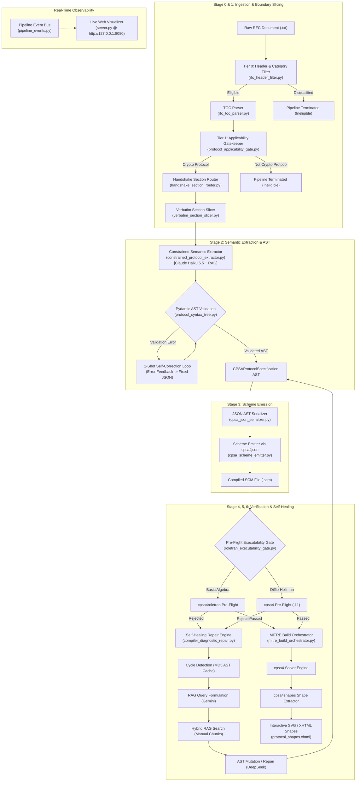
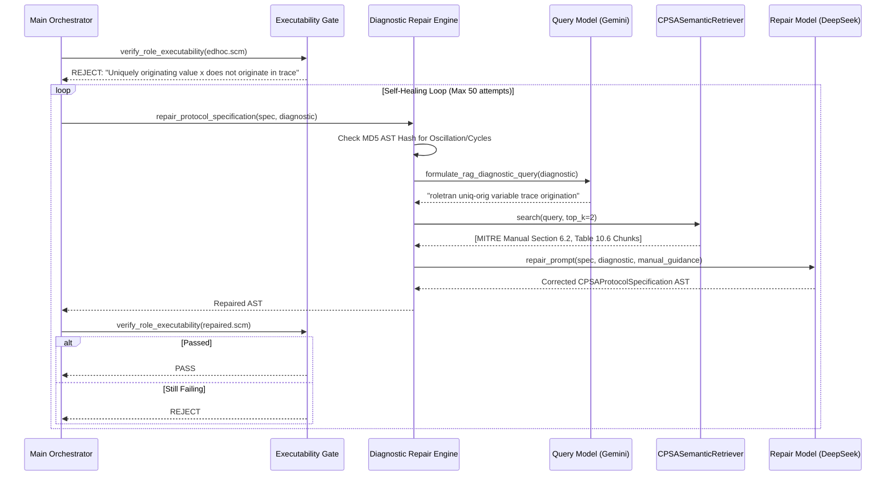

# RFC-LLM Master Blueprint: Complete Engineering Specification & Rebuild Guide

> **Target Audience**: Systems Engineers, Formal Methods Researchers, and Compiler Developers.  
> **Purpose**: A clean-room, zero-assumptions specification detailing the architecture, theoretical foundation, grammar invariants, verification loops, and operational mechanics of the RFC-to-CPSA synthesis engine. This document enables anyone to understand, maintain, or completely rebuild the system from scratch.

---

## 1. System Philosophy & Foundational Theory

### 1.1 The Core Problem
IETF Requests for Comments (RFCs) define the global standard for communication and security protocols (e.g., TLS, IKEv2, EDHOC, Kerberos, SSH). However:
- RFCs are written in ambiguous, semi-structured natural English accompanied by informal ASCII ladder diagrams and byte-level packet layouts.
- Cryptographic security guarantees (secrecy, mutual authentication, forward secrecy, replay resistance) require formal verification using mathematical tools like the **MITRE Cryptographic Protocol Shapes Analyzer (CPSA 4.4.9)**.
- Hand-crafting CPSA Scheme S-expressions (`.scm`) is error-prone, requiring deep expertise in order-sorted algebras, strand spaces, and procedural executability semantics.

### 1.2 Why Direct LLM Code Generation Fails
Prompting general-purpose LLMs directly to generate CPSA Scheme S-expressions fails catastrophically due to three distinct failure modes:
1. **Operator Hallucination**: LLMs mix syntax from ProVerif (`aenc`, `senc`), Tamarin, or standard programming languages into CPSA terms, which strictly allow only a tiny algebraic signature (`enc`, `hash`, `cat`, `pubk`, `privk`, `invk`, `ltk`, `bltk`, `exp`, `gen`, `mul`, `rec`).
2. **Grammar & Metadata Inversion**: LLMs frequently embed variable declarations or dictionaries (e.g. `{"name": "session_key", "description": "..."}`) directly inside message payload terms rather than using atomic string identifiers and declaring them under `(vars ...)`.
3. **Execution Deadlocks in Shape Realization**: LLMs naively insert secrecy listener strands (`deflistener`) into the primary point-of-view (POV) skeleton. In CPSA's strand space semantics, a listener on an uncompromised secret cannot be realized by the penetrator; this terminates the search tree with "0 shapes", completely blinding the analyzer to the bilateral handshake authentication shapes.

### 1.3 The RFC-LLM Solution: Staged Compiler Pipeline
RFC-LLM solves this by treating protocol formalization as a **multi-stage verified compiler pipeline**:
- Slices tens of thousands of lines of RFC down to verbatim handshake exchanges via Table of Contents (TOC) routing.
- Uses an intermediate representation (IR) enforced by strict Pydantic schemas with custom grammar desugaring.
- Emits Scheme S-expressions deterministically via `cpsa4json`.
- Validates protocols statically through a pre-flight executability gate (`cpsa4roletran` for basic algebra, `cpsa4 -l 1` for Diffie-Hellman algebra).
- Closes the loop with an automated self-healing repair cycle guided by dynamic RAG over the authoritative MITRE manual.
- Emits real-time state events to a live reactive web monitor.

---

## 2. End-to-End System Pipeline



---

## 3. Strict MITRE CPSA 4.4.9 Manual Grounding

The intermediate representation and validator are grounded 1-to-1 in Chapters 2, 3, 4, 10 and Tables 10.1 through 10.6 of the MITRE CPSA Manual.

### 3.1 Top-Level Input Syntax (Table 10.1)
```
file       ::= herald? form+
herald     ::= (herald [symbol | string] alist)
form       ::= (comment ...) | protocol | skeleton | goal
protocol   ::= (defprotocol id alg role+ rule* prot-alist)
id         ::= symbol
alg        ::= basic | diffie-hellman
role       ::= (defrole id vars trace role-alist)
vars       ::= (vars vdecl*)
vdecl      ::= (id+ sort)
trace      ::= (trace event+)
event      ::= (dir id? term)
dir        ::= send | recv | load | stor
skeleton   ::= (defskeleton id vars strand+ skel-alist)
strand     ::= (defstrand id integer maplet*)
             | (defstrandmax id integer? maplet*)
             | (deflistener term)
maplet     ::= (term term)
```

**Critical Invariant**:
- When `alg` is `diffie-hellman`, the `herald` declaration **must** specify `(algebra diffie-hellman)`. Otherwise, CPSA defaults to `basic` algebra and crashes with `Expecting terms in algebra basic`.

### 3.2 Order-Sorted Message Algebras (Tables 10.2 & 10.4)

| Sort Keyword | Meaning | Algebra | Allowed in `uniq-orig`? |
|---|---|---|---|
| `name` | Principal identity (e.g. `client_identity`, `server_identity`) | Basic & DH | No (identities are long-term) |
| `text` | Fresh nonces and random tokens (e.g. `client_random`, `server_random`) | Basic & DH | **Yes** |
| `data` | Arbitrary payloads, secrets, premaster secrets | Basic & DH | **Yes** |
| `skey` | Symmetric encryption keys (used in `enc` key position) | Basic & DH | **Yes** |
| `akey` | Asymmetric key variables | Basic & DH | No (held keys) |
| `chan` | Communication channels (e.g. `handshake_channel`) | Basic & DH | No |
| `tag` | Constant tags / domain separators | Basic & DH | No |
| `locn` | State memory locations for stateful load/stor | Basic & DH | No |
| `rndx` | Random exponents chosen per session | **Diffie-Hellman only** | **FORBIDDEN** in `uniq-orig`; **MANDATORY** in `uniq-gen` |
| `expt` | Compound exponent expressions or unconstrained received powers | **Diffie-Hellman only** | No |
| `mesg` | Top sort (any valid message term) | Basic & DH | No |

### 3.3 Message Term Grammar & Operator Signatures (Tables 10.3 & 10.5)

$$term \leftarrow id \mid integer \mid string \mid (op\ term^+)$$

1. **Atoms Only**: A term node is strictly a string atom (e.g. `"client_random"`), an integer constant, or a prefix operator list. **Dictionaries are strictly forbidden**.
2. **Encryption Arity & Key Position**:
   `(enc term+ term)` $\rightarrow$ `["enc", payload1, ..., payloadN, key]`
   The encryption key is strictly the **last** argument. Both symmetric and asymmetric encryption use `enc` (there is no `aenc` or `senc` in CPSA).
3. **Hashing**:
   `(hash term+)` $\rightarrow$ `["hash", term1, ...]`
4. **Pairing / Concatenation**:
   `(cat term+)` $\rightarrow$ `["cat", term1, term2, ...]`
5. **Key Constructors**:
   - `(pubk name)`: Public key of principal `name` (sort `name`).
   - `(privk name)`: Private key of principal `name` (sort `name`).
   - `(invk akey_var)`: Inverse of asymmetric key variable (sort `akey`).
   - `(ltk name1 name2)`: Pre-shared symmetric key between principals.
   - `(bltk name1 name2)`: Bi-directional long-term key (Diffie-Hellman algebra).
6. **Diffie-Hellman Operations**:
   - `(exp base expt)`: Modular exponentiation, e.g. `["exp", ["gen"], x]`.
   - `(gen)`: 0-ary generator constant $g$.
   - `(mul expt1 expt2)`: Exponent multiplication $x \cdot y$.
   - `(rec expt)`: Multiplicative inverse of exponent $x^{-1}$.

### 3.4 Role Declarations & Roletran Executability Invariant (Table 10.6)
Every role declaration must satisfy:
1. **Trace Scope Invariant**: Every variable appearing in `inputs`, `outputs`, `unique_originating` (`uniq-orig`), or `unique_generated` (`uniq-gen`) **must** appear in a `send` or `recv` trace event.
2. **Constructibility**: Every transmitted term in a trace must be constructible from previous receptions, inputs, and freshly originating terms.
3. **Destructibility**: Every received term must be destructible using known or previously received decryption keys.

### 3.5 The 3-Skeleton Architecture (Chapters 3 & 6)
To achieve complete shape realization and secrecy verification, the pipeline generates three distinct preskeletons:
1. **Initiator POV (Handshake Realization)**:
   - `defstrandmax` for Initiator.
   - `non-orig` for uncompromised responder private keys.
   - `uniq-orig` for fresh initiator nonces (or `uniq-gen` for DH exponents).
   - `listeners: []` (**STRICTLY EMPTY**).
2. **Responder POV (Mutual Authentication)**:
   - `defstrandmax` for Responder.
   - `non-orig` for uncompromised initiator private keys.
   - `uniq-orig` for fresh responder nonces (or `uniq-gen` for DH exponents).
   - `listeners: []` (**STRICTLY EMPTY**).
3. **Secrecy Skeleton (Confidentiality Proof)**:
   - `defstrandmax` for Initiator or Responder.
   - `deflistener <secret>` on the negotiated session key or secret.
   - Proves whether the penetrator can derive the secret.

---

## 4. Tiered Model Topology & Routing

RFC-LLM decouples model invocation across specialized tiers to maximize accuracy, throughput, and token economy:

| Pipeline Task | Environment Variable | Default Model | Rationale & Characteristics |
|---|---|---|---|
| **RAG Query Formulation** | `LLM_QUERY_MODEL` | `gemini/gemini-3.5-flash-lite` | Ultra-fast (<400ms), zero-cost, excellent conceptual abstraction without concrete identifier leakage. |
| **TOC Router & Gatekeeper** | `LLM_ROUTER_MODEL` | `nous/deepseek/deepseek-chat` | High context window, low cost, robust structured JSON extraction for document classification and section routing. |
| **Protocol Semantic Extraction** | `LLM_EXTRACTION_MODEL` | `nous/anthropic/claude-haiku-5.5` | SOTA formal reasoning, strict schema adherence, zero operator hallucinations, 1M context window. |
| **Compiler Diagnostic Repair** | `LLM_REPAIR_MODEL` | `nous/deepseek/deepseek-chat` | Exceptional code debugging capabilities, handles large AST surgery, highly economical across multi-pass repairs. |

### 4.1 Unified Nous Research Portal Integration
All third-party models (Claude, DeepSeek, Qwen) route seamlessly through Nous Research Portal via LiteLLM's `openai/` proxy protocol:
- Set `NOUS_API_KEY=sk-nous-...` and `NOUS_API_BASE=https://inference-api.nousresearch.com/v1`.
- Any model slug starting with `nous/` or `nousresearch/` is automatically normalized and authenticated.

---

## 5. Verification Engine & Closed-Loop Self-Healing

The verification engine provides zero-latency failure containment before running expensive solver jobs.



### 5.1 Pre-Flight Gate Dual Strategy
- **Basic Algebra**: Runs `cpsa4roletran`. Verifies that roles can be compiled to executable procedures (`defproc`).
- **Diffie-Hellman Algebra**: `cpsa4roletran` does not support Diffie-Hellman exponentiation. The gate switches to `cpsa4 -l 1`, validating syntax, sorts, and variable scopes directly against the CPSA engine in under 50ms.

### 5.2 Cycle & Oscillation Detection
A circular repair loop occurs when an LLM alternates between two invalid repairs (e.g. adding a variable to `inputs`, then removing it). RFC-LLM detects this by hashing the serialized JSON of each candidate AST. If a cycle is detected:
1. The cycle warning is injected into the prompt.
2. The model temperature is boosted from `0.0` to `0.4` to escape greedy local minima.

---

## 6. Real-Time Observability & Event Bus

The pipeline emits structured lifecycle events to `GLOBAL_EVENT_BUS` (`src/pipeline_events.py`):
- `stage_started`, `stage_completed`, `stage_failed`
- `slice_ready`: provides section IDs, line counts, and file paths.
- `rag_retrieval`: records queries, retrieved chunk IDs, and snippet previews.
- `repair_attempt`: logs attempt numbers, diagnostics, and cycle flags.
- `build_completed`: links to verified `.xhtml` graphs and shape counts.

The asynchronous server (`src/visualizer/server.py`) binds to the bus and streams events over Server-Sent Events (SSE) to `http://127.0.0.1:8080`, rendering interactive DAGs, SVG shape trees, and JSON AST inspectors.

---

## 7. Complete Rebuild Manifest

To rebuild the system in a fresh environment:

1. **System Dependencies**:
   - Python 3.10+ with `pydantic>=2.0`, `litellm`, `aiohttp`, `rank_bm25`, `sentence_transformers`.
   - Haskell GHC & Cabal.
   - MITRE CPSA 4.4.9 binaries built to `~/.cabal/bin/`: `cpsa4`, `cpsa4json`, `cpsa4roletran`, `cpsa4init`, `cpsa4shapes`, `cpsa4graph`.
   - Graphviz (`dot`) for SVG graph rendering.

2. **Core Source Modules**:
   - `src/system_config.py`: Environment variable loader and LiteLLM kwargs resolver.
   - `src/pipeline_events.py`: Thread-safe singleton event bus with subscriber fan-out.
   - `src/document_ingestion/`: Tier 0 header regex filter, TOC hierarchical parser, section router, and verbatim slicer.
   - `src/intermediate_representation/`:
     * `algebraic_sorts.py`: Enum of authorized sorts.
     * `cpsa_grammar.py`: CPSA 4.4.9 keywords, arities, desugaring normalizers, static term syntax validator.
     * `protocol_syntax_tree.py`: Strongly-typed Pydantic AST with `to_cpsa_json` serializers.
   - `src/semantic_extraction/constrained_protocol_extractor.py`: Grounded extraction prompt, RAG retrieval, and 1-shot self-healing schema correction.
   - `src/code_generation/`: Native JSON AST serializer and `cpsa4json` Scheme compiler.
   - `src/verification_engine/`: Roletran executability gate, RAG diagnostic repair engine, and Make build orchestrator.
   - `src/visualizer/`: Live SSE server and dashboard UI.
   - `src/main_pipeline_orchestrator.py`: End-to-end multi-stage pipeline driver.
   - `src/pipeline.py`: Unified CLI executable supporting single files and directory batching.
