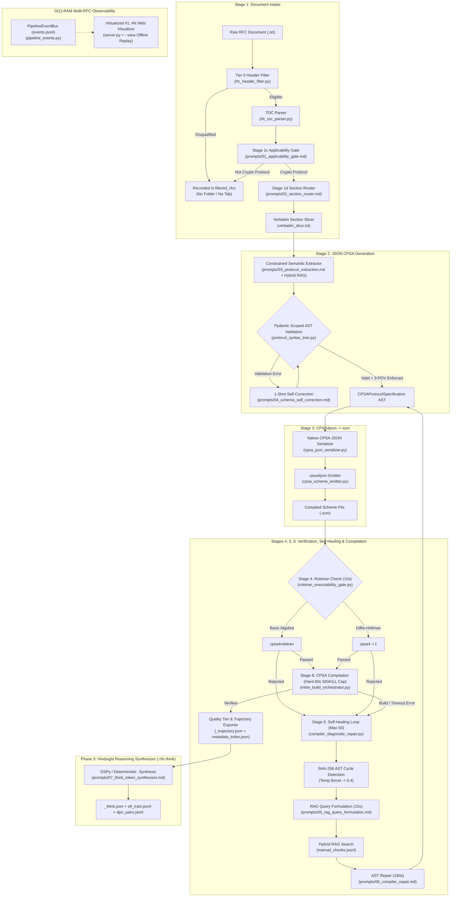
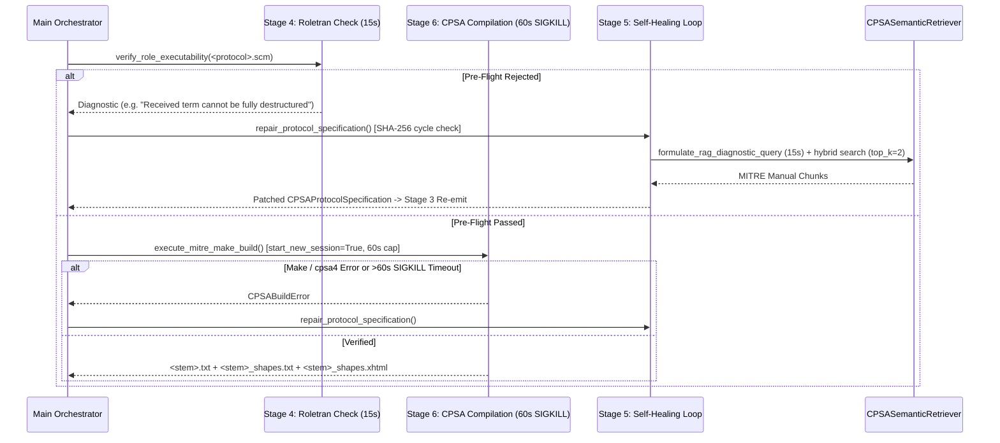

# RFC-LLM Master Blueprint: Complete Engineering Specification & Rebuild Guide

> **Target Audience**: Systems Engineers, Formal Methods Researchers, and Compiler Developers.  
> **Purpose**: A clean-room, zero-assumptions specification detailing the architecture, theoretical foundation, grammar invariants, YAML-routed verification loops, virtualized observability, and Phase 3 dataset curation of the RFC-to-CPSA synthesis engine.

---

## 1. System Philosophy & Foundational Theory

### 1.1 The Core Problem
IETF Requests for Comments (RFCs) define communication and security protocols (TLS, IKEv2, EDHOC, Kerberos, SSH) using semi-structured English prose, ASCII ladder diagrams, and byte-level packet layouts. Formal verification in the **MITRE Cryptographic Protocol Shapes Analyzer (CPSA 4.4.9)** requires order-sorted algebraic S-expressions under Dolev-Yao strand space and procedural executability semantics.

### 1.2 Why Direct LLM Code Generation Fails
Prompting an LLM to directly emit raw CPSA `.scm` strings fails due to three structural defects:
1. **Operator Hallucination**: Mixing ProVerif or Tamarin syntax (`aenc`, `senc`, `mac`) into CPSA terms, which authorize only a strict algebraic signature (`enc`, `hash`, `cat`, `pubk`, `privk`, `invk`, `ltk`, `bltk`, `exp`, `gen`, `mul`, `rec`, `one`).
2. **Grammar & Metadata Inversion**: Embedding variable dictionaries (`{"name": "session_key", "description": "..."}`) directly inside message terms instead of declaring variables under `(vars ...)` and referencing atomic identifiers.
3. **Listener Pruning in POV Skeletons**: Placing `(deflistener secret)` inside a participant's primary point-of-view (POV) `defskeleton`. When a secret is secure, the penetrator cannot realize the listener node, causing CPSA to prune the entire branch to `0` shapes and hiding the completed bilateral authentication shape.

### 1.3 The RFC-LLM Solution: Staged Compiler & Trajectory Factory
RFC-LLM treats protocol formalization as a **6-stage verified compiler pipeline** (`./rfc-llm`) paired with a **Phase 3 hindsight reasoning synthesizer** (`./rfc-think`):
- **Stage 1 (`Document Intake`)**: Filters non-protocols in <1 ms via regex, parses the TOC, verifies cryptographic applicability, routes handshake sections, and slices verbatim specification text (`verbatim_slice.txt`).
- **Stage 2 (`JSON CPSA Generation`)**: Extracts a strongly-typed Pydantic AST enforcing Tables 10.1-10.6, Equation 10.1, positional keyword scoping, 1-shot schema self-correction, and 3-POV skeleton separation.
- **Stage 3 (`CPSA4json -> scm`)**: Deterministically serializes native CPSA JSON arrays and compiles them to `.scm` via `cpsa4json`.
- **Stage 4 (`Roletran Check`)**: Pre-flight validates executability in milliseconds via `cpsa4roletran` (`basic` algebra) or `cpsa4 -l 1` (`diffie-hellman` algebra) under a `15s` timeout.
- **Stage 5 (`Self-Healing Loop`)**: Intercepts compiler errors, detects AST oscillations via SHA-256 hashing, formulates conceptual RAG queries (`15s` timeout), retrieves MITRE manual chunks, and repairs the AST up to `50` attempts.
- **Stage 6 (`CPSA Compilation`)**: Runs `cpsa4init` + `make` (`cpsa4`, `cpsa4shapes`, `cpsa4graph`) under a hard 60-second process-group `SIGKILL` cap, computes `GOLD`/`SILVER`/`BRONZE`/`REJECTED` quality tiers, and writes `<protocol>_trajectory.json`.
- **Phase 3 (`./rfc-think`)**: Synthesizes forward-looking 5-step `<think>...</think>` monologues with compiler backtracking (`<protocol>_think.json`) and exports `sft_train.jsonl` + contrastive `dpo_pairs.jsonl` for AMD ROCm Megatron-LM MoE post-training.

---

## 2. End-to-End System Pipeline



---

## 3. Strict MITRE CPSA 4.4.9 Manual Grounding

The intermediate representation ([`src/intermediate_representation/`](../src/intermediate_representation/)) enforces Chapters 2, 3, 4, 10 and Tables 10.1 through 10.6 of the MITRE CPSA 4.4.9 Manual.

### 3.1 Top-Level Input Syntax (Table 10.1)
```
file       ::= herald? form+
herald     ::= (herald [symbol | string] alist)
form       ::= (comment ...) | protocol | skeleton | goal
protocol   ::= (defprotocol id alg role+ rule* prot-alist)
id         ::= symbol
alg        ::= basic | diffie-hellman
role       ::= (defrole id vars trace role-alist)
vars       ::= (vars vdecl*)
vdecl      ::= (id+ sort)
trace      ::= (trace event+)
event      ::= (dir id? term)
dir        ::= send | recv | load | stor
skeleton   ::= (defskeleton id vars strand+ skel-alist)
strand     ::= (defstrand id integer maplet*)
             | (defstrandmax id integer? maplet*)
             | (deflistener term)
maplet     ::= (term term)
```

**Herald Algebra Invariant**:
- When `alg` is `diffie-hellman`, the `herald` declaration **must** include `(algebra diffie-hellman)`. Otherwise, CPSA defaults to `basic` algebra and fails with `Expecting terms in algebra basic`.

### 3.2 Order-Sorted Message Algebras (Tables 10.2 & 10.4)

| Sort Keyword | Meaning | Algebra | Allowed in `uniq-orig`? |
|---|---|---|---|
| `name` | Principal identity (`client_identity`, `server_identity`) | Basic & DH | No |
| `text` | Fresh nonces and challenge tokens (`client_random`) | Basic & DH | **Yes** |
| `data` | Arbitrary payloads, secrets, application data | Basic & DH | **Yes** |
| `skey` | Symmetric encryption keys | Basic & DH | **Yes** |
| `akey` | Asymmetric key variables (inverted via `invk`) | Basic & DH | No |
| `chan` | Communication channels (`ch`) | Basic & DH | No |
| `tag` | Constant tags / domain separators | Basic & DH | No |
| `locn` | Stateful storage locations for `load`/`stor` | Basic & DH | No |
| `rndx` | Fresh atomic Diffie-Hellman random exponents | **Diffie-Hellman only** | **Forbidden** in `uniq-orig`; **Mandatory** in `uniq-gen` |
| `expt` | Compound or received Diffie-Hellman exponents | **Diffie-Hellman only** | No |
| `base` | Diffie-Hellman group elements | **Diffie-Hellman only** | No |
| `mesg` | Universal top sort (forbidden as `enc` key per Equation 10.1) | Basic & DH | No |

*(First-order logic sorts `strd`, `indx`, and `fact` from Table 7.1 are restricted to `defrule`/`defgoal` quantifiers and forbidden in role/skeleton `(vars ...)` declarations.)*

### 3.3 Message Term Grammar & Operator Signatures (Tables 10.3 & 10.5)

$$term \leftarrow id \mid integer \mid string \mid (op\ term^+)$$

1. **Atoms Only**: Term nodes are strictly string atoms, integer constants, or prefix operator lists (`[op, ...args]`). Dictionaries inside terms are unpacked by `desugar_term_tree()` or rejected.
2. **Encryption (`enc`) & Equation 10.1**: `(enc term+ key)` -> `["enc", payload1, ..., payloadN, key]`. The encryption key is always the **last** element and must never be a variable of sort `mesg`.
3. **Hashing & Pairing**: `(hash term+)` and `(cat term+)`.
4. **Key Constructors**: `(pubk name)` / `(pubk "tag" name)`, `(privk name)` / `(privk "tag" name)`, `(invk akey_var)`, `(ltk name1 name2)`, and `(bltk name1 name2)` (DH only).
5. **Diffie-Hellman Operators**: `(exp base expt)`, `(gen)`, `(mul expt1 expt2 ...)`, `(rec expt)`, `(one)`.

### 3.4 Roletran Executability & 3-POV Skeleton Separation
1. **Roletran Scope Invariant**: Every variable in `inputs`, `outputs`, `uniq-orig`, or `uniq-gen` must appear in the role's `trace`. No `uniq-orig`/`uniq-gen` variable may appear in `inputs`, and no `inputs` variable may appear in `outputs`.
2. **3-POV Preskeleton Separation**:
   - **Skeleton 1 (Initiator POV)**: `defstrandmax` for Initiator, `listeners: []`.
   - **Skeleton 2 (Responder POV)**: `defstrandmax` for Responder, `listeners: []`.
   - **Skeleton 3 (Secrecy POV)**: `defstrandmax` + `(deflistener secret)` alongside `(non-orig ...)` key assumptions.

---

## 4. YAML Frontmatter Model Routing & Clean `.env`

Per-stage LLM routing, HTTP timeouts, and temperatures live directly in the YAML frontmatter of [`prompts/01_applicability_gate.md`](../prompts/01_applicability_gate.md) through [`prompts/07_think_token_synthesizer.md`](../prompts/07_think_token_synthesizer.md) and **hot-reload live mid-batch** via [`src/prompt_loader.py`](../src/prompt_loader.py):

| Prompt File | Pipeline Stage | Default `timeout` | Default `temperature` | CLI Override |
|---|---|---|---|---|
| `prompts/01_applicability_gate.md` | Stage 1c: Applicability Gate | `180s` | `0.0` | `--router-model` |
| `prompts/02_section_router.md` | Stage 1d: Section Router | `180s` | `0.0` | `--router-model` |
| `prompts/03_protocol_extraction.md` | Stage 2: JSON CPSA Generation | `180s` | `0.0` | `--extraction-model` |
| `prompts/04_schema_self_correction.md` | Stage 2: 1-Shot Schema Retry | `180s` | `0.0` | `--extraction-model` |
| `prompts/05_rag_query_formulation.md` | Stage 5/6: RAG Query Formulation | `15s` | `0.0` | `--query-model` |
| `prompts/06_compiler_repair.md` | Stage 5/6: Compiler Repair | `180s` | `0.0` | `--repair-model` |
| `prompts/07_think_token_synthesizer.md` | Phase 3: `<think>` Synthesizer | `180s` | `0.2` | `./rfc-think --model` |

- **Clean `.env` ([`.env.example`](../.env.example))**: Holds **only** API keys (`GEMINI_API_KEY`, `NOUS_API_KEY`, `OPENAI_API_KEY`, `ANTHROPIC_API_KEY`) and base endpoint URLs (`NOUS_API_BASE`, `OLLAMA_API_BASE`, `STRATA_API_BASE`).
- **Supported Provider Slugs**: `nous/<model>`, `strata/<model>`, `ollama/<model>`, `gemini/<model>`, `openai/<model>`, and `anthropic/<model>`.

---

## 5. Verification Engine, Hard 60s Compilation Cap & Self-Healing



- **Execution Bounds**: `ROLETRAN_TIMEOUT_SECONDS = 15`, `CPSA_TIMEOUT_SECONDS = 60` (process-group `os.killpg(..., signal.SIGKILL)`), `MAX_REPAIR_ATTEMPTS = 50`.
- **SHA-256 Cycle Detection**: Hashes `protocol_ast.model_dump_json()` on every repair turn; repeated hashes trigger an explicit cycle warning and raise temperature to `0.4`.
- **Verification Quality Tiers**: `trajectory_metadata_exporter.py` grades every run deterministically into `GOLD`, `SILVER`, `BRONZE`, or `REJECTED`, writes `<protocol>_trajectory.json`, prepends MoE router headers to `<protocol>.scm`, and updates `output/run_YYYY-MM-DD_HH-MM-SS/metadata_index.json`.

---

## 6. Bounded Observability, Virtualized Tabs & Offline Replay

- **Bounded Event Bus ([`src/pipeline_events.py`](../src/pipeline_events.py))**: Retains only the active RFC's events in memory while streaming per-RFC telemetry to `<rfc_dir>/events.jsonl` and maintaining compact accepted-tab (`#1..#N`) and `filtered_rfcs` registries (`O(1)` server RAM across 5,000+ RFCs).
- **Virtualized Multi-RFC Web Visualizer ([`src/visualizer/server.py`](../src/visualizer/server.py), [`src/visualizer/static/index.html`](../src/visualizer/static/index.html))**:
  - Virtual-scrolled `#1..#N` tab bar (`O(1)` browser DOM nodes) showing tab `#`, RFC ID, quality tier, and protocol name.
  - Collapsible, searchable `Filtered / Skipped` drawer for Tier 0 and Stage 1c disqualifications.
  - Per-attempt time-travel stepper (`Attempt 0 | Initial` -> `Attempt 1..K` -> `Final`) with rejected/repaired `.scm` toggle, JSON AST, diagnostics, RAG chunks, and SVG shape graphs.
  - Offline replay CLI: `./rfc-llm --view output/run_<timestamp>`.

---

## 7. Complete Rebuild Manifest

1. **System & Runtime Dependencies**:
   - Python 3.10+ (`pydantic>=2.14`, `pydantic-settings`, `litellm`, `dspy`, `aiohttp`, `pyyaml`, `json-repair`, `python-dotenv`, `numpy`, `pymupdf`).
   - Haskell GHC & Cabal + MITRE CPSA 4.4.9 binaries in `~/.cabal/bin/` (`cpsa4`, `cpsa4json`, `cpsa4roletran`, `cpsa4init`, `cpsa4shapes`, `cpsa4graph`, `cpsa4prot`) + Graphviz (`dot`).
2. **Core Repository Modules**:
   - `prompts/01_*.md` .. `07_*.md` & `src/prompt_loader.py`: Live hot-reloaded YAML-frontmatter prompt & model loader.
   - `src/system_config.py`: Credentials/endpoints `.env` loader, LiteLLM provider kwargs builder, and `15s` / `60s` / `50-attempt` compiler bounds.
   - `src/pipeline_events.py` & `src/visualizer/`: Bounded `O(1)`-RAM SSE event bus, virtualized `#1..#N` tab server, and `--view` offline replay UI.
   - `src/document_ingestion/`: Tier 0 regex filter, TOC parser, applicability gate, section router, and verbatim slicer.
   - `src/intermediate_representation/`: `algebraic_sorts.py`, `cpsa_grammar.py`, and `protocol_syntax_tree.py`.
   - `src/semantic_extraction/constrained_protocol_extractor.py` & `src/rag_retriever_client.py`: Hybrid RAG-grounded AST extractor with 1-shot self-correction and 3-POV skeleton enforcement.
   - `src/code_generation/`: `cpsa_json_serializer.py` and `cpsa_scheme_emitter.py` (`cpsa4json`).
   - `src/verification_engine/`: `roletran_executability_gate.py`, `compiler_diagnostic_repair.py`, `mitre_build_orchestrator.py`, and `trajectory_metadata_exporter.py`.
   - `src/main_pipeline_orchestrator.py` & `src/pipeline.py` (`./rfc-llm`): End-to-end 6-stage orchestrator and batch/replay CLI.
   - `src/generate_think/` (`./rfc-think`): `think_schema.py`, `dspy_think_synthesizer.py`, and `cli.py` for Phase 3 `<think>` synthesis and `sft_train.jsonl` / `dpo_pairs.jsonl` curation.
