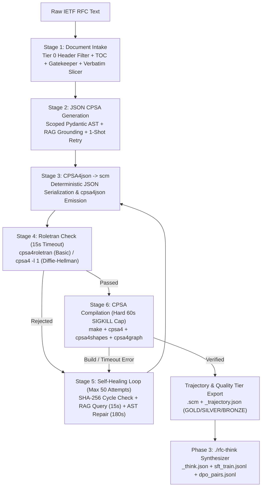

# RFC-LLM Technical Documentation

Technical reference documentation for **RFC-LLM**, an automated synthesis, formal verification, and synthetic trajectory curation engine that compiles informal IETF RFC security protocol specifications into mathematically verified MITRE CPSA 4.4.9 models.

---

## Documentation Index

1. **[Master Clean-Room Blueprint](MASTER_BLUEPRINT.md)**
   - Theoretical foundation, strand space formalism, and clean-room engineering specification.
   - End-to-end architecture, grammar invariants, verification loops, and complete rebuild manifest.

2. **[System Architecture & Pipeline Lifecycle](ARCHITECTURE.md)**
   - 6-stage synthesis lifecycle (`Document Intake`, `JSON CPSA Generation`, `CPSA4json -> scm`, `Roletran Check`, `Self-Healing Loop`, `CPSA Compilation`) and Phase 3 `./rfc-think` synthesizer.
   - Timestamped run directory structure (`output/run_YYYY-MM-DD_HH-MM-SS/metadata_index.json`), `<protocol>_trajectory.json`, `events.jsonl`, and `<protocol>_think.json`.
   - `O(1)`-RAM event bus and multi-RFC virtualized `#1..#N` web visualizer with offline replay (`--view`).

3. **[Formal Grammar & Intermediate Representation](INTERMEDIATE_REPRESENTATION.md)**
   - Strict 1-to-1 grounding in the MITRE CPSA 4.4.9 Manual (Chapters 2, 3, 4, 10; Tables 10.1-10.6; Equation 10.1).
   - Order-sorted message algebras (`basic` vs `diffie-hellman`).
   - Strongly-typed Pydantic AST (`CPSAProtocolSpecification`, `CPSAProtocolRole`, `CPSATraceEvent`, `CPSAPreskeleton`), desugaring normalizers, and the 3-POV skeleton invariant.

4. **[Complete CPSA Keyword & Grammar Reference](CPSA_KEYWORD_REFERENCE.md)**
   - Exhaustive reference for every keyword in MITRE CPSA 4.4.9 across all 8 syntax categories.
   - Formal BNF grammar productions, algebraic validity, strand space semantics, canonical S-expressions, Pydantic mappings, and compiler diagnostics.

5. **[Tiered Model Routing & YAML Frontmatter Configuration](TIERED_MODEL_ROUTING.md)**
   - Per-stage `model`, `timeout`, and `temperature` configuration in `prompts/01_*.md` through `prompts/07_*.md` YAML frontmatter with zero-restart live hot-reload.
   - Clean credentials- and base-URLs-only `.env` specification (`GEMINI_API_KEY`, `NOUS_API_KEY`, `OPENAI_API_KEY`, `ANTHROPIC_API_KEY`, `NOUS_API_BASE`, `OLLAMA_API_BASE`, `STRATA_API_BASE`).
   - Provider routing prefixes (`nous/`, `strata/`, `ollama/`, `gemini/`, `openai/`, `anthropic/`) and one-off CLI overrides.

6. **[Verification Engine & Self-Healing](VERIFICATION_AND_SELF_HEALING.md)**
   - Stage 4 `Roletran Check` (`cpsa4roletran` for `basic` algebra, `cpsa4 -l 1` for `diffie-hellman` algebra; `ROLETRAN_TIMEOUT_SECONDS = 15`).
   - Stage 5 `Self-Healing Loop` (SHA-256 AST cycle detection, conceptual RAG query formulation, hybrid manual retrieval, surgical AST repair; `MAX_REPAIR_ATTEMPTS = 50`).
   - Stage 6 `CPSA Compilation` (`CPSA_TIMEOUT_SECONDS = 60` hard process-group `SIGKILL` cap) and deterministic `GOLD` / `SILVER` / `BRONZE` / `REJECTED` verification quality tiers.
   - 300-query golden retrieval benchmark (BM25 + `ollama/nomic-embed-text` dense vectors + RRF).

7. **[Quickstart & Operational Runbook](QUICKSTART_AND_OPERATIONS.md)**
   - Prerequisites (Python 3.10+, Haskell Cabal, Graphviz, MITRE CPSA 4.4.9 binaries) and `.env` setup.
   - `./rfc-llm` single-RFC, directory batch, and offline visualizer replay (`--view`) commands.
   - `./rfc-think` Phase 3 `<think>` synthesis and `sft_train.jsonl` / `dpo_pairs.jsonl` dataset export.
   - Test suites, RAG evaluation harness, and compiler troubleshooting runbook.

---

## High-Level Pipeline Flow

---

## System Design Highlights

- **Formal Grounding Fidelity**: Strict 1-to-1 adherence to MITRE CPSA 4.4.9 formal semantics (Tables 10.1 through 10.6 and Equation 10.1).
- **Live Hot-Reloaded Routing**: Per-stage `model`, `timeout`, and `temperature` live in `prompts/*.md` YAML frontmatter and reload on every LLM call without restarting batch runs.
- **Bounded Compiler Verification**: Pre-flight executability checks (`15s` cap) and process-group-isolated `cpsa4` compilation (`60s` hard `SIGKILL` cap) contain state-space explosions and feed diagnostics directly into the cycle-aware RAG self-healing loop.
- **Virtualized Multi-RFC Observability**: Sequential `#1..#N` virtualized tabs, a collapsible `Filtered / Skipped` drawer, and a per-attempt time-travel stepper operate in `O(1)` browser DOM and server RAM for both live runs and offline `--view` replay.
