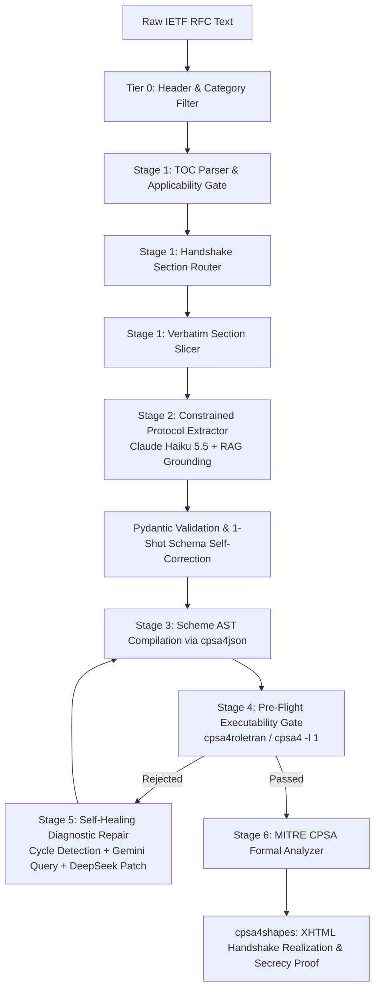

# RFC-LLM Technical Documentation

Welcome to the technical documentation for **RFC-LLM**, an automated synthesis and formal verification engine that compiles informal IETF RFC security protocol specifications into mathematically proven MITRE CPSA 4.4.9 models.

---

## Documentation Index

This documentation suite is organized into focused, modular technical references:

1. **[Master Clean-Room Blueprint](MASTER_BLUEPRINT.md)**
   - Theoretical foundation, strand space formalism, and clean-room engineering rebuild blueprint.
   - Comprehensive system specifications and zero-shot synthesis principles.

2. **[System Architecture & Pipeline Lifecycle](ARCHITECTURE.md)**
   - High-level system overview and end-to-end dataflow.
   - Stage-by-stage lifecycle breakdown (from raw RFC RFC-to-Model slicing to shape realization).
   - Event-driven monitoring bus and live web visualizer architecture.
   - Comprehensive source symbol reference table.

3. **[Formal Grammar & Intermediate Representation](INTERMEDIATE_REPRESENTATION.md)**
   - Strict 1-to-1 grounding with the MITRE CPSA 4.4.9 Manual (Chapters 2, 3, 4, 10; Tables 10.1–10.6).
   - Order-sorted message algebras (`basic` vs `diffie-hellman`).
   - Strongly-typed Pydantic AST (`CPSAProtocolSpecification`, `CPSAProtocolRole`, `CPSATraceEvent`, `CPSAPreskeleton`).
   - Term grammar rules, atom enforcement, desugaring normalizers, and the 3-POV skeleton architecture.

4. **[Complete CPSA Keyword & Grammar Reference](CPSA_KEYWORD_REFERENCE.md)**
   - Exhaustive technical reference for every single keyword in MITRE CPSA 4.4.9 across all 8 syntax categories.
   - Formal BNF grammar productions, algebraic validity, mathematical semantics, canonical S-expressions, Pydantic type models, and compiler error diagnostics.

5. **[Tiered Model Routing & Configuration](TIERED_MODEL_ROUTING.md)**
   - Multi-tier model allocation strategy (Claude Haiku 5.5, DeepSeek-Chat, Gemini Free Tier).
   - Task decoupling: RAG query formulation, section routing, extraction, and compiler repair.
   - Unified Nous Research Portal proxy configuration via LiteLLM.
   - Environment variables and fallback hierarchy.

6. **[Verification Engine & Self-Healing](VERIFICATION_AND_SELF_HEALING.md)**
   - Pre-flight executability gate (`cpsa4roletran` for basic algebra, `cpsa4 -l 1` for Diffie-Hellman).
   - Closed-loop self-healing diagnostic repair (cycle detection, dynamic RAG queries, AST surgical patching).
   - MITRE CPSA build orchestration (`cpsa4`, `cpsa4shapes`, XHTML shapes).
   - The 300-query golden retrieval benchmark (BM25 + Dense vector embeddings + RRF).

7. **[Quickstart & Operational Runbook](QUICKSTART_AND_OPERATIONS.md)**
   - Installation and prerequisites (Python 3.10+, Haskell Cabal, MITRE CPSA 4.4.9 binaries).
   - CLI flags and command usage (`./rfc-llm`).
   - Live visualizer operation (`--visualize`, `--keep-alive`).
   - Running test suites and benchmark evaluations.
   - Common troubleshooting scenarios and recovery steps.

---

## High-Level Pipeline Flow

---

## System Design Highlights

- **Grounding Fidelity**: Strict 1-to-1 adherence to MITRE CPSA 4.4.9 formal semantics (Tables 10.1 through 10.6).
- **Zero-Guesswork Routing**: Large RFCs (tens of thousands of lines) are sliced verbatim down to only the active handshake exchanges (typically 200–500 lines) using fast TOC routing.
- **Resilient Self-Healing**: Compile-time failures from `cpsa4roletran` or `cpsa4` trigger closed-loop diagnostic repair with cycle detection, querying the authoritative manual chunk corpus.
- **Real-Time Observability**: Execution traces and shape derivations are streamed live via SSE/WebSocket to the web visualizer at `http://127.0.0.1:8080`.
