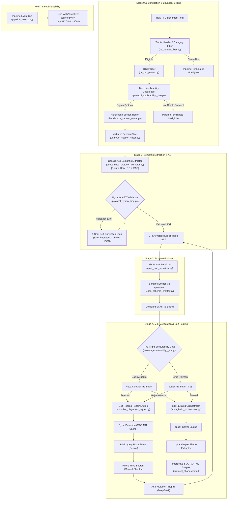
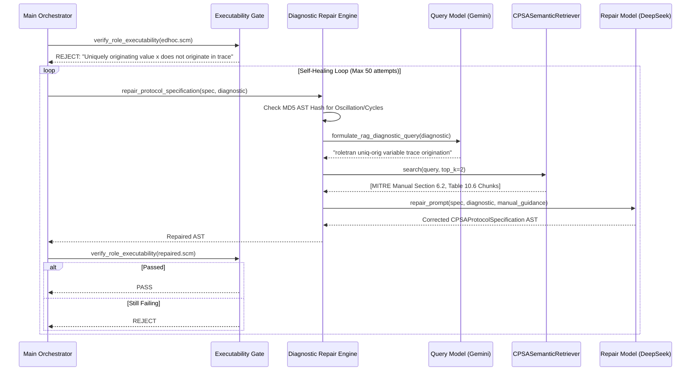
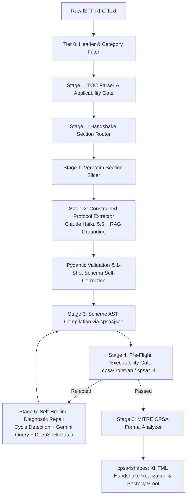

# RFC-LLM Master Index, Architecture & Project Configuration

> Tier 1 — Master repository index, executive Gemini ingestion guide, delta changelog since last sync, automated AST symbol and CLI script registry, heavy/binary asset inventory, architecture specifications, and root project configuration manifests.

*Generated: 2026-10-19 22:11:31 UTC · Git: `main` @ `81040c26a432` · Tier: Tier 1 — Architecture, Documentation & Project Configs · Files: 15 · Estimated Tokens: ~25,112*

---

## Changes Since Last Sync

- **Git branch:** `main`
- **Git commit:** `81040c26a432` — Refactor pipeline, externalize prompts to .prompts/, and enforce strict CPSA 4.4.9 scoping
- **Added (0):** none
- **Modified (1):**
  - `.env.example`
- **Deleted (0):** none

---

## Executive Ingestion & Grounding Guide (for LLMs / Gemini)

This unified repository context is optimized for ingestion into Gemini / LLM Notebooks. Key engineering invariants:

### 1. Cryptographic Protocol Shapes Analyzer (MITRE CPSA 4.4.9)
- **Order-Sorted Algebras**: Follow Table 10.1–10.6 productions strictly. Protocols using Diffie-Hellman operations **must** declare `(algebra diffie-hellman)` in the top-level `herald` form.
- **Exponent Origination**: In CPSA strand space semantics, exponents (`rndx`, `expt`) are never carried subterms in Dolev-Yao messages. They **must** be declared under `uniq-gen` (unique generated), **never** under `uniq-orig`.
- **3-POV Preskeleton Architecture**: Pure protocol viewpoints (Initiator POV, Responder POV) must contain **zero** listener terms. Secrecy listeners belong **strictly** in dedicated confidentiality skeletons (Skeleton 3) to prevent premature pruning of realized handshake shapes.
- **Pre-Flight Gates**: `cpsa4roletran` only validates `basic` crypto algebra. `diffie-hellman` protocols are pre-flight validated using `cpsa4 -l 1`.

---

## Bundle Catalog

| Bundle | Title | Files | Size | Estimated Tokens | Tier |
|---|---|---|---|---|---|
| `00_ARCHITECTURE_AND_INDEX.md` | RFC-LLM Master Index, Architecture & Project Configuration | 15 | 98.7 KB | ~25,112 | Tier 1 — Architecture, Documentation & Project Configs |
| `01_CORE_SOURCE_AND_CLI.md` | RFC-LLM Core Source Code, Compilers, IR & CLI Entrypoints | 39 | 421.7 KB | ~107,909 | Tier 2 — Core Source Code & CLI Entrypoints |
| `02_RAG_SCRIPTS_AND_TESTS.md` | Operational RAG Scripts, Evaluation Harnesses & Test Suites | 14 | 202.8 KB | ~51,906 | Tier 3 — Operational Scripts, Pipelines & Test Suites |
| `03_CPSA_DOMAIN_KNOWLEDGE_AND_GUIDES.md` | CPSA 4.4.9 Domain Modeling References, Manuals & Guides | 40 | 1714.7 KB | ~432,327 | Tier 1/3 — Domain Reference Documentation & Modeling Guides |
| `04_CPSA_SCM_EXAMPLES_CORPUS.md` | Official MITRE CPSA Scheme (.scm) Protocol Examples Corpus | 148 | 345.0 KB | ~88,246 | Tier 3 — Domain Reference Code Corpus (.scm) |

**Total Ingested Context Payload:** ~705,500 tokens across all bundles (70.5% of Gemini 1M context window)

---

## Symbol & Script Registry (automated AST introspection)

41 Python modules introspected with the stdlib `ast` module.

| Module | Docstring | Classes | Top-level Functions | CLI Arguments |
|---|---|---|---|---|
| `src/__init__.py` | RFC-LLM: End-to-End Synthesis of Formally Verified MITRE CPS | — | — | — |
| `src/code_generation/__init__.py` | Code Generation package for Stages 3 & 4 CPSA JSON serializa | — | — | — |
| `src/code_generation/cpsa_json_serializer.py` | CPSA JSON AST Serializer. | — | `serialize_to_cpsa_json`, `serialize_to_cpsa_json_string`, `write_cpsa_json_file` | — |
| `src/code_generation/cpsa_scheme_emitter.py` | CPSA Scheme S-Expression Emitter using cpsa4json. | `CPSAJsonCompilationError` | `emit_cpsa_scheme` | — |
| `src/document_ingestion/__init__.py` | Document Ingestion package for Stage 1 RFC filtering, TOC pa | — | — | — |
| `src/document_ingestion/handshake_section_router.py` | Handshake Section Router for Navigating RFC Table of Content | `SectionRoutingDecision` | `route_handshake_sections`, `_heuristic_section_router` | — |
| `src/document_ingestion/protocol_applicability_gate.py` | Protocol Applicability Gate (Tier 1 Gatekeeper). | `ProtocolApplicabilityReport` | `evaluate_protocol_applicability` | — |
| `src/document_ingestion/rfc_header_filter.py` | RFC Header and Frontmatter Metadata Filter (Tier 0 Filter). | `HeaderFilterResult` | `filter_rfc_header` | — |
| `src/document_ingestion/rfc_toc_parser.py` | RFC Table of Contents (TOC) Parser. | `TOCSectionEntry` | `parse_table_of_contents` | — |
| `src/document_ingestion/verbatim_section_slicer.py` | Verbatim RFC Section Boundary Slicer. | — | `_is_rfc_page_break`, `_find_section_start`, `slice_verbatim_sections` | — |
| `src/intermediate_representation/__init__.py` | Intermediate Representation (IR) package for MITRE CPSA 4.4. | — | — | — |
| `src/intermediate_representation/algebraic_sorts.py` | Order-Sorted Message Algebra Sort Definitions for MITRE CPSA | `CPSASortEnum` | — | — |
| `src/intermediate_representation/cpsa_grammar.py` | MITRE CPSA 4.4.9 Formal Grammar, Scoped Keywords, and Arity  | — | `desugar_term_tree`, `validate_cpsa_term_syntax` | — |
| `src/intermediate_representation/protocol_syntax_tree.py` | Strongly-Typed Intermediate Representation (AST) for MITRE C | `CPSAVariableDeclaration`, `CPSATraceEvent`, `CPSAProtocolRole`, `CPSAStrandInstance`, `CPSAPreskeleton`, `CPSAProtocolSpecification` | `_validate_cpsa_term`, `sanitize_cpsa_symbol`, `extract_term_tokens`, `normalize_cpsa_term`, `_validate_no_mesg_encryption_key`, `_is_valid_roletran_input_term` | — |
| `src/logging_config.py` | Comprehensive Structured Logging Subsystem for RFC-LLM Pipel | `PipelineConsoleFormatter`, `PipelineMetricsCSVLogger` | `configure_pipeline_logging`, `get_pipeline_logger` | — |
| `src/main_pipeline_orchestrator.py` | Main Pipeline Orchestrator for RFC-to-CPSA Synthesis. | `PipelineExecutionSummary` | `_extract_rfc_abstract`, `_run_roletran_self_healing_loop`, `_run_mitre_solver_self_healing_loop`, `run_rfc_translation_pipeline` | — |
| `src/pipeline.py` | Command-line interface for RFC-LLM synthesis pipeline suppor | — | `natural_rfc_sort_key`, `get_completed_rfc_ids`, `main` | `--output-dir`, `-o`, `--model`, `-m`, `--router-model`, `--extraction-model`, `--repair-model`, `--query-model`, `--no-visualize`, `--visualize` … |
| `src/pipeline_events.py` | Event bus and streaming state dispatcher for live pipeline v | `PipelineEvent`, `PipelineEventBus` | — | — |
| `src/prompt_loader.py` | Dynamic Markdown Prompt Loader for RFC-LLM (.prompts/ direct | — | `load_prompt`, `build_schema_system_prompt` | — |
| `src/rag_retriever_client.py` | Shared RAG Retriever Client for MITRE CPSA 4.4.9 Reference G | — | `get_cpsa_manual_retriever`, `retrieve_cpsa_manual_guidance` | — |
| `src/semantic_extraction/__init__.py` | Semantic Extraction package for Stage 2 constrained CPSA pro | — | — | — |
| `src/semantic_extraction/constrained_protocol_extractor.py` | Constrained Protocol Semantic Extractor with RAG Grounding. | — | `extract_protocol_specification`, `ensure_three_point_of_view_skeletons` | — |
| `src/system_config.py` | — | `SystemEnvironmentConfig` | — | — |
| `src/verification_engine/__init__.py` | Verification Engine package for Stages 5 & 6 roletran execut | — | — | — |
| `src/verification_engine/compiler_diagnostic_repair.py` | Compiler Diagnostic Repair Engine with RAG-Guided Self-Heali | — | `fallback_sanitize_diagnostic_query`, `formulate_rag_diagnostic_query`, `clean_rag_diagnostic_query`, `repair_protocol_specification` | — |
| `src/verification_engine/mitre_build_orchestrator.py` | MITRE Build Orchestrator for CPSA Verification and Visualiza | `CPSABuildArtifacts`, `CPSABuildError` | `_ensure_cpsa_makefile`, `_count_shapes_in_file`, `execute_mitre_make_build` | — |
| `src/verification_engine/roletran_executability_gate.py` | MITRE CPSA Roletran Pre-Flight Executability Gate (<15 ms). | `RoletranVerificationResult` | `verify_role_executability` | — |
| `src/visualizer/__init__.py` | RFC-LLM Live Visualization and Interactive Dashboard Module. | — | — | — |
| `src/visualizer/server.py` | Asynchronous web server for live RFC-to-CPSA synthesis visua | `VisualizerServer` | `run_visualizer_in_background` | — |
| `refrences/reports/evaluate_rag.py` | evaluate_rag.py | — | `compute_ndcg`, `evaluate_retriever`, `generate_figures` | `--benchmark`, `-b`, `--output`, `-o`, `--fig-dir`, `-f`, `--no-figs` |
| `refrences/reports/plot_clusters.py` | plot_clusters.py | — | `assign_functional_category`, `main` | — |
| `refrences/scripts/01_extract_chunks.py` | 01_extract_chunks.py | `SemanticBoundary`, `SemanticBlockSplitter`, `ChunkStreamManager` | `clean_page_text`, `partition_into_paragraph_blocks`, `clip_block_by_anchors`, `ensure_minimum_chunk_floor`, `run_splitter_with_backoff`, `process_document_text` … | `--dir`, `-d`, `--file`, `-f`, `--no-llm`, `--semantic-split`, `-m`, `--model`, `--api-key`, `--api-base` … |
| `refrences/scripts/02_extract_code_examples.py` | 02_extract_code_examples.py | `SCMExampleSummarizer`, `CodeExampleStreamManager` | `strip_scheme_comments`, `parse_cpsa_scm`, `run_summarizer_with_backoff`, `process_scm_file`, `main` | `--file`, `-f`, `--no-llm`, `-m`, `--model`, `--api-key`, `--api-base`, `--delay`, `--reprocess-all` |
| `refrences/scripts/03_query_rag.py` | 03_query_rag.py | `CPSASemanticRetriever` | `tokenize`, `main` | `--top-k`, `-k`, `--mode`, `-m`, `--source`, `-s`, `--type`, `-t` |
| `refrences/scripts/04_build_embeddings.py` | 04_build_embeddings.py | — | `prepare_chunk_text`, `compute_embedding_batch`, `build_embeddings`, `main` | `--chunks`, `--out-matrix`, `--out-meta`, `--provider`, `-p`, `--model`, `-m`, `--batch-size`, `-b`, `--api-key` … |
| `refrences/scripts/05_enrich_doc_chunks.py` | Contextual Enrichment Engine for CPSA Technical Documentatio | — | `extract_ast_features`, `build_ast_summary`, `generate_header_with_retry`, `main` | — |
| `tests/test_code_generation_and_verification.py` | Unit and Integration Tests for Code Generation and Verificat | — | `valid_unilateral_spec`, `unexecutable_spec`, `test_scheme_emitter_generates_valid_scm`, `test_roletran_gate_accepts_valid_protocol`, `test_roletran_gate_rejects_unexecutable_protocol`, `test_mitre_build_orchestrator_compiles_artifacts` … | — |
| `tests/test_cpsa_scoping_and_prompts.py` | Unit Tests for MITRE CPSA 4.4.9 Keyword/Sort Scoping and Ext | — | `test_externalized_prompts_load_from_disk_and_fallback`, `test_logic_only_sorts_forbidden_in_role_and_skeleton_vars`, `test_diffie_hellman_sorts_forbidden_under_basic_algebra`, `test_structural_keywords_forbidden_inside_message_terms`, `test_role_and_skeleton_keyword_scoping_separation`, `test_equation_10_1_forbids_mesg_sort_as_encryption_key` … | — |
| `tests/test_document_ingestion.py` | Unit & Integration Tests for Document Ingestion Subsystem (S | — | `tls_rfc_text`, `kerberos_rfc_text`, `mib_rfc_text`, `test_header_filter_accepts_tls`, `test_header_filter_accepts_kerberos`, `test_header_filter_rejects_mib` … | — |
| `tests/test_main_pipeline_orchestrator.py` | Integration tests for Main Pipeline Orchestrator. | — | `mock_valid_spec`, `test_pipeline_rejects_ineligible_rfc`, `test_pipeline_e2e_successful_synthesis_and_build` | — |
| `tests/test_visualizer_and_events.py` | Unit and integration tests for Pipeline Event Bus, Cycle Det | — | `sample_spec`, `test_pipeline_event_bus_emission_and_subscription`, `test_compiler_repair_cycle_detection_triggers_warning_and_jitter`, `test_visualizer_server_endpoints` | — |

---

## Excluded & Heavy Assets Inventory (Tier 4)

44 assets (20.2 MB total) were **excluded from raw text dumping** and summarized below with metadata and lightweight schema previews, so the downstream LLM is aware of every dataset, embedding matrix, manual, figure and log in the repository without ingesting their bulk.

### `logs/pipeline_runs.csv`

*10.8 KB · excluded because: declared Tier 4 summarized asset*

- Header (13 cols): `timestamp, rfc_id, is_eligible, protocol_name, selected_sections, sliced_lines_count, role_count, preskeleton_count, roletran_passed, solver_passed, shapes_count, duration_seconds, error_message`
- Sample row: `2026-09-23 14:46:04, RFC 5246, True, TLS 1.2, 7.3;7.4, 196, 2, 1, True, True, 1, 3.42, `
- Sample row: `2026-09-23 15:21:12, RFC2358, False, , , 0, 0, 0, , , 0, 0.002, Title keyword 'managed objects' indic...`
- Sample row: `2026-09-23 16:00:20, RFC2358, False, , , 0, 0, 0, , , 0, 0.001, Title keyword 'managed objects' indic...`
- Total rows (incl. header): 104

### `refrences/chunks/all_references_clean.md`

*1322.5 KB · 29183 lines · excluded because: exceeds max_file_size_kb (1322.5 KB > 600 KB)*

- Plain-text document: 29183 lines.
- First line: `# Complete CPSA Reference Corpus (Clean Markdown)`
- Outline (first headings):
  - # Complete CPSA Reference Corpus (Clean Markdown)
  - ### Manual Title and Author Information
  - ### Table of Contents
  - ### Cpsa4Manual (Part 2)
  - ### Cpsa4Manual (Part 3)
  - ### List of Figures
  - ### Goal statements
  - ### Responder first guarantee
  - ### Device-open role causing door to open
  - ### Critical section generated rules
  - ### List of Tables
  - ### Introduction to CPSA
  - ### Execution Analysis and Adversary Model
  - ### Definition of Protocol Shapes
  - ### Dolev-Yao Threat Model and Scope

### `refrences/chunks/code_examples.jsonl`

*593.9 KB · 148 lines · excluded because: declared Tier 4 summarized asset*

- JSONL stream: 148 records.
- Record keys: `chunk_id, chunk_type, source_file, breadcrumb, title, word_count, scenario_summary, tags, formal_metadata, text`

### `refrences/chunks/embeddings.npy`

*4278.1 KB · excluded because: binary file (raw bytes unsafe for text context)*

- NumPy array header: `{'descr': '<f4', 'fortran_order': False, 'shape': (1426, 768), }`

### `refrences/chunks/embeddings_meta.json`

*347.5 KB · 11417 lines · excluded because: declared Tier 4 summarized asset*

- Top-level object with 6 keys: `model, provider, dimensions, total_chunks, created_at, chunks`
  - `model`: ollama/nomic-embed-text
  - `provider`: ollama
  - `dimensions`: 768
  - `total_chunks`: 1426
  - `created_at`: 2026-09-18 20:01:40
  - `chunks`: list[1426] item keys: `matrix_index, chunk_id, chunk_type, title, source_file, word_count`

### `refrences/chunks/manual_chunks.jsonl`

*2436.8 KB · 1426 lines · excluded because: exceeds max_file_size_kb (2436.8 KB > 600 KB)*

- JSONL stream: 1426 records.
- Record keys: `chunk_id, chunk_type, source_file, breadcrumb, title, word_count, text, context_header, ast_features`

### `refrences/internet/guides_markdown/cpsa4manual.txt`

*240.0 KB · 4511 lines · excluded because: declared Tier 4 summarized asset*

- Plain-text document: 4511 lines.
- First line: `The Cryptographic Protocol Shapes Analyzer:`

### `refrences/internet/guides_markdown/cpsaspec.txt`

*103.8 KB · 2167 lines · excluded because: declared Tier 4 summarized asset*

- Plain-text document: 2167 lines.
- First line: `The CPSA Specification:`

### `refrences/internet/manifest.json`

*47.0 KB · 1310 lines · excluded because: declared Tier 4 summarized asset*

- Top-level object with 3 keys: `collection, description, categories`
  - `collection`: CPSA Comprehensive Knowledge Corpus
  - `description`: Exhaustive collection of official MITRE manuals, foundational research papers...
  - `categories`: dict with keys `papers_pdf, guides_markdown, docs_html, examples_scm`

### `refrences/internet/papers_pdf/caves_attestation_protocol_cpsa.pdf`

*296.9 KB · excluded because: binary file (raw bytes unsafe for text context)*

- Binary file: PDF document — raw bytes excluded from text context.

### `refrences/internet/papers_pdf/cpsa4manual.pdf`

*1335.9 KB · excluded because: binary file (raw bytes unsafe for text context)*

- Binary file: PDF document — raw bytes excluded from text context.

### `refrences/internet/papers_pdf/cpsa_cribsheet.pdf`

*123.7 KB · excluded because: binary file (raw bytes unsafe for text context)*

- Binary file: PDF document — raw bytes excluded from text context.

### `refrences/internet/papers_pdf/cpsadesign.pdf`

*278.8 KB · excluded because: binary file (raw bytes unsafe for text context)*

- Binary file: PDF document — raw bytes excluded from text context.

### `refrences/internet/papers_pdf/cpsafoundation.pdf`

*215.5 KB · excluded because: binary file (raw bytes unsafe for text context)*

- Binary file: PDF document — raw bytes excluded from text context.

### `refrences/internet/papers_pdf/cpsagoals.pdf`

*226.2 KB · excluded because: binary file (raw bytes unsafe for text context)*

- Binary file: PDF document — raw bytes excluded from text context.

### `refrences/internet/papers_pdf/cpsaintroslides.pdf`

*98.8 KB · excluded because: binary file (raw bytes unsafe for text context)*

- Binary file: PDF document — raw bytes excluded from text context.

### `refrences/internet/papers_pdf/cpsaprimer.pdf`

*293.0 KB · excluded because: binary file (raw bytes unsafe for text context)*

- Binary file: PDF document — raw bytes excluded from text context.

### `refrences/internet/papers_pdf/cpsaspec.pdf`

*429.4 KB · excluded because: binary file (raw bytes unsafe for text context)*

- Binary file: PDF document — raw bytes excluded from text context.

### `refrences/internet/papers_pdf/doghmi_guttman_thayer_searching_for_shapes.pdf`

*359.1 KB · excluded because: binary file (raw bytes unsafe for text context)*

- Binary file: PDF document — raw bytes excluded from text context.

### `refrences/internet/papers_pdf/formal_support_standardizing_protocols_state.pdf`

*303.7 KB · excluded because: binary file (raw bytes unsafe for text context)*

- Binary file: PDF document — raw bytes excluded from text context.

### `refrences/internet/papers_pdf/guttman_protocol_composition_auth_tests.pdf`

*299.6 KB · excluded because: binary file (raw bytes unsafe for text context)*

- Binary file: PDF document — raw bytes excluded from text context.

### `refrences/internet/papers_pdf/hybrid_analysis_protocols_with_state_cpsa.pdf`

*223.4 KB · excluded because: binary file (raw bytes unsafe for text context)*

- Binary file: PDF document — raw bytes excluded from text context.

### `refrences/internet/papers_pdf/ramsdell_deducing_security_goals_cpsa.pdf`

*187.2 KB · excluded because: binary file (raw bytes unsafe for text context)*

- Binary file: PDF document — raw bytes excluded from text context.

### `refrences/internet/papers_pdf/roletran.pdf`

*455.6 KB · excluded because: binary file (raw bytes unsafe for text context)*

- Binary file: PDF document — raw bytes excluded from text context.

### `refrences/internet/papers_pdf/security_theorems_via_model_theory.pdf`

*164.2 KB · excluded because: binary file (raw bytes unsafe for text context)*

- Binary file: PDF document — raw bytes excluded from text context.

### `refrences/manual/cpsa4manual.pdf`

*1336.2 KB · excluded because: binary file (raw bytes unsafe for text context)*

- Binary file: PDF document — raw bytes excluded from text context.

### `refrences/manual/cpsa4manual.txt`

*218.3 KB · 4795 lines · excluded because: declared Tier 4 summarized asset*

- Plain-text document: 4795 lines.
- First line: `The Cryptographic Protocol Shapes Analyzer:`

### `refrences/manual/cpsa4manual_clean.md`

*256.7 KB · 5219 lines · excluded because: declared Tier 4 summarized asset*

- Plain-text document: 5219 lines.
- First line: `# CPSA 4 Manual (Extracted Reference)`
- Outline (first headings):
  - # CPSA 4 Manual (Extracted Reference)
  - ## Introduction
  - ### Recommended reading
  - ### Tool components
  - ### Setup and Installation
  - ### Basic Protocol Modeling and Analysis with CPSA
  - ### Algebra Features of CPSA
  - ### The CPSA Search Algorithm
  - ### Constraining CPSA's search
  - ### Logical Security Goals and Rules
  - ### Channels and State - Channel Security Guarantees
  - ### Channels and State - Channels and Long-Term State
  - ### Troubleshooting
  - ### CPSA Program
  - ### CPSA Tools - CPSA Tools Overview

### `refrences/reports/benchmark_results.json`

*9.0 KB · 344 lines · excluded because: declared Tier 4 summarized asset*

- Top-level object with 4 keys: `benchmark_meta, summary, category_breakdown, complementarity`
  - `benchmark_meta`: dict with keys `num_queries, corpus_chunks, categories`
  - `summary`: dict with keys `bm25, dense, hybrid_rrf20, convex_ast, two_stage_rerank`
  - `category_breakdown`: dict with keys `bm25, dense, hybrid_rrf20, convex_ast, two_stage_rerank`
  - `complementarity`: dict with keys `both_top3, dense_only_top3, bm25_only_top3, rerank_rescued_top3, all_missed_top3, total_queries`

### `refrences/reports/benchmark_results_golden_benchmark_2.json`

*8.9 KB · 344 lines · excluded because: declared Tier 4 summarized asset*

- Top-level object with 4 keys: `benchmark_meta, summary, category_breakdown, complementarity`
  - `benchmark_meta`: dict with keys `num_queries, corpus_chunks, categories`
  - `summary`: dict with keys `bm25, dense, hybrid_rrf20, convex_ast, two_stage_rerank`
  - `category_breakdown`: dict with keys `bm25, dense, hybrid_rrf20, convex_ast, two_stage_rerank`
  - `complementarity`: dict with keys `both_top3, dense_only_top3, bm25_only_top3, rerank_rescued_top3, all_missed_top3, total_queries`

### `refrences/reports/embedding_clusters.html`

*1605.3 KB · 733 lines · excluded because: exceeds max_file_size_kb (1605.3 KB > 600 KB)*

- Rendered/generated HTML artifact: 733 lines.
- <title>: CPSA Corpus Embedding Topology & Real-Time RAG Search

### `refrences/reports/figures/fig1_recall_progression.png`

*209.6 KB · excluded because: binary file (raw bytes unsafe for text context)*

- Binary file: PNG image — raw bytes excluded from text context.

### `refrences/reports/figures/fig2_category_mrr.png`

*136.4 KB · excluded because: binary file (raw bytes unsafe for text context)*

- Binary file: PNG image — raw bytes excluded from text context.

### `refrences/reports/figures/fig3_latency_pareto.png`

*215.3 KB · excluded because: binary file (raw bytes unsafe for text context)*

- Binary file: PNG image — raw bytes excluded from text context.

### `refrences/reports/figures/fig4_rank_distribution.png`

*122.6 KB · excluded because: binary file (raw bytes unsafe for text context)*

- Binary file: PNG image — raw bytes excluded from text context.

### `refrences/reports/figures/fig5_complementarity.png`

*115.8 KB · excluded because: binary file (raw bytes unsafe for text context)*

- Binary file: PNG image — raw bytes excluded from text context.

### `refrences/reports/figures_golden_benchmark_2/fig1_recall_progression.png`

*226.7 KB · excluded because: binary file (raw bytes unsafe for text context)*

- Binary file: PNG image — raw bytes excluded from text context.

### `refrences/reports/figures_golden_benchmark_2/fig2_category_mrr.png`

*137.7 KB · excluded because: binary file (raw bytes unsafe for text context)*

- Binary file: PNG image — raw bytes excluded from text context.

### `refrences/reports/figures_golden_benchmark_2/fig3_latency_pareto.png`

*190.5 KB · excluded because: binary file (raw bytes unsafe for text context)*

- Binary file: PNG image — raw bytes excluded from text context.

### `refrences/reports/figures_golden_benchmark_2/fig4_rank_distribution.png`

*123.8 KB · excluded because: binary file (raw bytes unsafe for text context)*

- Binary file: PNG image — raw bytes excluded from text context.

### `refrences/reports/figures_golden_benchmark_2/fig5_complementarity.png`

*124.1 KB · excluded because: binary file (raw bytes unsafe for text context)*

- Binary file: PNG image — raw bytes excluded from text context.

### `refrences/reports/golden_benchmark.jsonl`

*68.2 KB · 300 lines · excluded because: declared Tier 4 summarized asset*

- JSONL stream: 300 records.
- Record keys: `query_id, category, query, target_chunk_ids, description`

### `refrences/reports/golden_benchmark_2.json`

*77.7 KB · 300 lines · excluded because: declared Tier 4 summarized asset*

- JSONL stream: 300 records.
- Record keys: `query_id, category, query, target_chunk_ids, description`

### `refrences/reports/rag_evaluation_report.pdf`

*856.6 KB · excluded because: binary file (raw bytes unsafe for text context)*

- Binary file: PDF document — raw bytes excluded from text context.

---

## Table of Contents

- [`.env.example`](#envexample)
- [`.gitignore`](#gitignore)
- [`LICENSE`](#license)
- [`README.md`](#readmemd)
- [`docs/ARCHITECTURE.md`](#docsarchitecturemd)
- [`docs/CPSA_KEYWORD_REFERENCE.md`](#docscpsa-keyword-referencemd)
- [`docs/INTERMEDIATE_REPRESENTATION.md`](#docsintermediate-representationmd)
- [`docs/MASTER_BLUEPRINT.md`](#docsmaster-blueprintmd)
- [`docs/QUICKSTART_AND_OPERATIONS.md`](#docsquickstart-and-operationsmd)
- [`docs/README.md`](#docsreadmemd)
- [`docs/TIERED_MODEL_ROUTING.md`](#docstiered-model-routingmd)
- [`docs/VERIFICATION_AND_SELF_HEALING.md`](#docsverification-and-self-healingmd)
- [`logs/.gitignore`](#logsgitignore)
- [`pytest.ini`](#pytestini)
- [`requirements.txt`](#requirementstxt)

---

### `.env.example`

*sha256:`880e99554b12` · 65 lines · 3.2 KB (~812 tokens) · lang:`example`*

```example
# ==============================================================================
# Environment Configuration Template for CPSA / RFC-LLM Pipeline
# Copy this file to .env and populate your credentials:
#   cp .env.example .env
# ==============================================================================

# ------------------------------------------------------------------------------
# 1. Cloud & Unified Proxy Credentials
# ------------------------------------------------------------------------------
# Google Gemini API Key
GEMINI_API_KEY=your_gemini_api_key_here

# Nous Research Portal API (portal.nousresearch.com)
NOUS_API_KEY=your_nous_api_key_here
NOUS_API_BASE=https://inference-api.nousresearch.com/v1

# Direct Provider Credentials (Optional if routing via Gemini, Nous, or Local Ollama)
OPENAI_API_KEY=your_openai_api_key_here
ANTHROPIC_API_KEY=your_anthropic_api_key_here

# ------------------------------------------------------------------------------
# 2. Local Model Endpoints
# ------------------------------------------------------------------------------
# Local Ollama Endpoint (use with `ollama/<model_name>` slugs)
OLLAMA_API_BASE=http://localhost:11434

# ------------------------------------------------------------------------------
# 3. Default & Task-Specific Model Routing (Loaded by src/system_config.py)
# ------------------------------------------------------------------------------
# Global Fallback Model (used whenever a task-specific variable below is left blank):
# - Cloud Gemini: gemini/gemini-2.5-flash, gemini/gemini-2.5-pro
# - Direct OpenAI / Anthropic: openai/gpt-4o-mini, anthropic/claude-3-5-sonnet-latest
# - Local Ollama: ollama/qwen2.5-coder:14b, ollama/llama3.1:8b
MODEL_NAME=ollama/qwen2.5-coder:14b

# Task-Specific Model Overrides (Leave blank to inherit MODEL_NAME)
# Format examples:
#   - Gemini: gemini/gemini-2.5-flash, gemini/gemini-2.5-pro
#   - OpenAI: openai/gpt-4o-mini, openai/gpt-4o
#   - Anthropic: anthropic/claude-3-5-haiku-latest, anthropic/claude-3-5-sonnet-latest
#   - Nous Portal: nous/Hermes-3-Llama-3.1-70B
#   - Local Ollama: ollama/qwen2.5-coder:7b, ollama/qwen2.5-coder:32b

# 1. RAG Query Formulation Model (converts compiler errors to formal CPSA manual concepts)
#    Prompt: .prompts/05_rag_query_formulation.md
LLM_QUERY_MODEL=ollama/qwen2.5-coder:7b

# 2. Document Router & Intake Gatekeeper (evaluates applicability & selects TOC sections)
#    Prompts: .prompts/01_applicability_gate.md, .prompts/02_section_router.md
LLM_ROUTER_MODEL=ollama/qwen2.5-coder:7b

# 3. Protocol Extraction Model (synthesizes the initial typed Pydantic JSON AST from RFC)
#    Prompts: .prompts/03_protocol_extraction.md, .prompts/04_schema_self_correction.md
LLM_EXTRACTION_MODEL=openai/gpt-4o

# 4. Self-Healing Compiler Repair Model (fixes roletran and solver verification failures)
#    Prompt: .prompts/06_compiler_repair.md
LLM_REPAIR_MODEL=anthropic/claude-3-5-sonnet-latest

# ------------------------------------------------------------------------------
# 4. Verification Engine Timeouts & Repair Budgets
# ------------------------------------------------------------------------------
SUBPROCESS_TIMEOUT_SECONDS=180
ROLETRAN_TIMEOUT_SECONDS=15
MAX_REPAIR_ATTEMPTS=50
```

---

### `.gitignore`

*sha256:`7e8cb1f31e97` · 251 lines · 5.2 KB (~1,333 tokens) · lang:`text`*

```text
# Byte-compiled / optimized / DLL files
__pycache__/
*.py[codz]
*$py.class

# C extensions
*.so
project_outline.md
output/
# Distribution / packaging
.Python
build/
develop-eggs/
dist/
downloads/
eggs/
.eggs/
lib/
lib64/
parts/
sdist/
var/
wheels/
share/python-wheels/
*.egg-info/
.installed.cfg
*.egg
MANIFEST

# PyInstaller
#   Usually these files are written by a python script from a template
#   before PyInstaller builds the exe, so as to inject date/other infos into it.
*.manifest
*.spec

# Installer logs
pip-log.txt
pip-delete-this-directory.txt

# Unit test / coverage reports
htmlcov/
.tox/
.nox/
.coverage
.coverage.*
.cache
nosetests.xml
coverage.xml
*.cover
*.py.cover
.hypothesis/
.pytest_cache/
cover/

# Translations
*.mo
*.pot

# Django stuff:
*.log
local_settings.py
db.sqlite3
db.sqlite3-journal

# Flask stuff:
instance/
.webassets-cache

# Scrapy stuff:
.scrapy

# Sphinx documentation
docs/_build/

# PyBuilder
.pybuilder/
target/

# Jupyter Notebook
.ipynb_checkpoints

# IPython
profile_default/
ipython_config.py

# pyenv
#   For a library or package, you might want to ignore these files since the code is
#   intended to run in multiple environments; otherwise, check them in:
# .python-version

# pipenv
#   According to pypa/pipenv#598, it is recommended to include Pipfile.lock in version control.
#   However, in case of collaboration, if having platform-specific dependencies or dependencies
#   having no cross-platform support, pipenv may install dependencies that don't work, or not
#   install all needed dependencies.
# Pipfile.lock

# UV
#   Similar to Pipfile.lock, it is generally recommended to include uv.lock in version control.
#   This is especially recommended for binary packages to ensure reproducibility, and is more
#   commonly ignored for libraries.
# uv.lock

# poetry
#   Similar to Pipfile.lock, it is generally recommended to include poetry.lock in version control.
#   This is especially recommended for binary packages to ensure reproducibility, and is more
#   commonly ignored for libraries.
#   https://python-poetry.org/docs/basic-usage/#commit-your-poetrylock-file-to-version-control
# poetry.lock
# poetry.toml

# pdm
#   Similar to Pipfile.lock, it is generally recommended to include pdm.lock in version control.
#   pdm recommends including project-wide configuration in pdm.toml, but excluding .pdm-python.
#   https://pdm-project.org/en/latest/usage/project/#working-with-version-control
# pdm.lock
# pdm.toml
.pdm-python
.pdm-build/

# pixi
#   Similar to Pipfile.lock, it is generally recommended to include pixi.lock in version control.
# pixi.lock
#   Pixi creates a virtual environment in the .pixi directory, just like venv module creates one
#   in the .venv directory. It is recommended not to include this directory in version control.
.pixi

# PEP 582; used by e.g. github.com/David-OConnor/pyflow and github.com/pdm-project/pdm
__pypackages__/

# Celery stuff
celerybeat-schedule
celerybeat.pid

# Redis
*.rdb
*.aof
*.pid

# RabbitMQ
mnesia/
rabbitmq/
rabbitmq-data/

# ActiveMQ
activemq-data/

# SageMath parsed files
*.sage.py

# Environments
.env
.envrc
.venv
env/
venv/
ENV/
env.bak/
venv.bak/

# Spyder project settings
.spyderproject
.spyproject

# Rope project settings
.ropeproject

# mkdocs documentation
/site

# mypy
.mypy_cache/
.dmypy.json
dmypy.json

# Pyre type checker
.pyre/

# pytype static type analyzer
.pytype/

# Cython debug symbols
cython_debug/

# PyCharm
#   JetBrains specific template is maintained in a separate JetBrains.gitignore that can
#   be found at https://github.com/github/gitignore/blob/main/Global/JetBrains.gitignore
#   and can be added to the global gitignore or merged into this file.  For a more nuclear
#   option (not recommended) you can uncomment the following to ignore the entire idea folder.
# .idea/

# Abstra
#   Abstra is an AI-powered process automation framework.
#   Ignore directories containing user credentials, local state, and settings.
#   Learn more at https://abstra.io/docs
.abstra/

# Visual Studio Code
#   Visual Studio Code specific template is maintained in a separate VisualStudioCode.gitignore 
#   that can be found at https://github.com/github/gitignore/blob/main/Global/VisualStudioCode.gitignore
#   and can be added to the global gitignore or merged into this file. However, if you prefer, 
#   you could uncomment the following to ignore the entire vscode folder
# .vscode/
# Temporary file for partial code execution
tempCodeRunnerFile.py

# Ruff stuff:
.ruff_cache/

# PyPI configuration file
.pypirc

# Marimo
marimo/_static/
marimo/_lsp/
__marimo__/

# Streamlit
.streamlit/secrets.toml

# RFC text archives & Pipeline artifacts
all_RFCs/
**/all_RFCs/
*.log

# Pipeline runtime checkpoints and ephemeral state
refrences/chunks/*checkpoint*.json
refrences/chunks/*.log
refrences/chunks/manual_chunks.json
refrences/chunks/code_examples.json
refrences/chunks/*cache*.json
refrences/reports/*200*.jsonl


# Track canonical distribution datasets and vector embeddings explicitly
!refrences/chunks/*.jsonl
!refrences/chunks/embeddings.npy
!refrences/chunks/embeddings_meta.json
!refrences/chunks/all_references_clean.md

# LaTeX compilation artifacts & previews
*.aux
*.out
*.fls
*.fdb_latexmk
*.synctex.gz
*.bak
*preview*.png

# Root HTML mirror
/embedding_clusters.html
```

---

### `LICENSE`

*sha256:`a1896ff9a996` · 21 lines · 1.0 KB (~267 tokens) · lang:`text`*

```text
MIT License

Copyright (c) 2026 Mario Marku

Permission is hereby granted, free of charge, to any person obtaining a copy
of this software and associated documentation files (the "Software"), to deal
in the Software without restriction, including without limitation the rights
to use, copy, modify, merge, publish, distribute, sublicense, and/or sell
copies of the Software, and to permit persons to whom the Software is
furnished to do so, subject to the following conditions:

The above copyright notice and this permission notice shall be included in all
copies or substantial portions of the Software.

THE SOFTWARE IS PROVIDED "AS IS", WITHOUT WARRANTY OF ANY KIND, EXPRESS OR
IMPLIED, INCLUDING BUT NOT LIMITED TO THE WARRANTIES OF MERCHANTABILITY,
FITNESS FOR A PARTICULAR PURPOSE AND NONINFRINGEMENT. IN NO EVENT SHALL THE
AUTHORS OR COPYRIGHT HOLDERS BE LIABLE FOR ANY CLAIM, DAMAGES OR OTHER
LIABILITY, WHETHER IN AN ACTION OF CONTRACT, TORT OR OTHERWISE, ARISING FROM,
OUT OF OR IN CONNECTION WITH THE SOFTWARE OR THE USE OR OTHER DEALINGS IN THE
SOFTWARE.
```

---

### `README.md`

*sha256:`ed37f87a77ba` · 139 lines · 13.0 KB (~3,320 tokens) · lang:`markdown`*

````markdown
# RFC-LLM: Formal Cryptographic Protocol Synthesis & MoE Post-Training Roadmap

**RFC-LLM** is an end-to-end formal methods synthesis engine and synthetic training data factory. It translates informal IETF RFC security protocol specifications into mathematically verified **MITRE CPSA 4.4.9** (Cryptographic Protocol Shapes Analyzer) models, with the overarching goal of generating compiler-verified formal verification trajectories to post-train a Mixture-of-Experts (MoE) model using **AMD ROCm Megatron-LM**.

> [!IMPORTANT]
> **Living Roadmap Invariant**: Every retrieval mechanism, prompt template, and intermediate agentic loop in this repository is subject to iteration and replacement **except the core thesis**: using strictly structured, compiler-verified CPSA code and test trajectories generated from real RFCs to post-train an MoE model via **ROCm Megatron-LM** to natively master formal cryptographic protocol modeling.

---

## 1. Project Evolution & Master Roadmap

```mermaid
flowchart LR
    subgraph P1["Phase 1: Context & Grounding (Built / Fluid)"]
        R1["MITRE CPSA 4.4.9 Corpus\n(1,426 Enriched Chunks)"] --> R2["Hybrid RAG (BM25 + Dense + RRF)\n300-Query Golden Benchmark"]
        R2 -. "Under Evaluation:\nFast Lookup / Prefix Cache / Weights?" .-> P2
    end

    subgraph P2["Phase 2: Agentic Synthesis & Verification Engine (Active)"]
        A1["RFC Ingestion & Verbatim Slicer"] --> A2["Scoped Pydantic AST\n(Tables 10.1–10.6)"]
        A2 --> A3["Scheme Emitter &\ncpsa4roletran / cpsa4 Gate"]
        A3 -->|Compiler Reject| A4["Closed-Loop Diagnostic Repair"]
        A4 --> A3
        A3 -->|Compiler Pass| A5["Verified .scm + Realized Shapes\n(cpsa4shapes)"]
    end

    subgraph P3["Phase 3: Synthetic Dataset Factory (Next)"]
        A5 --> D1["SFT Corpus:\n(RFC Slice → AST → Verified .scm)"]
        A4 --> D2["DPO / RLVR Trajectories:\n(Compiler Error → Verified Fix)"]
    end

    subgraph P4["Phase 4: MoE Post-Training (Target)"]
        D1 & D2 --> M1["AMD ROCm Megatron-LM\nMoE Post-Training (SFT + RLVR)"]
        M1 --> M2["Domain-Specialized CPSA MoE\n(Zero-Shot Formal Verification)"]
    end
```



---

## 2. Roadmap Phases & Current Status

### Phase 1: Domain Knowledge & Context Retrieval `[BUILT — ARCHITECTURE SUBJECT TO CHANGE]`
To bridge the gap between natural language RFCs and MITRE CPSA's order-sorted S-expression grammar, we built a domain-specific Retrieval-Augmented Generation (RAG) pipeline and evaluation suite:
- **Enriched Corpus ([`refrences/chunks/`](file:///home/mario/Work/RFC-LLM/refrences/chunks/))**: 1,426 chunks combining 1,278 AST-enriched documentation sections (`cpsa4manual.pdf`, `cpsaspec.txt`, `cpsauser.md`, `cpsadesign.txt`, `cpsaprimer.txt`) and 148 official MITRE `.scm` protocol models.
- **Hybrid Retrieval ([`src/rag_retriever_client.py`](file:///home/mario/Work/RFC-LLM/src/rag_retriever_client.py), [`refrences/scripts/03_query_rag.py`](file:///home/mario/Work/RFC-LLM/refrences/scripts/03_query_rag.py))**: Combines lexical BM25 (`k1=1.5, b=0.75`) with dense vector embeddings (`BAAI/bge-large-en-v1.5`) via Reciprocal Rank Fusion (`RRF k=20`).
- **300-Query Golden Benchmark ([`refrences/reports/evaluate_rag.py`](file:///home/mario/Work/RFC-LLM/refrences/reports/evaluate_rag.py))**: Evaluates retrieval across syntax, protocol models, strand space theory, and stateful channels/locations.

> [!WARNING]
> **Why RAG is Subject to Change**: Runtime vector/hybrid RAG adds latency and may not be the optimal way to surface formal compiler constraints fast. Alternatives under active consideration:
> 1. **Deterministic Compiler Diagnostic Lookup**: Mapping `cpsa4roletran` and `cpsa4` Haskell error strings directly to curated grammar rules without embedding search.
> 2. **Pinned KV-Cache Context**: Pre-loading the condensed CPSA 4.4.9 BNF grammar and operator tables ([`docs/CPSA_KEYWORD_REFERENCE.md`](file:///home/mario/Work/RFC-LLM/docs/CPSA_KEYWORD_REFERENCE.md)) directly into a cached system prefix.
> 3. **Weight Internalization (Phase 4)**: Post-training the MoE model directly on the CPSA corpus and synthetic trajectories so runtime RAG can be reduced or eliminated.

---

### Phase 2: Agentic Constrained Synthesis & Formal Verification Loop `[ACTIVE BASELINE]`
Rather than prompting an LLM to emit raw, unconstrained Scheme strings, the current pipeline enforces formal correctness through a **7-stage compiler-in-the-loop architecture** orchestrated by [`src/main_pipeline_orchestrator.py`](file:///home/mario/Work/RFC-LLM/src/main_pipeline_orchestrator.py):

1. **Tier 0 & Stage 1 — RFC Filtering & Verbatim Section Slicing ([`src/document_ingestion/`](file:///home/mario/Work/RFC-LLM/src/document_ingestion/))**:
   - [`rfc_header_filter.py`](file:///home/mario/Work/RFC-LLM/src/document_ingestion/rfc_header_filter.py) & [`protocol_applicability_gate.py`](file:///home/mario/Work/RFC-LLM/src/document_ingestion/protocol_applicability_gate.py): Rejects non-protocol RFCs (informational, administrative, pure payload formats).
   - [`rfc_toc_parser.py`](file:///home/mario/Work/RFC-LLM/src/document_ingestion/rfc_toc_parser.py), [`handshake_section_router.py`](file:///home/mario/Work/RFC-LLM/src/document_ingestion/handshake_section_router.py), & [`verbatim_section_slicer.py`](file:///home/mario/Work/RFC-LLM/src/document_ingestion/verbatim_section_slicer.py): Slices 10,000+ line RFCs down to the verbatim 200–600 lines defining the cryptographic message exchange.
2. **Stage 2 — Strongly-Typed Pydantic Order-Sorted AST ([`src/intermediate_representation/`](file:///home/mario/Work/RFC-LLM/src/intermediate_representation/))**:
   - Enforces MITRE CPSA 4.4.9 Tables 10.1–10.6, Equation 10.1 (`mesg` forbidden as encryption key in `enc`), and strict positional keyword scoping across [`algebraic_sorts.py`](file:///home/mario/Work/RFC-LLM/src/intermediate_representation/algebraic_sorts.py), [`cpsa_grammar.py`](file:///home/mario/Work/RFC-LLM/src/intermediate_representation/cpsa_grammar.py), and [`protocol_syntax_tree.py`](file:///home/mario/Work/RFC-LLM/src/intermediate_representation/protocol_syntax_tree.py).
   - Enforces the **3-POV Preskeleton Invariant**: Skeletons 1 and 2 model pure Initiator/Responder viewpoints with zero listeners; Skeleton 3 isolates `deflistener` secrecy probes so handshake shape realization is never prematurely pruned.
3. **Stage 3 & 4 — Deterministic Code Emission ([`src/code_generation/`](file:///home/mario/Work/RFC-LLM/src/code_generation/))**:
   - [`cpsa_scheme_emitter.py`](file:///home/mario/Work/RFC-LLM/src/code_generation/cpsa_scheme_emitter.py) & [`cpsa_json_serializer.py`](file:///home/mario/Work/RFC-LLM/src/code_generation/cpsa_json_serializer.py): Deterministically compiles the validated Pydantic AST into canonical CPSA 4.4.9 `.scm` S-expressions.
4. **Stage 5 & 6 — Pre-Flight Executability Gate & Self-Healing Repair ([`src/verification_engine/`](file:///home/mario/Work/RFC-LLM/src/verification_engine/))**:
   - [`roletran_executability_gate.py`](file:///home/mario/Work/RFC-LLM/src/verification_engine/roletran_executability_gate.py): Runs `cpsa4roletran` (for `basic` algebra) or `cpsa4 -l 1` (for `diffie-hellman` algebra) to verify role constructibility and variable origination before full search.
   - [`compiler_diagnostic_repair.py`](file:///home/mario/Work/RFC-LLM/src/verification_engine/compiler_diagnostic_repair.py): Intercepts compiler rejections, detects repair cycles, and surgically patches the Pydantic AST until compilation succeeds.
5. **Stage 7 — Formal Shape Analysis ([`mitre_build_orchestrator.py`](file:///home/mario/Work/RFC-LLM/src/verification_engine/mitre_build_orchestrator.py))**:
   - Executes `cpsa4` and `cpsa4shapes` to produce realized protocol shapes and interactive XHTML strand-space diagrams.

All 6 LLM prompt templates powering the 4 active LLM loops are externalized in [`.prompts/`](file:///home/mario/Work/RFC-LLM/.prompts/README.md) via [`src/prompt_loader.py`](file:///home/mario/Work/RFC-LLM/src/prompt_loader.py) so prompt engineering is completely decoupled from Python code.

---

### Phase 3: Synthetic Trajectory Curation & Verifiable Reward Dataset `[UPCOMING]`
The Phase 2 agentic pipeline doubles as a **synthetic training data generator** backed by a formal ground-truth verifier (`cpsa4roletran` + `cpsa4`):
- **Bulk RFC Sweep**: Run the pipeline across the IETF RFC corpus ([`refrences/all_RFCs/`](file:///home/mario/Work/RFC-LLM/refrences/all_RFCs/)) and protocol variants.
- **Supervised Fine-Tuning (SFT) Dataset**:
  - Input: Verbatim RFC handshake specification slice + structured extraction prompt.
  - Target: Compiler-verified `CPSAProtocolSpecification` JSON AST and canonical `.scm` code that passes `cpsa4` shape realization (`realized_count > 0`).
- **Compiler-Feedback Preference & RLVR Trajectories**:
  - Every self-healing repair loop in [`compiler_diagnostic_repair.py`](file:///home/mario/Work/RFC-LLM/src/verification_engine/compiler_diagnostic_repair.py) logs `(Rejected AST, Compiler Diagnostic, Accepted Repaired AST)`.
  - Provides high-signal contrastive pairs for **DPO (Direct Preference Optimization)** and **RLVR (Reinforcement Learning with Verifiable Rewards)** where the MITRE CPSA binary acts as a deterministic, zero-hallucination reward oracle.

---

### Phase 4: MoE Post-Training via AMD ROCm Megatron-LM `[NORTH STAR TARGET]`
The culmination of the project is post-training an open-weight **Mixture-of-Experts (MoE)** model on our structured synthetic CPSA code and verification trajectories using **AMD ROCm Megatron-LM** (`ROCm/Megatron-LM`):

- **Training Stack**: **AMD ROCm Megatron-LM** leveraging tensor, pipeline, and expert parallelism (`EP`) optimized for AMD Instinct / Strix Halo ROCm hardware.
- **Why MoE for Formal Verification**:
  - Cryptographic protocol synthesis requires simultaneous mastery of informal RFC prose comprehension, strict Pydantic/JSON structural formatting, order-sorted algebra (`basic` vs. `diffie-hellman`), and Dolev-Yao strand-space origination semantics (`uniq-orig` vs. `uniq-gen`).
  - Post-training an MoE allows sparse expert specialization across syntax emission, algebraic sort checking, and compiler error repair without catastrophic forgetting of general reasoning.
- **Two-Stage Post-Training Regimen**:
  1. **Structured SFT in ROCm Megatron-LM**: Train on verified `(RFC Slice → Scoped Pydantic AST → .scm)` pairs plus CPSA 4.4.9 specification chunks to internalize the grammar.
  2. **Compiler-in-the-Loop Post-Training (DPO / GRPO)**: Optimize the MoE on multi-turn repair trajectories and verifiable `cpsa4roletran` / `cpsa4` execution outcomes to maximize first-pass compilation pass@1 and realized shape soundness.

---

## 3. Repository Structure & Documentation Map

| Directory / File | Purpose |
| :--- | :--- |
| [`rfc-llm`](file:///home/mario/Work/RFC-LLM/rfc-llm) | Root CLI launcher (`./rfc-llm <rfc_path> [--visualize]`) |
| [`.env.example`](file:///home/mario/Work/RFC-LLM/.env.example) | Environment configuration template (API keys, tiered model routing, local `100.77.124.9` endpoints) |
| [`.prompts/`](file:///home/mario/Work/RFC-LLM/.prompts/README.md) | Externalized system & user prompt templates for all 4 LLM pipeline loops |
| [`src/`](file:///home/mario/Work/RFC-LLM/src/) | Core 7-stage synthesis, Pydantic IR, code generation, verification, and visualizer |
| [`docs/`](file:///home/mario/Work/RFC-LLM/docs/README.md) | Detailed technical documentation, CPSA 4.4.9 keyword reference, and runbooks |
| [`tests/`](file:///home/mario/Work/RFC-LLM/tests/) | Unit and integration test suite enforcing CPSA 4.4.9 scoping and pipeline invariants |
| [`refrences/`](file:///home/mario/Work/RFC-LLM/refrences/) | MITRE CPSA 4.4.9 manuals, 148 `.scm` examples, RAG scripts, and 300-query benchmark |
| [`notebook_context/`](file:///home/mario/Work/RFC-LLM/notebook_context/README.md) | Automated repository-to-Markdown context bundler for LLM Notebook ingestion |

### Core Technical Documentation (`docs/`)
- **[System Architecture & Lifecycle](file:///home/mario/Work/RFC-LLM/docs/ARCHITECTURE.md)**
- **[Formal Grammar & Intermediate Representation](file:///home/mario/Work/RFC-LLM/docs/INTERMEDIATE_REPRESENTATION.md)**
- **[Complete CPSA 4.4.9 Keyword & Grammar Reference](file:///home/mario/Work/RFC-LLM/docs/CPSA_KEYWORD_REFERENCE.md)**
- **[Tiered Model Routing & Local Workstation Endpoints (`100.77.124.9`)](file:///home/mario/Work/RFC-LLM/docs/TIERED_MODEL_ROUTING.md)**
- **[Verification Engine & Self-Healing Loop](file:///home/mario/Work/RFC-LLM/docs/VERIFICATION_AND_SELF_HEALING.md)**
- **[Quickstart & Operational Runbook](file:///home/mario/Work/RFC-LLM/docs/QUICKSTART_AND_OPERATIONS.md)**

---

## 4. Quickstart (Current Phase 2 Pipeline)

```bash
# 1. Copy the environment configuration template and configure your endpoints/keys
cp .env.example .env

# 2. Run the full test suite (verifies CPSA 4.4.9 AST scoping & prompt templates)
.venv/bin/pytest tests/

# 3. Synthesize & formally verify a CPSA model from an RFC (e.g., RFC 9528 EDHOC)
./rfc-llm refrences/all_RFCs/rfc9528.txt --visualize

# 4. Rebuild NotebookLM / Gemini markdown context bundles after edits
python3 notebook_context/sync_context.py
```
````

---

### `docs/ARCHITECTURE.md`

*sha256:`20006661f94b` · 152 lines · 8.5 KB (~2,134 tokens) · lang:`markdown`*

````markdown
# RFC-LLM Pipeline Architecture & Lifecycle

## 1. System Overview

RFC-LLM translates raw, unstructured IETF RFC documents into formally verified MITRE CPSA 4.4.9 models (`.scm`).

RFC specifications are full of ambiguities: English prose, ASCII sequence diagrams, and byte-level packet layouts. CPSA requires exact, order-sorted algebraic S-expressions under strict Dolev-Yao strand space semantics. Passing an RFC straight to an LLM produces hallucinated operators, invalid sort assignments, and uncompilable Scheme code.

This system decomposes translation into seven discrete compiler stages:

```
[RFC Text]
   │
   ▼
[Stage 0: Header Filter] ─── (Rejects Non-Protocols via Regex/TOC)
   │
   ▼
[Stage 1: TOC Routing & Slicing] ─── (Extracts Exchange Sections 1480-1915)
   │
   ▼
[Stage 2: Constrained Extraction] ─── (Claude Haiku 5.5 + RAG -> Pydantic AST)
   │
   ▼
[Stage 3: SCM Emission] ─── (Compiles JSON AST -> Scheme via cpsa4json)
   │
   ▼
[Stage 4: Pre-Flight Gate] ─── (cpsa4roletran for Basic / cpsa4 for DH)
   │           │
   │ (Pass)    │ (Fail)
   │           ▼
   │     [Stage 5: Self-Healing Repair] ─── (Gemini Query + DeepSeek AST Patch)
   │           │
   │           └───────► (Re-emit to Stage 3)
   ▼
[Stage 6: MITRE CPSA Analyzer] ─── (cpsa4 computes shapes / secrecy)
   │
   ▼
[Stage 7: Shape Graph Generation] ─── (cpsa4shapes -> XHTML / SVG DAGs)
```

---

## 2. Pipeline Stages

### Stage 0: Tier 0 Header & Frontmatter Filter
- **File**: `src/document_ingestion/rfc_header_filter.py`
- **Execution Cost**: <1ms (No LLM calls).
- **Function**: Inspects the first 100 lines of the RFC using regular expressions.
- **Rules**:
  - Rejects documents under 60 lines (errata, 1-page stubs).
  - Extracts RFC ID (`Request for Comments: (\d+)`) and Category (`Standards Track`, `Informational`, etc.).
  - Rejects categories: `Historic`, `Best Current Practice`.
  - Rejects blacklisted title keywords: `MIB`, `Management Information Base`, `Managed Objects`, `Architecture`, `Applicability Statement`, `Problem Statement`, `Requirements for`, `Guidelines for`, `Meeting Minutes`.

### Stage 1: TOC Parser, Gatekeeper, and Section Slicer
1. **TOC Parser** (`src/document_ingestion/rfc_toc_parser.py`):
   - Locates `Table of Contents` in lines 1–250.
   - Extracts hierarchical sections: dotted identifiers (`5.2`, `A.1`), titles, page numbers, and indentation levels.
   - Falls back to column-0 regex scanning if no formal TOC block exists.
2. **Tier 1 Applicability Gate** (`src/document_ingestion/protocol_applicability_gate.py`):
   - Feeds metadata + entire TOC to `LLM_ROUTER_MODEL` (DeepSeek-Chat).
   - Verifies whether the RFC specifies an interactive protocol with cryptographic mechanisms (keys, nonces, auth, secure channels).
   - Drops static data formats, XML schemas, transport-only specs.
3. **Handshake Section Router** (`src/document_ingestion/handshake_section_router.py`):
   - Scans the TOC to pick the specific sections defining the cryptographic handshake (e.g. `['5.2', '5.3', '5.4', '5.5']` for EDHOC).
   - Filters out non-handshake sections (IANA considerations, security considerations prose, ASN.1 tables).
4. **Verbatim Slicer** (`src/document_ingestion/verbatim_section_slicer.py`):
   - Finds column-0 section headers in the raw text.
   - Slices only the target lines (typically 200–600 lines out of 50,000+).
   - Strips page breaks, form feeds (`\x0c`), and header/footer boilerplate.
   - Saves `verbatim_slice.txt` for extraction grounding and auditing.

### Stage 2: Constrained Semantic Extraction
- **File**: `src/semantic_extraction/constrained_protocol_extractor.py`
- **Model**: `LLM_EXTRACTION_MODEL` (`nous/anthropic/claude-haiku-5.5`).
- **Input**: `verbatim_slice.txt` + RAG reference examples + Pydantic JSON schema.
- **Output**: Validated `CPSAProtocolSpecification` instance.
- **Core Constraints**:
  - Semantic variable identifiers: e.g. `client_random`, `premaster_secret`, `session_key`. No single-letter variables (`a`, `b`, `k`).
  - CPSA Sorts: `name`, `text`, `data`, `skey`, `akey`, `chan`, `rndx`, `expt`.
  - Strict atom terms: Terms in traces must be string atoms or prefix lists. Dictionaries inside terms are illegal.
  - Mandatory 3-skeleton architecture: Initiator POV (pure), Responder POV (pure), Secrecy POV (`deflistener`).
- **1-Shot Self-Correction**:
  - If `CPSAProtocolSpecification.model_validate()` fails, the raw validation error string is piped back into a fast correction turn.

### Stage 3: SCM Emission & cpsa4json Compilation
- **Files**: `src/code_generation/cpsa_json_serializer.py`, `src/code_generation/cpsa_scheme_emitter.py`
- **Process**:
  1. AST serializes to native CPSA JSON S-expression arrays:
     ```json
     ["defprotocol", "edhoc", "diffie-hellman",
       ["defrole", "initiator",
         ["vars", ["initiator_dh_exponent", "rndx"], ["connection_id_i", "text"]],
         ["trace", ["send", "ch", ["cat", "method", ["exp", ["gen"], "initiator_dh_exponent"]]]]
       ]
     ]
     ```
  2. Pipes serialized JSON into `~/.cabal/bin/cpsa4json` via stdin.
  3. Emits clean Scheme S-expressions to `<output_dir>/<stem>.scm`.

### Stage 4: Pre-Flight Executability Gate
- **File**: `src/verification_engine/roletran_executability_gate.py`
- **Execution Cost**: 15–40ms.
- **Dual Verification Path**:
  - **Basic Algebra**: Runs `~/.cabal/bin/cpsa4roletran <stem>.scm`. Verifies that roles are statically constructible and destructible. Produces procedural `defproc` code.
  - **Diffie-Hellman Algebra**: `cpsa4roletran` does not support Diffie-Hellman exponentiation (`exp`, `gen`, `mul`). The gate branches to `~/.cabal/bin/cpsa4 -l 1 <stem>.scm`, validating role well-formedness, variable scopes, and sort rules directly.

### Stage 5: Self-Healing Diagnostic Repair
- **Files**: `src/verification_engine/compiler_diagnostic_repair.py`, `src/rag_retriever_client.py`, `src/prompt_loader.py`
- **Prompts**: `.prompts/05_rag_query_formulation.md`, `.prompts/06_compiler_repair.md`
- **Trigger**: Any failure in Stage 4 (roletran) or Stage 6 (CPSA build).
- **Mechanism**:
  1. **Cycle Detection**: SHA-256 hashes candidate ASTs. If an identical AST was previously generated, flags an oscillation and boosts temperature to 0.4.
  2. **RAG Query Formulation**: `LLM_QUERY_MODEL` (`nous/deepseek/deepseek-chat`) abstracts concrete variable names from the error string into formal CPSA manual concepts.
  3. **Corpus Search**: Queries `manual_chunks.jsonl` via `src/rag_retriever_client.py` using hybrid BM25 + dense RRF retrieval for authoritative rule snippets.
  4. **AST Mutation**: `LLM_REPAIR_MODEL` (`nous/anthropic/claude-haiku-5.5`) modifies the AST to fix the defect.
  5. **Loop**: Re-emits to Stage 3 and re-tests. Allowed up to 50 attempts before halting.

### Stage 6 & 7: Formal Verification & Shape Derivation
- **File**: `src/verification_engine/mitre_build_orchestrator.py`
- **Process**:
  1. Initializes build directory using `cpsa4init` (generates `Makefile` and `cpsa4.mk`).
  2. Executes `make <stem>_shapes.xhtml`.
  3. GNU Make invokes:
     - `cpsa4 <stem>.scm -o <stem>.txt`: Computes the strand space search tree.
     - `cpsa4shapes <stem>.txt -o <stem>_shapes.txt`: Filters unrealized skeletons down to minimal shapes.
     - `cpsa4graph <stem>_shapes.txt -o <stem>_shapes.xhtml`: Renders interactive SVG graphs of realized bilateral authentication shapes.
  4. Parses `shapes_count` to verify that at least one shape was realized.

---

## 3. Real-Time Event Bus & Web Visualizer

### Global Event Bus (`src/pipeline_events.py`)
- Thread-safe singleton `GLOBAL_EVENT_BUS`.
- Events carry: `event_id`, `timestamp`, `event_type`, `stage`, `data`.
- Core event types:
  - `pipeline_started`, `pipeline_completed`
  - `stage_started`, `stage_completed`, `stage_failed`
  - `slice_ready` (metadata, line counts, section IDs)
  - `rag_retrieval` (queries, hits, snippet previews)
  - `repair_attempt` (attempt index, cycle flag, diagnostic text)
  - `build_completed` (shape count, links to XHTML artifacts)

### Asynchronous Server (`src/visualizer/server.py`)
- Built on `aiohttp`. Runs in a background thread during pipeline execution.
- Default port: `8080`.
- Endpoints:
  - `GET /`: Serves single-page dashboard (`static/index.html`).
  - `GET /api/events`: Live Server-Sent Events (SSE) feed.
  - `GET /api/history`: Full replay of past events for clients connecting mid-run.
  - `GET /api/artifact?path=...`: Serves emitted Scheme files and rendered SVG/XHTML shape graphs.
````

---

### `docs/CPSA_KEYWORD_REFERENCE.md`

*sha256:`0dade393cca0` · 362 lines · 15.3 KB (~3,918 tokens) · lang:`markdown`*

````markdown
# MITRE CPSA 4.4.9 Complete Keyword & Grammar Specification

This document provides the authoritative, exhaustive technical reference for every keyword, operator, sort, and construct supported by the MITRE Cryptographic Protocol Shapes Analyzer (CPSA 4.4.9).

Every entry defines:
1. **Grammar Production**: Formal syntax from MITRE Manual Tables 10.1 through 10.6.
2. **Algebra Availability**: Applicable under `basic`, `diffie-hellman`, or both.
3. **Context / Scope**: Where the keyword may appear in a `.scm` file.
4. **Semantics**: Dolev-Yao strand space and order-sorted algebraic interpretation.
5. **Scheme S-Expression**: Concrete `.scm` snippet.
6. **Pydantic Model / Field**: Corresponding Python type in `src/intermediate_representation/protocol_syntax_tree.py`.
7. **Compiler Diagnostic**: Error emitted by `cpsa4`, `cpsa4json`, or `cpsa4roletran` if misused.

---

## Table of Contents

1. [Top-Level Forms (Table 10.1)](#1-top-level-forms-table-101)
2. [Cryptographic Message Algebras (Tables 10.2 & 10.4)](#2-cryptographic-message-algebras-tables-102--104)
3. [Sorts & Types Hierarchy (Tables 10.2, 10.4, 10.5)](#3-sorts--types-hierarchy-tables-102-104-105)
4. [Role Declaration Keywords (Tables 10.1, 10.6 & Roletran)](#4-role-declaration-keywords-tables-101-106--roletran)
5. [Preskeleton Declaration Keywords (Tables 10.1 & 10.6)](#5-preskeleton-declaration-keywords-tables-101--106)
6. [Trace Events & State Actions (Section 10.2)](#6-trace-events--state-actions-section-102)
7. [Cryptographic Term Operators (Tables 10.3 & 10.5)](#7-cryptographic-term-operators-tables-103--105)
8. [First-Order Logic Rules & Goals (Table 7.1)](#8-first-order-logic-rules--goals-table-71)

---

## 1. Top-Level Forms (Table 10.1)

### `herald`
- **Grammar**: `(herald [symbol | string] alist)`
- **Algebra**: All
- **Context**: File header (must be the first form in the file).
- **Semantics**: Identifies the protocol verification suite and sets global analyzer parameters (step limits, strand bounds, default algebra).
- **Scheme Example**:
  ```scheme
  (herald "EDHOC Verification Suite" (bound 20) (algebra diffie-hellman))
  ```
- **Pydantic**: `CPSAProtocolSpecification.herald_comment`
- **Compiler Diagnostic**: `Expecting terms in algebra basic` (emitted if protocol uses `diffie-hellman` but herald omits `(algebra diffie-hellman)`).

### `defprotocol`
- **Grammar**: `(defprotocol id alg role+ rule* prot-alist)`
- **Algebra**: All
- **Context**: Top-level protocol definition.
- **Semantics**: Defines a security protocol with its constituent participant roles, message algebra, and optional rewrite rules.
- **Scheme Example**:
  ```scheme
  (defprotocol tls13 diffie-hellman
    (defrole client ...)
    (defrole server ...))
  ```
- **Pydantic**: `CPSAProtocolSpecification.protocol_name`, `CPSAProtocolSpecification.message_algebra`, `CPSAProtocolSpecification.roles`
- **Compiler Diagnostic**: `defprotocol: bad algebra` or `defprotocol requires at least one role`.

### `defskeleton`
- **Grammar**: `(defskeleton id vars strand+ skel-alist)`
- **Algebra**: All
- **Context**: Top-level problem query.
- **Semantics**: Declares a point-of-view preskeleton to be solved. Defines which strands have run and what initial assumptions (non-origination, unique origination) hold.
- **Scheme Example**:
  ```scheme
  (defskeleton tls13
    (vars (c s name) (cr sr text))
    (defstrandmax client (client_identity c) (server_identity s))
    (non-orig (privk s))
    (uniq-orig cr))
  ```
- **Pydantic**: `CPSAPreskeleton`
- **Compiler Diagnostic**: `Unknown role in defstrand` or `Variable not in skeleton scope`.

### `defmacro`
- **Grammar**: `(defmacro (id id*) body)`
- **Algebra**: All
- **Context**: Top-level S-expression.
- **Semantics**: Defines syntactic replacement macros. In CPSA 4, parameters inside the body are prefixed with `^` (e.g. `^x`). Expanded prior to analysis via `cpsa4 -e`.
- **Scheme Example**:
  ```scheme
  (defmacro (dh-key ^x ^y) (exp (exp (gen) ^x) ^y))
  ```
- **Pydantic**: Preserved via desugaring or compiled via `cpsa4 -e`.

### `defrule`
- **Grammar**: `(defrule id sentence alist)`
- **Algebra**: All
- **Context**: Inside `defprotocol` or at top level.
- **Semantics**: Defines an inference rule that fires during skeleton analysis to augment skeletons when antecedent conditions are satisfied.
- **Scheme Example**:
  ```scheme
  (defrule trust-anchor
    (forall ((a name))
      (implies (fact trusted a)
               (non-orig (privk a)))))
  ```
- **Pydantic**: `CPSAProtocolSpecification.rules`

### `defgenrule`
- **Grammar**: `(defgenrule id sentence alist)`
- **Algebra**: All
- **Context**: Top-level rule form.
- **Semantics**: Generalization of `defrule` supporting compound state transition relations across multiple strand positions.

### `defgoal`
- **Grammar**: `(defgoal id sentence+ alist)`
- **Algebra**: All
- **Context**: Inside `defskeleton` or at top level.
- **Semantics**: Asserts a formal security goal in first-order logic. CPSA evaluates whether all minimal realized shapes satisfy the conclusion.
- **Scheme Example**:
  ```scheme
  (defgoal nsl
    (forall ((n text) (z strd))
      (implies
        (and (p "init" z 2) (p "init" "n" z n) (non-orig (privk "b")))
        (exists ((y strd))
          (and (p "resp" y 2) (p "resp" "n" y n))))))
  ```
- **Pydantic**: `CPSAPreskeleton.goal`

### `deflemma`
- **Grammar**: `(deflemma id sentence alist)`
- **Algebra**: All
- **Context**: Top-level form.
- **Semantics**: Asserts a proven intermediate lemma to prune the search space during shape analysis.

### `comment`
- **Grammar**: `(comment string | any*)`
- **Algebra**: All
- **Context**: Any top-level or alist location.
- **Semantics**: Ignored by solver; preserved in output markup.
- **Pydantic**: `.comment` attributes on roles, skeletons, specifications.

---

## 2. Cryptographic Message Algebras (Tables 10.2 & 10.4)

### `basic`
- **Context**: `(defprotocol <id> basic ...)`
- **Semantics**: Standard Dolev-Yao term algebra over symmetric keys, asymmetric key pairs, hashes, and concatenations. Diffie-Hellman exponentiation operators (`exp`, `gen`, `mul`, `rec`) are strictly forbidden.

### `diffie-hellman`
- **Context**: `(defprotocol <id> diffie-hellman ...)`
- **Semantics**: Extends basic algebra with abelian group exponentiation modulo algebraic equations. Random exponents must be typed as `rndx` and declared under `uniq-gen`.

---

## 3. Sorts & Types Hierarchy (Tables 10.2, 10.4, 10.5)

| Sort Keyword | Super-Sort | Semantics & Usage | Roletran Allowed in `inputs`? |
|---|---|---|---|
| `name` | `mesg` | Principal identity atom (e.g. `client_identity`). Required argument for `(pubk name)`, `(privk name)`, `(ltk name1 name2)`. | Yes |
| `text` | `mesg` | Fresh unguessable nonces and random challenge tokens (e.g. `client_random`). Declared in `uniq-orig`. | No (if fresh) / Yes (if received) |
| `data` | `mesg` | Arbitrary payloads, secrets, premaster secrets, application data. | Yes |
| `skey` | `mesg` | Symmetric encryption keys. Any key variable used in `(enc payload key)` for symmetric crypto **must** have sort `skey`. | Yes |
| `akey` | `mesg` | Asymmetric public or private key variables. Inverted via `(invk k)`. Cannot be wrapped in `(pubk k)`. | Yes |
| `tag` | `mesg` | Constant domain separation strings or tag atoms. | Yes |
| `chan` | `mesg` | Directional communication channel (e.g. `ch`). Required by `cpsa4roletran`. | **Mandatory** |
| `locn` | `mesg` | Stateful memory cell identifier for state protocols using `load` and `stor`. | Yes |
| `rndx` | `expt` | Atomic, randomly generated Diffie-Hellman private exponent. **Must be declared in `uniq-gen`, NEVER `uniq-orig`**. | No |
| `expt` | `mesg` | Compound exponent expression or unconstrained received exponent in Diffie-Hellman groups. | Yes |
| `base` | `mesg` | Group element in Diffie-Hellman algebra (e.g. `(exp (gen) x)`). | Yes |
| `mesg` | Top | Universal top sort. Variables cannot be encrypted with sort `mesg` keys because inversion is undefined on `mesg`. | Yes |
| `fact` | Formula | Logical fact assertion sort used in state rules and facts declarations. | N/A |
| `strd` | Formula | Strand identifier sort in first-order rules and goals. | N/A |
| `indx` | Formula | Node height index sort in first-order rules and goals. | N/A |

---

## 4. Role Declaration Keywords (Tables 10.1, 10.6 & Roletran)

### `defrole`
- **Grammar**: `(defrole id vars trace role-alist)`
- **Semantics**: Defines principal behavior.

### `vars`
- **Grammar**: `(vars (id+ sort)*)`
- **Semantics**: Scope-bound variable type declarations: `(vars (c s name) (cr sr text) (k skey))`.

### `trace`
- **Grammar**: `(trace event+)`
- **Semantics**: Ordered sequence of directional communications.

### `inputs` / `params`
- **Grammar**: `(inputs term*)` (alias: `params`)
- **Semantics**: Procedural roletran formal parameters required to execute the role. Must include all channels. Every variable in `inputs` **must** appear in the trace.

### `outputs` / `returns`
- **Grammar**: `(outputs term*)` (alias: `returns`)
- **Semantics**: Procedural roletran return values yielded on handshake completion. Every variable in `outputs` **must** appear in the trace.

### `uniq-orig`
- **Grammar**: `(uniq-orig term+)`
- **Semantics**: Asserts that terms originate uniquely within this role across all protocol executions (e.g. fresh nonces of sort `text`).
- **Compiler Diagnostic**: `Role not well formed: uniq-orig x doesn't originate` (triggered if `x` is sort `rndx` or never sent in trace).

### `uniq-gen`
- **Grammar**: `(uniq-gen term+)`
- **Semantics**: Asserts unique generation for atomic Diffie-Hellman exponents of sort `rndx`.

### `non-orig`
- **Grammar**: `(non-orig term+)`
- **Semantics**: Asserts that keys (e.g. `(privk s)`, `(ltk a b)`) are never compromised and never originate on any strand.

### `pen-non-orig`
- **Grammar**: `(pen-non-orig term+)`
- **Semantics**: Penetrator non-originating assumption. Similar to `non-orig` but restricts the adversary from obtaining the term while allowing compromised strands.

### `conf`
- **Grammar**: `(conf chan+)`
- **Semantics**: Declares channels confidential; adversary cannot read traffic sent over these channels.

### `auth`
- **Grammar**: `(auth chan+)`
- **Semantics**: Declares channels authenticated; adversary cannot inject messages on these channels.

### `facts`
- **Grammar**: `(facts (id term*)*)`
- **Semantics**: User-defined logical relational assertions recorded upon reaching this role height.

### `priority`
- **Grammar**: `(priority (height integer)+)`
- **Semantics**: Solver heuristics overriding branch search priority.

---

## 5. Preskeleton Declaration Keywords (Tables 10.1 & 10.6)

### `defstrand`
- **Grammar**: `(defstrand role-name height (role-var skel-term)*)`
- **Semantics**: Instantiates a role strand up to a specific height with variable bindings.

### `defstrandmax`
- **Grammar**: `(defstrandmax role-name (role-var skel-term)*)`
- **Semantics**: Instantiates a role strand run to its maximum trace length.

### `deflistener`
- **Grammar**: `(deflistener term)`
- **Semantics**: A 1-node strand that receives `term`. Used to test secrecy. If penetrator cannot derive `term`, the listener is dead and 0 shapes are found.

### `precedes`
- **Grammar**: `(precedes ((s1 n1) (s2 n2))*)`
- **Semantics**: Enforces causal message ordering between strand node pairs.

### `leadsto`
- **Grammar**: `(leadsto ((s1 n1) (s2 n2))*)`
- **Semantics**: State synchronization ordering constraint.

---

## 6. Trace Events & State Actions (Section 10.2)

### `send`
- **Grammar**: `(send ch? term)`
- **Semantics**: Transmission of `term` over optional channel `ch`.

### `recv`
- **Grammar**: `(recv ch? term)`
- **Semantics**: Reception of `term` from optional channel `ch`. Must be destructible.

### `load`
- **Grammar**: `(load locn? term)`
- **Semantics**: Stateful read of `term` from optional memory location `locn` (sort `locn`). Never takes both a `chan` and a `locn`.

### `stor`
- **Grammar**: `(stor locn? term)`
- **Semantics**: Stateful write of `term` to optional memory location `locn` (sort `locn`). Never takes both a `chan` and a `locn`.

### `cheq`
- **Grammar**: `(cheq id term)`
- **Semantics**: Equality check annotation.

---

## 7. Cryptographic Term Operators (Tables 10.3 & 10.5)

### `enc`
- **Grammar**: `(enc term+ term)`
- **Arity**: $\ge 2$.
- **Semantics**: Encryption of 1 or more payload terms under a key. **The key is always the LAST argument**. Per Equation 10.1, the encryption key cannot be a variable declared of sort `mesg`.
- **Scheme**: `(enc m1 m2 k)` $\equiv \{| m_1, m_2 |\}_k$.
- **Pydantic**: `["enc", "m1", "m2", "k"]`.

### `hash`
- **Grammar**: `(hash term+)`
- **Arity**: $\ge 1$.
- **Semantics**: One-way cryptographic hash of terms.
- **Scheme**: `(hash m1 m2)` $\equiv \#(m_1, m_2)$.

### `cat`
- **Grammar**: `(cat term+)`
- **Arity**: $\ge 1$.
- **Semantics**: Concatenation / tuple pairing.
- **Scheme**: `(cat m1 m2)` $\equiv (m_1, m_2)$.

### `pubk`
- **Grammar**: `(pubk name) | (pubk tag_string name)`
- **Arity**: 1 or 2.
- **Semantics**: Public key corresponding to principal `name` (optionally scoped by a leading string `tag_string` per Table 10.3).
- **Compiler Diagnostic**: `Expecting a name` if applied to a key variable rather than a principal identifier, or `Malformed pubk` if the 2-argument order `(pubk tag_string name)` is reversed.

### `privk`
- **Grammar**: `(privk name) | (privk tag_string name)`
- **Arity**: 1 or 2.
- **Semantics**: Private key corresponding to principal `name` (optionally scoped by a leading string `tag_string` per Table 10.3).

### `invk`
- **Grammar**: `(invk akey_var)`
- **Arity**: 1.
- **Semantics**: Multiplicative algebraic inverse of asymmetric key variable $k^{-1}$.

### `ltk`
- **Grammar**: `(ltk name1 name2)`
- **Arity**: 2.
- **Semantics**: Long-term pre-shared symmetric key between principals.

### `bltk`
- **Grammar**: `(bltk name1 name2)`
- **Arity**: 2 (Diffie-Hellman only).
- **Semantics**: Bi-directional long-term key satisfying $bltk(a, b) = bltk(b, a)$.

### `exp`
- **Grammar**: `(exp base expt)`
- **Arity**: 2 (Diffie-Hellman only).
- **Semantics**: Modular exponentiation $h^x$.

### `gen`
- **Grammar**: `(gen)`
- **Arity**: 0 (Diffie-Hellman only).
- **Semantics**: Group generator constant $g$.

### `mul`
- **Grammar**: `(mul expt1 expt2 ...)`
- **Arity**: $\ge 2$ (Diffie-Hellman only).
- **Semantics**: Exponent multiplication $x \cdot y$.

### `rec`
- **Grammar**: `(rec expt)`
- **Arity**: 1 (Diffie-Hellman only).
- **Semantics**: Multiplicative inverse of exponent $x^{-1}$.

### `one`
- **Grammar**: `(one)`
- **Arity**: 0 (Diffie-Hellman only).
- **Semantics**: Multiplicative identity constant $1$.

---

## 8. First-Order Logic Rules & Goals (Table 7.1)

| Keyword | Production | Semantics |
|---|---|---|
| `forall` | `(forall (vdecl*) formula)` | Universal quantification |
| `exists` | `(exists (vdecl*) formula)` | Existential quantification |
| `implies` | `(implies antecedent conclusion)` | Logical implication |
| `and` | `(and formula*)` | Conjunction |
| `or` | `(or formula*)` | Disjunction |
| `not` | `(not formula)` | Negation |
| `equals` | `(equals term1 term2)` | Term syntactic equality |
| `prec` | `(prec strd indx strd indx)` | Precedence assertion between nodes $(s_1, i_1) \prec (s_2, i_2)$ |
| `leads-to` | `(leads-to strd indx strd indx)` | State synchronization constraint |
| `fact` | `(fact id term*)` | Relational fact predicate evaluation |
| `p` | `(p role_name indx [var] [term])` | Position predicate in goal syntax |
````

---

### `docs/INTERMEDIATE_REPRESENTATION.md`

*sha256:`1cd7beec26d3` · 193 lines · 9.8 KB (~2,508 tokens) · lang:`markdown`*

````markdown
# Formal Grammar & Intermediate Representation (IR)

## 1. Grounding in MITRE CPSA 4.4.9

RFC-LLM's internal representation maps 1-to-1 to the formal grammar specified in Chapters 2, 3, 4, and 10 of the MITRE CPSA 4.4.9 Manual.

The system does not allow arbitrary or informal S-expressions. Every structure is defined by static Pydantic schemas in `src/intermediate_representation/protocol_syntax_tree.py` and validated by compiler rules in `src/intermediate_representation/cpsa_grammar.py`.

---

## 2. Cryptographic Message Algebras (Tables 10.2 & 10.4)

CPSA defines two distinct order-sorted message algebras:

### 2.1 Basic Crypto Algebra (`basic`)
- Free order-sorted algebra generated by function symbols modulo $(a^{-1})^{-1} = a$.
- Used for symmetric and asymmetric protocols without exponentiation (e.g., Needham-Schroeder, Kerberos, TLS-RSA).
- **Sort Hierarchy**:
  ```
  name, text, data, tag, skey, akey < mesg
  chan, locn < mesg
  ```
- **Operators**:
  - `enc`: $\{| m_0 \dots m_n |\}_k$ (Arity: $\ge 2$, key is the last argument).
  - `hash`: $\#(m_0 \dots m_n)$ (Arity: $\ge 1$).
  - `cat`: $(m_0, \dots, m_n)$ (Arity: $\ge 1$).
  - `pubk`: $K(a)$ or $K(a, s)$ (Arity: 1 or 2). $a$ must be sort `name`.
  - `privk`: $K(a)^{-1}$ (Arity: 1 or 2). $a$ must be sort `name`.
  - `invk`: $k^{-1}$ (Arity: 1). $k$ must be sort `akey`.
  - `ltk`: $ltk(a, b)$ (Arity: 2). Long-term symmetric shared key.

### 2.2 Diffie-Hellman Algebra (`diffie-hellman`)
- Extends the basic algebra with abelian group exponentiation modulo:
  $$x \cdot y = y \cdot x, \quad x \cdot 1 = x, \quad x \cdot x^{-1} = 1, \quad (h^x)^y = h^{x \cdot y}, \quad h^1 = h$$
- **Sort Hierarchy**:
  ```
  name, text, data, tag, skey, akey < mesg
  rndx < expt < mesg
  chan, locn < mesg
  base (group elements)
  ```
- **Sort Distinction between `rndx` and `expt`** (Section 4.2 & 10.3.2):
  - `rndx`: Represents fresh atomic random exponents generated by a principal per session. **Mandatory** for fresh exponents originated in roles.
  - `expt`: Represents compound expressions ($x \cdot y$) or unconstrained received values ($h^\alpha$).
  - **Invariant**: Variables of sort `rndx` **CANNOT** appear in `uniq-orig`. They **MUST** appear in `uniq-gen`. In strand space theory, an exponent inside $g^x$ is not transmitted as a plaintext or ciphertext component, so it cannot originate in the Dolev-Yao sense. It is uniquely generated.
- **Additional Operators**:
  - `exp`: $(h)^x$ (Arity: 2, base $\times$ exponent).
  - `gen`: Group generator constant $g$ (Arity: 0).
  - `mul`: $x \cdot y \dots$ (Arity: $\ge 2$).
  - `rec`: $x^{-1}$ (Arity: 1).
  - `bltk`: Bi-directional long-term key ($bltk(a, b) = bltk(b, a)$).

---

## 3. Term Grammar & AST Desugaring

### 3.1 Term Definition (Tables 10.3 & 10.5)

$$term \leftarrow id \mid integer \mid string \mid (op\ term^+)$$

In the JSON intermediate representation:
- Atoms are strings: `"client_random"`, `"server_identity"`, `"session_key"`.
- Integers are constants: `1`.
- Operators are lists: `["enc", "payload", "key"]`, `["exp", ["gen"], "x"]`.

### 3.2 The Dict-In-Term Failure Mode
LLMs frequently hallucinate object representations inside message terms:
```json
// INVALID CPSA TERM:
["enc", ["cat", "nonce", {"name": "session_key", "description": "derived key"}]]
```
This violates Table 10.3. A CPSA term cannot contain dictionary nodes or inline variable declarations. Variables must be declared in the role's `(vars ...)` form, and referenced strictly as string identifiers.

### 3.3 Desugaring Normalizer (`src/intermediate_representation/cpsa_grammar.py`)
To prevent compiler crashes, `desugar_term_tree` normalizes terms prior to validation:
1. **Operator Translation**:
   - `aenc`, `senc`, `asym_enc`, `sym_enc`, `sign` $\rightarrow$ `enc`
   - `mac`, `hmac` $\rightarrow$ `hash`
2. **Dictionary Unpacking**:
   Extracts identifier names from hallucinated objects:
   ```python
   if isinstance(term, dict):
       for key in ("name", "variable", "identifier", "var", "id", "atom", "field", "val", "value"):
           if key in term and isinstance(term[key], str):
               return term[key]
       if "term" in term:
           return desugar_term_tree(term["term"])
       if "args" in term and isinstance(term.get("op"), str):
           return desugar_term_tree([term["op"]] + term["args"])
   ```
3. **Static Syntax Validation (`validate_cpsa_term_syntax`)**:
   Recursively verifies:
   - Operator authorization (must exist in `CPSA_ALL_OPERATORS`).
   - Algebra compatibility (DH operators forbidden under `basic`).
   - Operator arity constraints matching Tables 10.3 and 10.5.

---

## 4. AST Schema Reference (`src/intermediate_representation/protocol_syntax_tree.py`)

### 4.1 `CPSAVariableDeclaration`
Declares a variable in a role or skeleton scope.
```python
class CPSAVariableDeclaration(BaseModel):
    name: str             # Identifier: e.g. "client_random", "server_identity"
    sort: CPSASortEnum    # Authorized CPSA sort
    description: str      # Semantic explanation from RFC
    rfc_field: str        # Exact RFC packet field (e.g. "ClientHello.random")
```

### 4.2 `CPSATraceEvent`
A directional event on a communication channel.
```python
class CPSATraceEvent(BaseModel):
    direction: Literal["send", "recv", "load", "stor"]
    channel: str = "ch"   # Channel variable identifier (sort chan)
    location: Optional[str] = None  # Memory cell identifier for stateful events
    message_term: CPSATerm # Atomic string, integer, or prefix operator list
```

### 4.3 `CPSAProtocolRole`
Defines a protocol principal's behavior.
```python
class CPSAProtocolRole(BaseModel):
    role_name: str
    variables: List[CPSAVariableDeclaration]
    trace: List[CPSATraceEvent]
    inputs: List[CPSATerm]             # Formal procedure input parameters (roletran)
    outputs: List[CPSATerm]            # Procedure return values (roletran)
    unique_originating: List[CPSATerm] # Nonces originating in this role (uniq-orig)
    unique_generated: List[CPSATerm]   # Fresh DH exponents (uniq-gen)
    non_originating: List[CPSATerm]    # Uncompromised private/LT keys (non-orig)
    confidential_channels: List[str]
    authenticated_channels: List[str]
```

**Roletran & Table 10.6 Scoping Invariants**:
- **Positional Keyword Scoping**: Preskeleton-only keywords (`strands`, `listeners`, `defstrand`, `defstrandmax`, `deflistener`, `precedes`, `leadsto`, `goal`, `goals`) are strictly rejected inside `CPSAProtocolRole`, and role-only keywords (`trace`, `inputs`, `outputs`, `params`, `returns`, `defrole`, `assume`) are strictly rejected inside `CPSAPreskeleton`.
- **Sort Scoping**: First-order logic sorts (`strd`, `indx`, `fact`, Table 7.1) are forbidden in role/skeleton `(vars ...)` declarations (Tables 10.2 & 10.4). Under `basic` algebra, Diffie-Hellman sorts (`rndx`, `expt`, `base`) and operators (`exp`, `gen`, `mul`, `rec`, `one`, `bltk`) are strictly forbidden.
- **Equation 10.1 Enforcement**: Variables declared with top sort `mesg` are forbidden as the encryption key (last argument) in `["enc", ..., key]`.
- **Roletran Serialization Invariants (`to_cpsa_json()`)**:
  1. Variables of sort `rndx` or `expt` found in `unique_originating` are automatically migrated to `unique_generated` (`uniq-gen`).
  2. All channel variables used in `send`/`recv` events are automatically declared in `(vars ...)` with sort `chan` and included in `inputs`.
  3. Uniquely originating/generated values (`uniq-orig` / `uniq-gen`) and compound non-key terms (`cat`, `enc`, `hash`) are stripped from `inputs`.
  4. Input parameters (`inputs`) are stripped from `outputs` so no input is repeated as an output (`cpsa4roletran.md`).
  5. Every variable in `inputs`, `outputs`, and `unique_originating` is verified against `trace_tokens`.

### 4.4 `CPSAPreskeleton`
Defines an execution scenario / point of view.
```python
class CPSAPreskeleton(BaseModel):
    protocol_name: str
    strands: List[CPSAStrandInstance]  # Instantiated role strands (defstrandmax)
    non_originating: List[CPSATerm]    # Uncompromised keys
    unique_originating: List[CPSATerm] # Fresh nonces
    unique_generated: List[CPSATerm]   # Fresh DH exponents
    listeners: List[CPSATerm]          # Terms tested for secrecy (deflistener)
```

### 4.5 `CPSAProtocolSpecification`
Top-level specification container.
```python
class CPSAProtocolSpecification(BaseModel):
    protocol_name: str
    message_algebra: Literal["basic", "diffie-hellman"]
    roles: List[CPSAProtocolRole]
    primary_secrecy_goals: List[CPSATerm]
    skeletons: List[CPSAPreskeleton]
    herald_comment: Optional[str]
```

**Herald Serialization Rule**:
When compiling to Scheme via `to_cpsa_json_payload()`:
- If `message_algebra == "diffie-hellman"`, the herald must be:
  `["herald", "<comment>", ["algebra", "diffie-hellman"]]`
- Omitting `["algebra", "diffie-hellman"]` causes `cpsa4` to default to `basic` and fail immediately.

---

## 5. The 3-Skeleton Architecture

A common failure in automated protocol formalization is testing secrecy and authentication in the same skeleton.

In CPSA:
- A skeleton with `(deflistener K)` asserts that the penetrator learns $K$.
- If $K$ is secure, the listener node can never be realized.
- The solver prunes the strand space search tree as dead.
- Result: **0 shapes are reported**. The tool cannot display the realized bilateral handshake between Initiator and Responder.

RFC-LLM enforces `ensure_three_point_of_view_skeletons()`:
1. **Skeleton 1 (Initiator POV)**: Contains only the Initiator's `defstrandmax`. `listeners` is empty. The solver outputs the minimal realized shape showing the Responder's execution.
2. **Skeleton 2 (Responder POV)**: Contains only the Responder's `defstrandmax`. `listeners` is empty. Verifies mutual authentication from the responder's perspective.
3. **Skeleton 3 (Secrecy Verification)**: Contains a single role strand + `(deflistener secret)`. A dead / 0-shape result here formally proves that the secret is uncompromised.
````

---

### `docs/MASTER_BLUEPRINT.md`

*sha256:`9ab736f5de9f` · 279 lines · 16.5 KB (~4,236 tokens) · lang:`markdown`*

````markdown
# RFC-LLM Master Blueprint: Complete Engineering Specification & Rebuild Guide

> **Target Audience**: Systems Engineers, Formal Methods Researchers, and Compiler Developers.  
> **Purpose**: A clean-room, zero-assumptions specification detailing the architecture, theoretical foundation, grammar invariants, verification loops, and operational mechanics of the RFC-to-CPSA synthesis engine. This document enables anyone to understand, maintain, or completely rebuild the system from scratch.

---

## 1. System Philosophy & Foundational Theory

### 1.1 The Core Problem
IETF Requests for Comments (RFCs) define the global standard for communication and security protocols (e.g., TLS, IKEv2, EDHOC, Kerberos, SSH). However:
- RFCs are written in ambiguous, semi-structured natural English accompanied by informal ASCII ladder diagrams and byte-level packet layouts.
- Cryptographic security guarantees (secrecy, mutual authentication, forward secrecy, replay resistance) require formal verification using mathematical tools like the **MITRE Cryptographic Protocol Shapes Analyzer (CPSA 4.4.9)**.
- Hand-crafting CPSA Scheme S-expressions (`.scm`) is error-prone, requiring deep expertise in order-sorted algebras, strand spaces, and procedural executability semantics.

### 1.2 Why Direct LLM Code Generation Fails
Prompting general-purpose LLMs directly to generate CPSA Scheme S-expressions fails catastrophically due to three distinct failure modes:
1. **Operator Hallucination**: LLMs mix syntax from ProVerif (`aenc`, `senc`), Tamarin, or standard programming languages into CPSA terms, which strictly allow only a tiny algebraic signature (`enc`, `hash`, `cat`, `pubk`, `privk`, `invk`, `ltk`, `bltk`, `exp`, `gen`, `mul`, `rec`).
2. **Grammar & Metadata Inversion**: LLMs frequently embed variable declarations or dictionaries (e.g. `{"name": "session_key", "description": "..."}`) directly inside message payload terms rather than using atomic string identifiers and declaring them under `(vars ...)`.
3. **Execution Deadlocks in Shape Realization**: LLMs naively insert secrecy listener strands (`deflistener`) into the primary point-of-view (POV) skeleton. In CPSA's strand space semantics, a listener on an uncompromised secret cannot be realized by the penetrator; this terminates the search tree with "0 shapes", completely blinding the analyzer to the bilateral handshake authentication shapes.

### 1.3 The RFC-LLM Solution: Staged Compiler Pipeline
RFC-LLM solves this by treating protocol formalization as a **multi-stage verified compiler pipeline**:
- Slices tens of thousands of lines of RFC down to verbatim handshake exchanges via Table of Contents (TOC) routing.
- Uses an intermediate representation (IR) enforced by strict Pydantic schemas with custom grammar desugaring.
- Emits Scheme S-expressions deterministically via `cpsa4json`.
- Validates protocols statically through a pre-flight executability gate (`cpsa4roletran` for basic algebra, `cpsa4 -l 1` for Diffie-Hellman algebra).
- Closes the loop with an automated self-healing repair cycle guided by dynamic RAG over the authoritative MITRE manual.
- Emits real-time state events to a live reactive web monitor.

---

## 2. End-to-End System Pipeline



---

## 3. Strict MITRE CPSA 4.4.9 Manual Grounding

The intermediate representation and validator are grounded 1-to-1 in Chapters 2, 3, 4, 10 and Tables 10.1 through 10.6 of the MITRE CPSA Manual.

### 3.1 Top-Level Input Syntax (Table 10.1)
```
file       ::= herald? form+
herald     ::= (herald [symbol | string] alist)
form       ::= (comment ...) | protocol | skeleton | goal
protocol   ::= (defprotocol id alg role+ rule* prot-alist)
id         ::= symbol
alg        ::= basic | diffie-hellman
role       ::= (defrole id vars trace role-alist)
vars       ::= (vars vdecl*)
vdecl      ::= (id+ sort)
trace      ::= (trace event+)
event      ::= (dir id? term)
dir        ::= send | recv | load | stor
skeleton   ::= (defskeleton id vars strand+ skel-alist)
strand     ::= (defstrand id integer maplet*)
             | (defstrandmax id integer? maplet*)
             | (deflistener term)
maplet     ::= (term term)
```

**Critical Invariant**:
- When `alg` is `diffie-hellman`, the `herald` declaration **must** specify `(algebra diffie-hellman)`. Otherwise, CPSA defaults to `basic` algebra and crashes with `Expecting terms in algebra basic`.

### 3.2 Order-Sorted Message Algebras (Tables 10.2 & 10.4)

| Sort Keyword | Meaning | Algebra | Allowed in `uniq-orig`? |
|---|---|---|---|
| `name` | Principal identity (e.g. `client_identity`, `server_identity`) | Basic & DH | No (identities are long-term) |
| `text` | Fresh nonces and random tokens (e.g. `client_random`, `server_random`) | Basic & DH | **Yes** |
| `data` | Arbitrary payloads, secrets, premaster secrets | Basic & DH | **Yes** |
| `skey` | Symmetric encryption keys (used in `enc` key position) | Basic & DH | **Yes** |
| `akey` | Asymmetric key variables | Basic & DH | No (held keys) |
| `chan` | Communication channels (e.g. `handshake_channel`) | Basic & DH | No |
| `tag` | Constant tags / domain separators | Basic & DH | No |
| `locn` | State memory locations for stateful load/stor | Basic & DH | No |
| `rndx` | Random exponents chosen per session | **Diffie-Hellman only** | **FORBIDDEN** in `uniq-orig`; **MANDATORY** in `uniq-gen` |
| `expt` | Compound exponent expressions or unconstrained received powers | **Diffie-Hellman only** | No |
| `mesg` | Top sort (any valid message term) | Basic & DH | No |

### 3.3 Message Term Grammar & Operator Signatures (Tables 10.3 & 10.5)

$$term \leftarrow id \mid integer \mid string \mid (op\ term^+)$$

1. **Atoms Only**: A term node is strictly a string atom (e.g. `"client_random"`), an integer constant, or a prefix operator list. **Dictionaries are strictly forbidden**.
2. **Encryption Arity & Key Position**:
   `(enc term+ term)` $\rightarrow$ `["enc", payload1, ..., payloadN, key]`
   The encryption key is strictly the **last** argument. Both symmetric and asymmetric encryption use `enc` (there is no `aenc` or `senc` in CPSA).
3. **Hashing**:
   `(hash term+)` $\rightarrow$ `["hash", term1, ...]`
4. **Pairing / Concatenation**:
   `(cat term+)` $\rightarrow$ `["cat", term1, term2, ...]`
5. **Key Constructors**:
   - `(pubk name)`: Public key of principal `name` (sort `name`).
   - `(privk name)`: Private key of principal `name` (sort `name`).
   - `(invk akey_var)`: Inverse of asymmetric key variable (sort `akey`).
   - `(ltk name1 name2)`: Pre-shared symmetric key between principals.
   - `(bltk name1 name2)`: Bi-directional long-term key (Diffie-Hellman algebra).
6. **Diffie-Hellman Operations**:
   - `(exp base expt)`: Modular exponentiation, e.g. `["exp", ["gen"], x]`.
   - `(gen)`: 0-ary generator constant $g$.
   - `(mul expt1 expt2)`: Exponent multiplication $x \cdot y$.
   - `(rec expt)`: Multiplicative inverse of exponent $x^{-1}$.

### 3.4 Role Declarations & Roletran Executability Invariant (Table 10.6)
Every role declaration must satisfy:
1. **Trace Scope Invariant**: Every variable appearing in `inputs`, `outputs`, `unique_originating` (`uniq-orig`), or `unique_generated` (`uniq-gen`) **must** appear in a `send` or `recv` trace event.
2. **Constructibility**: Every transmitted term in a trace must be constructible from previous receptions, inputs, and freshly originating terms.
3. **Destructibility**: Every received term must be destructible using known or previously received decryption keys.

### 3.5 The 3-Skeleton Architecture (Chapters 3 & 6)
To achieve complete shape realization and secrecy verification, the pipeline generates three distinct preskeletons:
1. **Initiator POV (Handshake Realization)**:
   - `defstrandmax` for Initiator.
   - `non-orig` for uncompromised responder private keys.
   - `uniq-orig` for fresh initiator nonces (or `uniq-gen` for DH exponents).
   - `listeners: []` (**STRICTLY EMPTY**).
2. **Responder POV (Mutual Authentication)**:
   - `defstrandmax` for Responder.
   - `non-orig` for uncompromised initiator private keys.
   - `uniq-orig` for fresh responder nonces (or `uniq-gen` for DH exponents).
   - `listeners: []` (**STRICTLY EMPTY**).
3. **Secrecy Skeleton (Confidentiality Proof)**:
   - `defstrandmax` for Initiator or Responder.
   - `deflistener <secret>` on the negotiated session key or secret.
   - Proves whether the penetrator can derive the secret.

---

## 4. Tiered Model Topology & Routing

RFC-LLM decouples model invocation across specialized tiers to maximize accuracy, throughput, and token economy:

| Pipeline Task | Environment Variable | Default Model | Rationale & Characteristics |
|---|---|---|---|
| **RAG Query Formulation** | `LLM_QUERY_MODEL` | `gemini/gemini-3.5-flash-lite` | Ultra-fast (<400ms), zero-cost, excellent conceptual abstraction without concrete identifier leakage. |
| **TOC Router & Gatekeeper** | `LLM_ROUTER_MODEL` | `nous/deepseek/deepseek-chat` | High context window, low cost, robust structured JSON extraction for document classification and section routing. |
| **Protocol Semantic Extraction** | `LLM_EXTRACTION_MODEL` | `nous/anthropic/claude-haiku-5.5` | SOTA formal reasoning, strict schema adherence, zero operator hallucinations, 1M context window. |
| **Compiler Diagnostic Repair** | `LLM_REPAIR_MODEL` | `nous/deepseek/deepseek-chat` | Exceptional code debugging capabilities, handles large AST surgery, highly economical across multi-pass repairs. |

### 4.1 Unified Nous Research Portal Integration
All third-party models (Claude, DeepSeek, Qwen) route seamlessly through Nous Research Portal via LiteLLM's `openai/` proxy protocol:
- Set `NOUS_API_KEY=sk-nous-...` and `NOUS_API_BASE=https://inference-api.nousresearch.com/v1`.
- Any model slug starting with `nous/` or `nousresearch/` is automatically normalized and authenticated.

---

## 5. Verification Engine & Closed-Loop Self-Healing

The verification engine provides zero-latency failure containment before running expensive solver jobs.



### 5.1 Pre-Flight Gate Dual Strategy
- **Basic Algebra**: Runs `cpsa4roletran`. Verifies that roles can be compiled to executable procedures (`defproc`).
- **Diffie-Hellman Algebra**: `cpsa4roletran` does not support Diffie-Hellman exponentiation. The gate switches to `cpsa4 -l 1`, validating syntax, sorts, and variable scopes directly against the CPSA engine in under 50ms.

### 5.2 Cycle & Oscillation Detection
A circular repair loop occurs when an LLM alternates between two invalid repairs (e.g. adding a variable to `inputs`, then removing it). RFC-LLM detects this by hashing the serialized JSON of each candidate AST. If a cycle is detected:
1. The cycle warning is injected into the prompt.
2. The model temperature is boosted from `0.0` to `0.4` to escape greedy local minima.

---

## 6. Real-Time Observability & Event Bus

The pipeline emits structured lifecycle events to `GLOBAL_EVENT_BUS` (`src/pipeline_events.py`):
- `stage_started`, `stage_completed`, `stage_failed`
- `slice_ready`: provides section IDs, line counts, and file paths.
- `rag_retrieval`: records queries, retrieved chunk IDs, and snippet previews.
- `repair_attempt`: logs attempt numbers, diagnostics, and cycle flags.
- `build_completed`: links to verified `.xhtml` graphs and shape counts.

The asynchronous server (`src/visualizer/server.py`) binds to the bus and streams events over Server-Sent Events (SSE) to `http://127.0.0.1:8080`, rendering interactive DAGs, SVG shape trees, and JSON AST inspectors.

---

## 7. Complete Rebuild Manifest

To rebuild the system in a fresh environment:

1. **System Dependencies**:
   - Python 3.10+ with `pydantic>=2.0`, `litellm`, `aiohttp`, `rank_bm25`, `sentence_transformers`.
   - Haskell GHC & Cabal.
   - MITRE CPSA 4.4.9 binaries built to `~/.cabal/bin/`: `cpsa4`, `cpsa4json`, `cpsa4roletran`, `cpsa4init`, `cpsa4shapes`, `cpsa4graph`.
   - Graphviz (`dot`) for SVG graph rendering.

2. **Core Source Modules**:
   - `src/system_config.py`: Environment variable loader and LiteLLM kwargs resolver.
   - `src/pipeline_events.py`: Thread-safe singleton event bus with subscriber fan-out.
   - `src/document_ingestion/`: Tier 0 header regex filter, TOC hierarchical parser, section router, and verbatim slicer.
   - `src/intermediate_representation/`:
     * `algebraic_sorts.py`: Enum of authorized sorts.
     * `cpsa_grammar.py`: CPSA 4.4.9 keywords, arities, desugaring normalizers, static term syntax validator.
     * `protocol_syntax_tree.py`: Strongly-typed Pydantic AST with `to_cpsa_json` serializers.
   - `src/semantic_extraction/constrained_protocol_extractor.py`: Grounded extraction prompt, RAG retrieval, and 1-shot self-healing schema correction.
   - `src/code_generation/`: Native JSON AST serializer and `cpsa4json` Scheme compiler.
   - `src/verification_engine/`: Roletran executability gate, RAG diagnostic repair engine, and Make build orchestrator.
   - `src/visualizer/`: Live SSE server and dashboard UI.
   - `src/main_pipeline_orchestrator.py`: End-to-end multi-stage pipeline driver.
   - `src/pipeline.py`: Unified CLI executable supporting single files and directory batching.
````

---

### `docs/QUICKSTART_AND_OPERATIONS.md`

*sha256:`1d33d431aaab` · 142 lines · 6.7 KB (~1,708 tokens) · lang:`markdown`*

````markdown
# Quickstart & Operations Runbook

## 1. System Requirements & Setup

### 1.1 Prerequisites
- **Operating System**: Linux (Ubuntu 22.04+ or Debian 12 recommended)
- **Python**: 3.10, 3.11, or 3.12 (Virtual environment at `.venv/`)
- **Haskell Toolchain**: GHC 9.6+ and Cabal 3.10+
- **Graphviz**: `sudo apt install graphviz` (provides `dot` for SVG generation)
- **MITRE CPSA 4.4.9 Suite**:
  Must be compiled and installed to `~/.cabal/bin/`:
  - `cpsa4`: Core strand space analyzer
  - `cpsa4json`: Scheme $\leftrightarrow$ JSON AST compiler
  - `cpsa4roletran`: Procedural executability compiler
  - `cpsa4init`: Makefile and project scaffolding tool
  - `cpsa4shapes`: Shape extraction and distillation tool
  - `cpsa4graph`: SVG graph generator
  - `cpsa4prot`: Protocol table renderer

Verify binary installation:
```bash
~/.cabal/bin/cpsa4 -v
~/.cabal/bin/cpsa4json --version
~/.cabal/bin/cpsa4roletran
```

### 1.2 Python Environment Setup
```bash
python3 -m venv .venv
source .venv/bin/activate
pip install -r requirements.txt
```

### 1.3 API Keys Configuration (`.env`)
Create `.env` in the repository root:
```bash
# Nous Research Portal Credentials
NOUS_API_KEY=sk-nous-...
NOUS_API_BASE=https://inference-api.nousresearch.com/v1

# Google Gemini Credentials (Free Tier)
GEMINI_API_KEY=AIzaSy...

# Decoupled Model Routing
LLM_QUERY_MODEL=gemini/gemini-3.5-flash-lite
LLM_ROUTER_MODEL=nous/deepseek/deepseek-chat
LLM_EXTRACTION_MODEL=nous/anthropic/claude-haiku-5.5
LLM_REPAIR_MODEL=nous/deepseek/deepseek-chat

# Subprocess & HTTP Timeouts (Seconds)
SUBPROCESS_TIMEOUT_SECONDS=180
ROLETRAN_TIMEOUT_SECONDS=30
```

---

## 2. CLI Execution & Commands

The project root contains the executable wrapper `./rfc-llm` which automatically configures `PYTHONPATH` and activates `.venv`.

### 2.1 Single RFC Synthesis & Verification
Run on a single RFC text file with live visualization:
```bash
./rfc-llm refrences/all_RFCs/rfc9528.txt --output-dir output/run_rfc9528 --visualize
```
- Open `http://127.0.0.1:8080` in your browser to view the real-time pipeline execution DAG, logs, and generated shapes.
- When running non-interactively in scripts, add `--keep-alive 600` to keep the visualizer running for 10 minutes post-completion.

### 2.2 Directory Batch Processing
Process an entire directory of RFCs:
```bash
./rfc-llm refrences/all_RFCs/ --pattern "rfc*.txt" --output-dir output/batch_runs --limit 50 --skip-completed
```
- `--pattern "rfc*.txt"`: Glob pattern for selecting RFC text files.
- `--limit 50`: Restricts processing to the first 50 discovered files.
- `--skip-completed`: Checks `logs/pipeline_runs.csv` and skips RFCs that already have completed execution entries.

### 2.3 Model Overrides via CLI
Override any model assignment without editing `.env`:
```bash
./rfc-llm refrences/all_RFCs/rfc5246.txt \
  --extraction-model nous/anthropic/claude-haiku-5.5 \
  --router-model nous/deepseek/deepseek-chat \
  --repair-model nous/deepseek/deepseek-chat \
  --query-model gemini/gemini-3.5-flash-lite
```

---

## 3. Web Visualizer Dashboard

The visualizer starts automatically when `--visualize` is active (default).

- **URL**: `http://127.0.0.1:8080`
- **Port Override**: `./rfc-llm ... --port 8888`
- **Headless Mode**: Pass `--no-visualize` to disable the visualizer server entirely.

### Dashboard Capabilities
1. **Live Stepper**: Displays real-time status (Idle, Running, Passed, Failed) for all 5 stages.
2. **Execution Logs**: Real-time log stream over Server-Sent Events (SSE).
3. **Artifact Inspector Tabs**:
   - `Verbatim Slice`: Shows lines sliced from the RFC.
   - `Extracted AST`: Live JSON representation of the Pydantic spec.
   - `Emitted Scheme`: The compiled `.scm` source code.
   - `Shape Graph`: Interactive SVG showing realized shapes and secrecy proofs.
   - `RAG Retrieval`: Queries, scores, and chunk snippets used for grounding.

---

## 4. Running Tests & Benchmarks

### 4.1 Unit & Integration Test Suite
```bash
.venv/bin/pytest tests/
```
The test suite contains 24 tests across:
- `test_document_ingestion.py`: Header filter regexes, TOC parsing, and section slicing.
- `test_code_generation_and_verification.py`: Pydantic AST validation, operator arity enforcement, `cpsa4json` emission, roletran gates, and build orchestrator.
- `test_main_pipeline_orchestrator.py`: End-to-end synthesis pipeline on sample RFCs.
- `test_visualizer_and_events.py`: Global event bus thread-safety, SSE endpoints, and cycle jitter.

### 4.2 RAG Information Retrieval Benchmark
Run evaluation across 300 ground-truth queries:
```bash
.venv/bin/python refrences/reports/evaluate_rag.py
```
Outputs MRR, Recall@1, Recall@5, and Mean NDCG across BM25, Dense, Hybrid RRF-60, and Hybrid RRF-20.

---

## 5. Troubleshooting Runbook

| Diagnostic / Symptom | Root Cause | Solution |
|---|---|---|
| `Roletran REJECT: Expecting terms in basic algebra` | Protocol uses `diffie-hellman` algebra, but `cpsa4roletran` only supports `basic`. | Handled automatically: `roletran_executability_gate.py` branches to `cpsa4 -l 1` for Diffie-Hellman files. |
| `Expecting terms in algebra basic` (from `cpsa4`) | Herald S-expression missing `(algebra diffie-hellman)`. | `to_cpsa_json_payload()` now injects `["algebra", "diffie-hellman"]` into herald whenever protocol uses Diffie-Hellman. |
| `Role not well formed: uniq-orig x doesn't originate` | Random exponent of sort `rndx` was placed in `uniq-orig`. | Exponents in $(g)^x$ cannot originate as carried terms. Sort `rndx` variables must be declared in `uniq-gen`. AST serializer automatically migrates `rndx` to `uniq-gen`. |
| `Value error, Invalid term node at 'term[...]'. Expected string atom, integer, or nested operator list, got dict` | LLM embedded a variable metadata dictionary inside a message term. | `desugar_term_tree` unpacks `term["name"]` automatically, and 1-shot self-healing repairs any remaining syntax defects. |
| `Received term cannot be fully destructured` | Role receives an encrypted payload but lacks the corresponding decryption key in its inputs. | Ensure the principal's private key or shared symmetric key is declared in `inputs`. |
| `Undeclared variable <var> in inputs` | Variable declared in `inputs` or `outputs` never appears in the trace. | In CPSA roletran, every parameter in `inputs`/`outputs` must be transmitted or received in a trace event. Remove unused variables from inputs. |
| `APITimeoutError` / `429 RateLimitError` | Proxy rate-limit or network latency to Nous Research Portal. | `constrained_protocol_extractor.py` and `compiler_diagnostic_repair.py` include exponential backoff retries with `SUBPROCESS_TIMEOUT_SECONDS=180`. |
| `cpsa4json binary missing at ~/.cabal/bin/cpsa4json` | Cabal binaries not installed or wrong path. | Recompile CPSA with `cabal install --installdir=$HOME/.cabal/bin`. |
````

---

### `docs/README.md`

*sha256:`d4e1b52af164` · 77 lines · 4.4 KB (~1,130 tokens) · lang:`markdown`*

````markdown
# RFC-LLM Technical Documentation

Welcome to the technical documentation for **RFC-LLM**, an automated synthesis and formal verification engine that compiles informal IETF RFC security protocol specifications into mathematically proven MITRE CPSA 4.4.9 models.

---

## Documentation Index

This documentation suite is organized into focused, modular technical references:

1. **[Master Clean-Room Blueprint](MASTER_BLUEPRINT.md)**
   - Theoretical foundation, strand space formalism, and clean-room engineering rebuild blueprint.
   - Comprehensive system specifications and zero-shot synthesis principles.

2. **[System Architecture & Pipeline Lifecycle](ARCHITECTURE.md)**
   - High-level system overview and end-to-end dataflow.
   - Stage-by-stage lifecycle breakdown (from raw RFC RFC-to-Model slicing to shape realization).
   - Event-driven monitoring bus and live web visualizer architecture.
   - Comprehensive source symbol reference table.

3. **[Formal Grammar & Intermediate Representation](INTERMEDIATE_REPRESENTATION.md)**
   - Strict 1-to-1 grounding with the MITRE CPSA 4.4.9 Manual (Chapters 2, 3, 4, 10; Tables 10.1–10.6).
   - Order-sorted message algebras (`basic` vs `diffie-hellman`).
   - Strongly-typed Pydantic AST (`CPSAProtocolSpecification`, `CPSAProtocolRole`, `CPSATraceEvent`, `CPSAPreskeleton`).
   - Term grammar rules, atom enforcement, desugaring normalizers, and the 3-POV skeleton architecture.

4. **[Complete CPSA Keyword & Grammar Reference](CPSA_KEYWORD_REFERENCE.md)**
   - Exhaustive technical reference for every single keyword in MITRE CPSA 4.4.9 across all 8 syntax categories.
   - Formal BNF grammar productions, algebraic validity, mathematical semantics, canonical S-expressions, Pydantic type models, and compiler error diagnostics.

5. **[Tiered Model Routing & Configuration](TIERED_MODEL_ROUTING.md)**
   - Multi-tier model allocation strategy (Claude Haiku 5.5, DeepSeek-Chat, Gemini Free Tier).
   - Task decoupling: RAG query formulation, section routing, extraction, and compiler repair.
   - Unified Nous Research Portal proxy configuration via LiteLLM.
   - Environment variables and fallback hierarchy.

6. **[Verification Engine & Self-Healing](VERIFICATION_AND_SELF_HEALING.md)**
   - Pre-flight executability gate (`cpsa4roletran` for basic algebra, `cpsa4 -l 1` for Diffie-Hellman).
   - Closed-loop self-healing diagnostic repair (cycle detection, dynamic RAG queries, AST surgical patching).
   - MITRE CPSA build orchestration (`cpsa4`, `cpsa4shapes`, XHTML shapes).
   - The 300-query golden retrieval benchmark (BM25 + Dense vector embeddings + RRF).

7. **[Quickstart & Operational Runbook](QUICKSTART_AND_OPERATIONS.md)**
   - Installation and prerequisites (Python 3.10+, Haskell Cabal, MITRE CPSA 4.4.9 binaries).
   - CLI flags and command usage (`./rfc-llm`).
   - Live visualizer operation (`--visualize`, `--keep-alive`).
   - Running test suites and benchmark evaluations.
   - Common troubleshooting scenarios and recovery steps.

---

## High-Level Pipeline Flow



---

## System Design Highlights

- **Grounding Fidelity**: Strict 1-to-1 adherence to MITRE CPSA 4.4.9 formal semantics (Tables 10.1 through 10.6).
- **Zero-Guesswork Routing**: Large RFCs (tens of thousands of lines) are sliced verbatim down to only the active handshake exchanges (typically 200–500 lines) using fast TOC routing.
- **Resilient Self-Healing**: Compile-time failures from `cpsa4roletran` or `cpsa4` trigger closed-loop diagnostic repair with cycle detection, querying the authoritative manual chunk corpus.
- **Real-Time Observability**: Execution traces and shape derivations are streamed live via SSE/WebSocket to the web visualizer at `http://127.0.0.1:8080`.
````

---

### `docs/TIERED_MODEL_ROUTING.md`

*sha256:`ee8e879cf265` · 131 lines · 7.3 KB (~1,755 tokens) · lang:`markdown`*

````markdown
# Tiered Model Routing & Configuration

## 1. Multi-Model Architecture Rationale

Using a single large frontier model (e.g. Claude Opus or GPT-4o) across all stages of the RFC-to-CPSA pipeline is slow and unnecessarily expensive:
- Document applicability checks and TOC parsing process 10,000+ line tables of contents but require simple boolean decisions.
- Diagnostic query formulation requires stripping concrete variables into abstract search keywords, where frontier reasoning is overkill and high latency hurts iteration speed.
- Semantic extraction demands rigorous formal reasoning, zero operator hallucinations, and strict Pydantic JSON adherence.
- Compiler repair requires multi-turn code debugging where expensive per-token billing accumulates rapidly across 5–15 iterative self-healing passes.

RFC-LLM decouples model invocation across four specialized task tiers:

```
                  ┌────────────────────────────────────────────────────────┐
                  │                 RFC-LLM Task Tiers                     │
                  └──────────────────────────┬─────────────────────────────┘
                                             │
      ┌───────────────────────┬──────────────┴───────────────┬───────────────────────┐
      ▼                       ▼                              ▼                       ▼
 [Tier 1: Query]     [Tier 2: Router/Gate]        [Tier 3: Extraction]        [Tier 4: Repair]
  DeepSeek-Chat           DeepSeek-Chat              Claude Haiku 5.5          Claude Haiku 5.5
(Abstract RAG Query) (High Context / Low Cost)    (Strict Formal AST)        (Iterative Repair)
```

---

## 2. Model Task Assignments & Customizable Prompts (`.prompts/`)

All system prompts for these four tiers are externalized in `.prompts/` and loaded dynamically at runtime via `src/prompt_loader.py`.

### 2.1 RAG Diagnostic Query Formulation (`LLM_QUERY_MODEL`)
- **Active Model**: `nous/deepseek/deepseek-chat`
- **Prompt Template**: `.prompts/05_rag_query_formulation.md`
- **CLI Flag**: `--query-model`
- **Task**: Takes raw compiler error diagnostics from `cpsa4roletran` or `cpsa4` (e.g. `"Roletran REJECT: :6:6: Received term cannot be fully destructured"`) and abstracts them into a 3–6 word conceptual search query for the MITRE CPSA manual (e.g. `"roletran trace reception term destructuring"`).
- **Why DeepSeek-Chat**:
  - Fast, low-cost inference via Nous Portal.
  - Strong conceptual abstraction without leaking concrete protocol identifiers (e.g. `client_random`, `edhoc.scm`).

### 2.2 TOC Router & Document Gatekeeper (`LLM_ROUTER_MODEL`)
- **Active Model**: `nous/deepseek/deepseek-chat`
- **Prompt Templates**: `.prompts/01_applicability_gate.md`, `.prompts/02_section_router.md`
- **CLI Flag**: `--router-model`
- **Tasks**:
  1. `protocol_applicability_gate.py`: Classifies whether an RFC describes an interactive security protocol.
  2. `handshake_section_router.py`: Selects the exact section numbers defining message exchanges from 70+ TOC entries.
- **Why DeepSeek-Chat**:
  - Handles massive Table of Contents context effortlessly.
  - Cost per million tokens is a fraction of frontier models.
  - High accuracy for structured classification and JSON selection.

### 2.3 Protocol Semantic Extraction (`LLM_EXTRACTION_MODEL`)
- **Active Model**: `nous/anthropic/claude-haiku-5.5`
- **Prompt Templates**: `.prompts/03_protocol_extraction.md`, `.prompts/04_schema_self_correction.md`
- **CLI Flag**: `--extraction-model`
- **Task**: Analyzes verbatim RFC section slices (typically 200–600 lines) and constructs the complete `CPSAProtocolSpecification` AST (variables, traces, channels, 3 preskeletons).
- **Why Claude Haiku 5.5**:
  - Superior adherence to strict negative constraints (never outputting `aenc`, never nesting dicts in message terms).
  - Eliminates syntax errors during first-pass extraction.

### 2.4 Self-Healing Compiler Repair (`LLM_REPAIR_MODEL`)
- **Active Model**: `nous/anthropic/claude-haiku-5.5`
- **Prompt Template**: `.prompts/06_compiler_repair.md`
- **CLI Flag**: `--repair-model`
- **Task**: Takes a failing AST, the compiler diagnostic, and retrieved MITRE manual passages, then surgically mutates the AST to fix constructibility or scope errors.
- **Why Claude Haiku 5.5**:
  - High formal methods reasoning precision and strict adherence to Pydantic AST and CPSA 4.4.9 scoping constraints during multi-pass compiler repair.

---

## 3. Unified Nous Research Portal Integration

All third-party models (Claude, DeepSeek, Qwen) route through the **Nous Research Portal** (`portal.nousresearch.com` / `https://inference-api.nousresearch.com/v1`) using LiteLLM's `openai/` proxy protocol.

### 3.1 Implementation in `src/system_config.py`
Any model slug starting with `nous/` or `nousresearch/` is automatically intercepted:
```python
if model_name.startswith("nous/") or model_name.startswith("nousresearch/"):
    clean_model = model_name.split("/", 1)[1]  # e.g. "anthropic/claude-haiku-5.5"
    return {
        "model": f"openai/{clean_model}",
        "api_key": self.NOUS_API_KEY,
        "api_base": self.NOUS_API_BASE,
        "temperature": temperature,
    }
```

### 3.2 Configuration File (`.env`)
```bash
# Nous Research Portal Credentials
NOUS_API_KEY=sk-nous-...
NOUS_API_BASE=https://inference-api.nousresearch.com/v1

# Google Gemini Credentials (Optional Fallback)
GEMINI_API_KEY=AIzaSy...

# Decoupled Model Routing
LLM_QUERY_MODEL=nous/deepseek/deepseek-chat
LLM_ROUTER_MODEL=nous/deepseek/deepseek-chat
LLM_EXTRACTION_MODEL=nous/anthropic/claude-haiku-5.5
LLM_REPAIR_MODEL=nous/anthropic/claude-haiku-5.5

# Subprocess & HTTP Timeouts (Seconds)
SUBPROCESS_TIMEOUT_SECONDS=180
ROLETRAN_TIMEOUT_SECONDS=30
```

---

## 4. Local Workstation Model Endpoints (`100.77.124.9`)

When running local open-weight models instead of cloud APIs, inference requests route over Tailscale to the workstation (`100.77.124.9`):

| Runtime Service | Base Endpoint | OpenAI-Compatible Endpoint | Usage in RFC-LLM |
| :--- | :--- | :--- | :--- |
| **Desktop Ollama (Standard GPU)** | `http://100.77.124.9:11434` | `http://100.77.124.9:11434/v1` | `OLLAMA_API_BASE=http://100.77.124.9:11434` with `ollama/<model>` slugs |
| **Strata (Strix Halo HIP)** | `http://100.77.124.9:11435` | `http://100.77.124.9:11435/v1` | OpenAI-compatible proxy (`openai/<model>` via `http://100.77.124.9:11435/v1`) |

---

## 5. Fallback Hierarchy

In [`src/system_config.py`](file:///home/mario/Work/RFC-LLM/src/system_config.py), `SystemEnvironmentConfig` validates task model assignments using a `@model_validator`:
1. If `LLM_EXTRACTION_MODEL` is blank, falls back to `MODEL_NAME` (global default).
2. If `LLM_ROUTER_MODEL` is blank, falls back to `MODEL_NAME`.
3. If `LLM_REPAIR_MODEL` is blank, falls back to `MODEL_NAME`.
4. If `LLM_QUERY_MODEL` is blank, falls back to `MODEL_NAME`.
5. If `MODEL_NAME` is blank, defaults to `gemini/gemini-3.5-flash-lite`.

This guarantees that leaving any specific task env var empty does not crash the pipeline.
````

---

### `docs/VERIFICATION_AND_SELF_HEALING.md`

*sha256:`3e8560f56c54` · 122 lines · 7.5 KB (~1,909 tokens) · lang:`markdown`*

````markdown
# Verification Engine & Closed-Loop Self-Healing

## 1. Pre-Flight Executability Gate (`src/verification_engine/roletran_executability_gate.py`)

Running the full CPSA solver (`cpsa4`) on a broken model is computationally expensive (can take seconds or minutes depending on search depth). The pre-flight executability gate catches syntactic and structural defects in under 40 milliseconds before solver invocation.

### 1.1 The Basic Algebra Path (`cpsa4roletran`)
For protocols declared under `basic` message algebra:
- Runs `~/.cabal/bin/cpsa4roletran <protocol>.scm`.
- **Procedural Executability Semantics**: `cpsa4roletran` verifies that a protocol role corresponds to a real, executable program:
  1. **Constructibility**: Every transmitted term can be assembled from the role's declared inputs and previously received messages.
  2. **Destructibility**: Every received term can be parsed and decrypted using known or previously received keys.
  3. **Output Validity**: Every term in `outputs` can be built from known parameters.
- **Output**: Compiles the role into language-independent procedural code (`defproc`).

### 1.2 The Diffie-Hellman Algebra Path (`cpsa4 -l 1`)
- **Crucial Architecture Fact**: In MITRE CPSA 4.4.9, `cpsa4roletran` only implements `CPSA.Roletran.Algebra` (the basic cryptoalgebra). It **does not support Diffie-Hellman exponentiation**. Passing a `diffie-hellman` protocol to `cpsa4roletran` unconditionally outputs: `Expecting terms in basic algebra`.
- **The Dual Strategy**:
  When `diffie-hellman` is detected in the Scheme file:
  - The gate branches to `~/.cabal/bin/cpsa4 -l 1 <protocol>.scm`.
  - Runs with step limit 1 to execute loader parsing, variable scope checking, and sort validation without performing full strand search.
  - Verifies that all exponents are declared as `rndx`, all exponent origination uses `uniq-gen`, and all DH terms (`exp`, `gen`, `mul`) are algebraically well-formed.

---

## 2. Closed-Loop Self-Healing Diagnostic Repair (`src/verification_engine/compiler_diagnostic_repair.py`)

When the pre-flight gate or solver rejects a specification, the orchestrator triggers an automated repair cycle (up to 50 attempts).

```
[Failing Scheme File] ──► [Compiler Diagnostic: ":6:6: Received term cannot be fully destructured"]
                                │
                                ▼
                       [MD5 AST Cycle Detection]
                                │
                                ▼
                    [Gemini 3.5 Flash Lite Query Formulation]
                    (Abstracts to: "roletran trace reception term destructuring")
                                │
                                ▼
                    [Hybrid RAG Search: manual_chunks.jsonl]
                    (Retrieves Chapter 6 / Table 10.6 rule chunks)
                                │
                                ▼
                    [DeepSeek-Chat Surgical AST Patch]
                    (Adds decryption key to role inputs)
                                │
                                ▼
                    [Pydantic Re-Validation & Scheme Re-Emission]
```

### 2.1 Error Diagnostic Extraction
The gate parses standard error streams into clean error strings:
- Strips file paths, line numbers, and Make boilerplate.
- Isolates the root compiler diagnostic: e.g. `Received term cannot be fully destructured`, `Uniquely originating value x does not originate in trace`, `Expecting a name`.

### 2.2 Oscillation & Cycle Detection
LLMs frequently fall into greedy minimum oscillations (e.g. adding variable `k` to `inputs`, then removing it next turn because of an unused variable warning).
- The engine hashes each serialized AST: `hashlib.md5(spec.model_dump_json().encode()).hexdigest()`.
- Hashed ASTs are stored in an execution cache `seen_spec_hashes`.
- If an AST hash is seen again:
  - `cycle_detected = True`.
  - Injects a strict cycle warning into the prompt instructing the model to discard previous edits.
  - Jitters sampling temperature from `0.0` to `0.4` to break greedy determinism.

### 2.3 Two-Phase Dynamic RAG Query Formulation
Querying vector databases with raw compiler diagnostics yields poor retrieval because compiler errors contain local file paths and concrete protocol variables (`edhoc.scm:14:1`, `connection_id_i`) that never appear in the MITRE manual.
1. **Abstraction Pass (`LLM_QUERY_MODEL` / Gemini 3.5 Flash Lite)**:
   - Takes: `Failure Stage: roletran` + `Compiler Diagnostic: Expecting a name`.
   - Produces 3–6 word conceptual query: `"asymmetric key constructor pubk name sort"`.
   - Completely removes protocol-specific variables and line numbers.
2. **Fallback Sanitizer (`fallback_sanitize_diagnostic_query`)**:
   - If the LLM call fails or times out, deterministic regex purges numbers, paths, and punctuation, preserving compiler keywords.

### 2.4 Hybrid RAG Retrieval (`refrences/scripts/03_query_rag.py`)
Queries the 1,426 chunks in `manual_chunks.jsonl`:
- **Lexical BM25**: Preserves hyphenated Scheme S-expression atoms (`defprotocol`, `non-orig`, `uniq-orig`).
- **Dense Vectors**: `embeddings.npy` semantic vector similarity.
- **Reciprocal Rank Fusion (RRF-60)**:
  $$RRF\_Score(d) = \sum_{m \in \{BM25, Dense\}} \frac{1}{60 + Rank_m(d)}$$
- Injects the top 2 relevant manual excerpts directly into the repair prompt.

### 2.5 Surgical AST Mutation (`LLM_REPAIR_MODEL` / DeepSeek-Chat)
- DeepSeek receives: failing AST JSON + exact diagnostic + manual guidance + verbatim RFC excerpt.
- Emits the repaired JSON matching `CPSAProtocolSpecification`.
- Pydantic validates the patched AST and passes it back to Stage 3 for re-emission.

---

## 3. MITRE CPSA Build Orchestrator (`src/verification_engine/mitre_build_orchestrator.py`)

When pre-flight verification succeeds, the orchestrator triggers GNU Make to generate formal shapes.

### 3.1 Build Lifecycle
1. `_ensure_cpsa_makefile()`: Invokes `~/.cabal/bin/cpsa4init` in the target directory to create the official `Makefile` and `cpsa4.mk`.
2. Sets `PATH` to include `~/.cabal/bin`.
3. Executes `make <stem>_shapes.xhtml`:
   - `cpsa4 <stem>.scm -o <stem>.txt`: Derives all strand space skeletons.
   - `cpsa4shapes <stem>.txt -o <stem>_shapes.txt`: Filters unrealized search nodes down to minimal shapes.
   - `cpsa4graph <stem>_shapes.txt -o <stem>_shapes.xhtml`: Generates interactive SVG graphs embedded in XHTML.
4. Executes `make <stem>.xhtml` to render the full search tree DAG.

### 3.2 Realized Shape Counting
Parses `_shapes.txt` for `(defskeleton` occurrences:
- If `shapes_count > 0`: Formal verification succeeded. Bilateral shapes are realized.
- If `shapes_count == 0`: Skeletons are unrealized / dead (expected only for Secrecy Skeletons where the secret was protected from the adversary).

---

## 4. The 300-Query Golden Benchmark

The retrieval engine is benchmarked using `refrences/reports/golden_benchmark.jsonl` (300 verified ground-truth queries partitioned across 4 MITRE manuals):
- **SYN-001 to SYN-075**: Grammar, BNF syntax, sort hierarchies, channel rules.
- **PROT-001 to PROT-085**: Authoritative Scheme protocol models (Kerberos, NSL, Otway-Rees, Yahalom, Diffie-Hellman hacks).
- **TH-001 to TH-075**: Shape analysis theorems, skeleton quotienting, augmentation theorems.
- **ADV-001 to ADV-065**: State envelopes, door separators, fact rules.

Benchmark runner:
```bash
.venv/bin/python refrences/reports/evaluate_rag.py
```
Evaluates BM25, Dense, Hybrid RRF-60, Hybrid RRF-20, and Two-Stage Rerank. Hybrid RRF-60 achieves >0.85 Mean Reciprocal Rank (MRR) and >0.92 Recall@5 across specialized Scheme DSL tokens.
````

---

### `logs/.gitignore`

*sha256:`46b6b3b94a18` · 2 lines · 0.1 KB (~16 tokens) · lang:`text`*

```text
# Ignore continuous log streams, keep tabular CSV results
*.log
```

---

### `pytest.ini`

*sha256:`b160d82f7811` · 3 lines · 0.0 KB (~10 tokens) · lang:`ini`*

```ini
[pytest]
pythonpath = .
testpaths = tests
```

---

### `requirements.txt`

*sha256:`bba9594e006d` · 12 lines · 0.2 KB (~56 tokens) · lang:`text`*

```text
# Core Dependencies for CPSA / RFC-LLM Pipeline
dspy>=3.3.0
pymupdf>=1.28.0
pydantic>=2.10.0
backoff>=2.2.1
python-dotenv>=1.0.0
litellm>=1.100.0
requests>=2.31.0
numpy>=1.26.0
scikit-learn>=1.4.0
plotly>=5.18.0
pandas>=2.2.0
```

---
