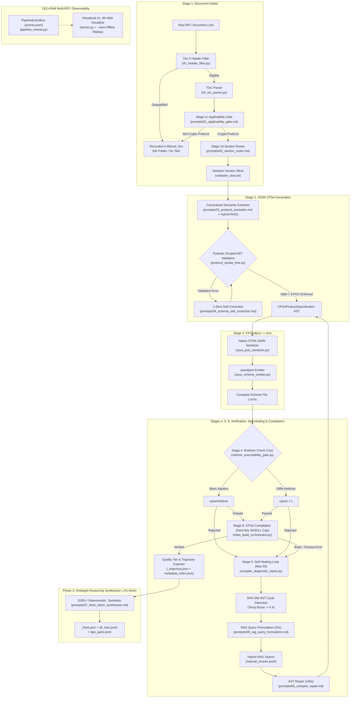
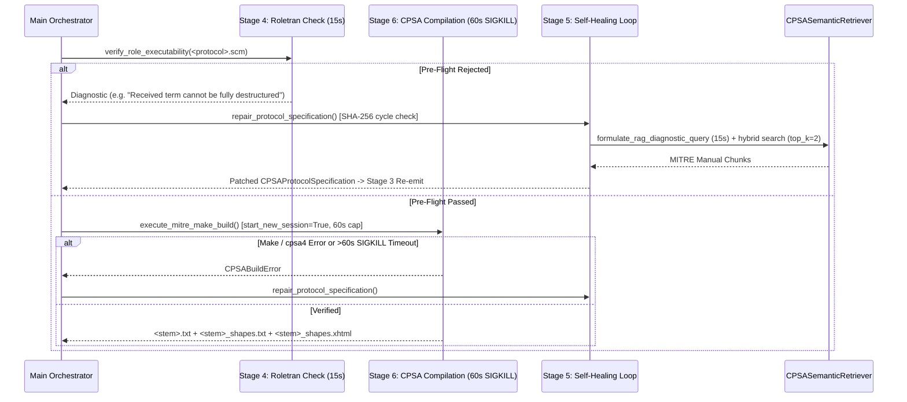
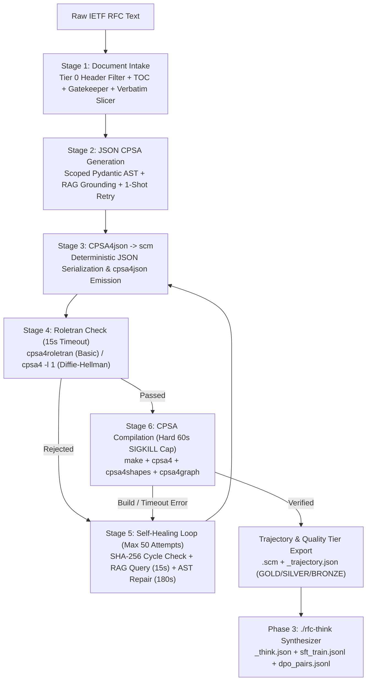

# RFC-LLM Master Index, Architecture & Project Configuration

> Tier 1 — Master repository index, executive Gemini ingestion guide, delta changelog since last sync, automated AST symbol and CLI script registry, heavy/binary asset inventory, architecture specifications, and root project configuration manifests.

*Generated: 2026-11-03 19:45:16 UTC · Git: `main` @ `101b107977b3` · Tier: Tier 1 — Architecture, Documentation & Project Configs · Files: 15 · Estimated Tokens: ~28,709*

---

## Changes Since Last Sync

- **Git branch:** `main`
- **Git commit:** `101b107977b3` — Simplify README: remove roadmap and important callout, add concise top-level overview
- **Added (0):** none
- **Modified (1):**
  - `README.md`
- **Deleted (0):** none

---

## Executive Ingestion & Grounding Guide (for LLMs / Gemini)

This unified repository context is optimized for ingestion into Gemini / LLM Notebooks. Key engineering invariants:

### 1. Cryptographic Protocol Shapes Analyzer (MITRE CPSA 4.4.9)
- **Order-Sorted Algebras**: Follow Table 10.1-10.6 productions and Equation 10.1 (`mesg` forbidden as encryption key in `enc`) strictly. Protocols using Diffie-Hellman operations **must** declare `(algebra diffie-hellman)` in the top-level `herald` form.
- **Exponent Origination**: In CPSA strand space semantics, exponents (`rndx`, `expt`) are never carried subterms in Dolev-Yao messages. Fresh private exponents **must** have sort `rndx` and be declared under `uniq-gen` (unique generated), **never** under `uniq-orig`.
- **3-POV Preskeleton Architecture**: Pure participant viewpoints (Initiator POV, Responder POV) must contain **zero** listener terms (`listeners: []`). Secrecy `deflistener` probes belong **strictly** in dedicated confidentiality skeletons (Skeleton 3) to prevent premature pruning of realized handshake shapes.
- **Bounded Pre-Flight & Compilation Gates**: `cpsa4roletran` validates `basic` crypto algebra while `diffie-hellman` protocols pre-flight via `cpsa4 -l 1` (`ROLETRAN_TIMEOUT_SECONDS = 15`). Full `make` / `cpsa4` compilation runs under a hard 60-second process-group `SIGKILL` cap (`CPSA_TIMEOUT_SECONDS = 60`) with up to `MAX_REPAIR_ATTEMPTS = 50` SHA-256 cycle-aware RAG self-healing iterations.

### 2. YAML Frontmatter Model Routing & Phase 3 Trajectory Curation
- **Live Hot-Reloaded Routing (`prompts/*.md`)**: Per-stage `model`, HTTP `timeout` (`180s` default; `15s` for `05_rag_query_formulation.md`), and `temperature` live in YAML frontmatter at the top of `prompts/01_*.md` through `prompts/07_*.md` (`nous/`, `strata/`, `ollama/`, `gemini/`, `openai/`, `anthropic/`), hot-reloading mid-batch without restarts. `.env` holds **only** API credentials and base endpoint URLs.
- **Quality Tiers & `./rfc-think` Datasets**: Each run writes timestamped artifacts (`output/run_YYYY-MM-DD_HH-MM-SS/metadata_index.json`, `<protocol>_trajectory.json`, `events.jsonl`) graded as `GOLD`, `SILVER`, `BRONZE`, or `REJECTED`. `./rfc-think` synthesizes 5-step forward-looking `<think>` monologues (`<protocol>_think.json`) and exports `sft_train.jsonl` + contrastive `dpo_pairs.jsonl` for AMD ROCm Megatron-LM MoE post-training.

---

## Bundle Catalog

| Bundle | Title | Files | Size | Estimated Tokens | Tier |
|---|---|---|---|---|---|
| `00_ARCHITECTURE_AND_INDEX.md` | RFC-LLM Master Index, Architecture & Project Configuration | 15 | 112.4 KB | ~28,709 | Tier 1 — Architecture, Documentation & Project Configs |
| `01_CORE_SOURCE_AND_CLI.md` | RFC-LLM Core Source Code, Compilers, IR & CLI Entrypoints | 48 | 783.4 KB | ~200,508 | Tier 2 — Core Source Code & CLI Entrypoints |
| `02_RAG_SCRIPTS_AND_TESTS.md` | CPSA Knowledge Base TOC & Pytest Verification Suites | 11 | 174.3 KB | ~44,375 | Tier 3 — Knowledge Base Index & Test Suites |
| `03_CPSA_DOMAIN_KNOWLEDGE_AND_GUIDES.md` | CPSA 4.4.9 Core Rules, Compiler Diagnostics & Official Manuals | 13 | 693.4 KB | ~175,802 | Tier 1/3 — Domain Reference Documentation & Modeling Guides |
| `04_CPSA_SCM_EXAMPLES_CORPUS.md` | Official MITRE CPSA Scheme (.scm) Protocol Examples & Catalog (151 Files) | 155 | 915.3 KB | ~234,169 | Tier 3 — Domain Reference Code Corpus (.scm) |

**Total Ingested Context Payload:** ~683,563 tokens across all bundles (68.4% of Gemini 1M context window)

---

## Symbol & Script Registry (automated AST introspection)

46 Python modules introspected with the stdlib `ast` module.

| Module | Docstring | Classes | Top-level Functions | CLI Arguments |
|---|---|---|---|---|
| `src/__init__.py` | RFC-LLM: End-to-End Synthesis of Formally Verified MITRE CPS | — | — | — |
| `src/code_generation/__init__.py` | Code Generation package for Stage 3 CPSA JSON serialization  | — | — | — |
| `src/code_generation/cpsa_json_serializer.py` | CPSA JSON AST Serializer. | — | `serialize_to_cpsa_json`, `serialize_to_cpsa_json_string` | — |
| `src/code_generation/cpsa_scheme_emitter.py` | CPSA Scheme S-Expression Emitter using cpsa4json. | `CPSAJsonCompilationError` | `sanitize_protocol_stem`, `emit_cpsa_scheme` | — |
| `src/cost_tracker.py` | Real-Time Token & USD Cost Telemetry Tracker across Pipeline | `PipelineCostTracker` | `_empty_role_bucket`, `make_empty_cost_summary`, `_normalize_model_key`, `_safe_int` | — |
| `src/document_ingestion/__init__.py` | Document Ingestion package for Stage 1 RFC filtering, TOC pa | — | — | — |
| `src/document_ingestion/handshake_section_router.py` | Handshake Section Router for Navigating RFC Table of Content | `SectionRoutingDecision` | `route_handshake_sections`, `_heuristic_section_router` | — |
| `src/document_ingestion/protocol_applicability_gate.py` | Protocol Applicability Gate (Tier 1 Gatekeeper). | `ProtocolApplicabilityReport` | `evaluate_protocol_applicability` | — |
| `src/document_ingestion/rfc_header_filter.py` | RFC Header and Frontmatter Metadata Filter (Tier 0 Filter). | `HeaderFilterResult` | `filter_rfc_header` | — |
| `src/document_ingestion/rfc_toc_parser.py` | RFC Table of Contents (TOC) Parser. | `TOCSectionEntry` | `parse_table_of_contents` | — |
| `src/document_ingestion/verbatim_section_slicer.py` | Verbatim RFC Section Boundary Slicer. | — | `_is_rfc_page_break`, `_find_section_start`, `_find_section_end`, `slice_verbatim_sections` | — |
| `src/generate_think/__init__.py` | Phase 3 Hindsight Reasoning (<think>) Synthesizer Package. | — | — | — |
| `src/generate_think/cli.py` | Command-line interface for Phase 3 Hindsight Reasoning (<thi | — | `main` | `--model`, `-m`, `--mode`, `--min-tier`, `--no-jsonl` |
| `src/generate_think/dspy_think_synthesizer.py` | Phase 3 Agentic DSPy Hindsight Reasoning (<think>) Synthesiz | `CPSAHindsightReasoningSignature`, `CPSAHindsightThinkModule` | `_format_sexpr`, `_extract_compiler_backtracking_summary`, `compile_deterministic_reasoning_steps`, `_sanitize_hindsight_leakage`, `_compose_comprehensive_monologue`, `synthesize_reasoning_steps_via_dspy_or_llm` … | — |
| `src/generate_think/think_schema.py` | Pydantic Schemas for Phase 3 Hindsight Reasoning (<think>) S | `SynthesizedReasoningSteps`, `DPOContrastivePair`, `ThinkArtifactBundle` | — | — |
| `src/intermediate_representation/__init__.py` | Intermediate Representation (IR) package for MITRE CPSA 4.4. | — | — | — |
| `src/intermediate_representation/algebraic_sorts.py` | Order-Sorted Message Algebra Sort Definitions for MITRE CPSA | `CPSASortEnum` | — | — |
| `src/intermediate_representation/cpsa_grammar.py` | MITRE CPSA 4.4.9 Formal Grammar, Scoped Keywords, and Arity  | — | `desugar_term_tree`, `validate_cpsa_term_syntax` | — |
| `src/intermediate_representation/protocol_syntax_tree.py` | Strongly-Typed Intermediate Representation (AST) for MITRE C | `CPSAVariableDeclaration`, `CPSATraceEvent`, `CPSAProtocolRole`, `CPSAStrandInstance`, `CPSAPreskeleton`, `CPSAProtocolSpecification` | `_validate_cpsa_term`, `sanitize_cpsa_symbol`, `extract_term_tokens`, `normalize_cpsa_term`, `_validate_no_mesg_encryption_key`, `_is_valid_roletran_input_term` | — |
| `src/logging_config.py` | Comprehensive Structured Logging Subsystem for RFC-LLM Pipel | `PipelineConsoleFormatter`, `PipelineMetricsCSVLogger` | `configure_pipeline_logging`, `get_pipeline_logger` | — |
| `src/main_pipeline_orchestrator.py` | Main Pipeline Orchestrator for RFC-to-CPSA Synthesis. | `PipelineExecutionSummary` | `_extract_rfc_abstract`, `_read_scm_safe`, `_compute_ast_hash`, `_run_roletran_self_healing_loop`, `_run_mitre_solver_self_healing_loop`, `run_rfc_translation_pipeline` | — |
| `src/pipeline.py` | Command-line interface for RFC-LLM synthesis pipeline suppor | — | `_print_cost_breakdown`, `natural_rfc_sort_key`, `get_completed_rfc_ids`, `get_failed_rfc_ids`, `main` | `--view`, `--output-dir`, `-o`, `--model`, `-m`, `--router-model`, `--extraction-model`, `--repair-model`, `--query-model`, `--no-visualize` … |
| `src/pipeline_events.py` | Bounded event bus, sequential tab registry, and disk telemet | `PipelineEvent`, `PipelineEventBus` | `_strip_bulky_event_fields` | — |
| `src/prompt_loader.py` | Dynamic Markdown & YAML-Frontmatter Prompt Loader for RFC-LL | `PromptSpec` | `parse_prompt_frontmatter`, `load_prompt_spec`, `resolve_prompt_model`, `load_prompt`, `build_schema_system_prompt`, `_unwrap_schema_envelope` … | — |
| `src/rag_retriever_client.py` | CPSA 4.4.9 Knowledge Base Indexer, `TOC.md` Flag Manager, an | `CPSAKnowledgeBase` | `tokenize_cpsa_dsl`, `_slugify_heading`, `parse_toc_rebuild_flag`, `_split_markdown_file_into_sections`, `_extract_scm_metadata_from_source`, `build_cpsa_kb_index` … | — |
| `src/semantic_extraction/__init__.py` | Semantic Extraction package for Stage 2 constrained CPSA pro | — | — | — |
| `src/semantic_extraction/constrained_protocol_extractor.py` | Constrained Protocol Semantic Extractor with RAG Grounding. | — | `extract_protocol_specification`, `ensure_three_point_of_view_skeletons` | — |
| `src/system_config.py` | Global environment, binary paths, execution limits, and prov | `SystemEnvironmentConfig` | — | — |
| `src/verification_engine/__init__.py` | Verification Engine package for Stages 4, 5 & 6 roletran che | — | — | — |
| `src/verification_engine/compiler_diagnostic_repair.py` | Compiler Diagnostic Repair Engine with RAG-Guided Self-Heali | — | `fallback_sanitize_diagnostic_query`, `formulate_rag_diagnostic_query`, `repair_protocol_specification` | — |
| `src/verification_engine/mitre_build_orchestrator.py` | MITRE Build Orchestrator for CPSA Verification and Visualiza | `CPSABuildArtifacts`, `CPSABuildError` | `_run_make_with_hard_timeout`, `_ensure_cpsa_makefile`, `_count_shapes_in_file`, `execute_mitre_make_build` | — |
| `src/verification_engine/roletran_executability_gate.py` | MITRE CPSA Roletran Pre-Flight Executability Gate (<15 ms). | `RoletranVerificationResult` | `verify_role_executability` | — |
| `src/verification_engine/snowball_autopsy.py` | CPSA 4.4.9 State-Space Snowball Classifier, Herald Injector, | — | `is_snowball_state_error`, `inject_herald_options_into_scm`, `_extract_balanced_sexp`, `_normalize_primed_identifiers`, `_parse_skeleton_records`, `_extract_primed_variable_stats` … | — |
| `src/verification_engine/trajectory_metadata_exporter.py` | Programmatic Trajectory & Formal Verification Metadata Expor | — | `split_top_level_sexprs`, `_extract_int_clause`, `_has_flag_clause`, `_extract_clause_block`, `_extract_root_deflistener`, `_extract_defstrands` … | — |
| `src/visualizer/__init__.py` | RFC-LLM Live Visualization and Interactive Dashboard Module. | — | — | — |
| `src/visualizer/server.py` | Asynchronous web server for live and offline multi-RFC synth | `VisualizerServer` | `_get_manual_chunk_lookup`, `_resolve_chunks_by_ids`, `hydrate_tab_payload`, `_synthesize_events_from_trajectory`, `run_visualizer_in_background` | — |
| `tests/conftest.py` | Global pytest fixtures ensuring hermetic test execution with | — | `_hermetic_logs_directory` | — |
| `tests/test_code_generation_and_verification.py` | Unit and Integration Tests for Code Generation and Verificat | — | `valid_unilateral_spec`, `unexecutable_spec`, `test_scheme_emitter_generates_valid_scm`, `test_roletran_gate_accepts_valid_protocol`, `test_roletran_gate_rejects_unexecutable_protocol`, `test_mitre_build_orchestrator_compiles_artifacts` … | — |
| `tests/test_cpsa_kb_and_agentic_searcher.py` | Unit & Integration Tests for the CPSA 4.4.9 Knowledge Base,  | — | `_make_sample_spec`, `test_production_cpsa_kb_completeness_and_toc_flag`, `test_toc_rebuild_flag_lifecycle_in_isolated_kb`, `test_cpsa_kb_four_tools_precision`, `test_agentic_searcher_multi_tool_loop`, `test_two_speed_repair_trigger_skips_searcher_on_fast_attempt_and_escalates` … | — |
| `tests/test_cpsa_scoping_and_prompts.py` | Unit Tests for MITRE CPSA 4.4.9 Keyword/Sort Scoping and Ext | — | `test_externalized_prompts_load_frontmatter_strip_yaml_and_fallback`, `test_prompt_frontmatter_live_hot_reload_and_strata_routing`, `test_logic_only_sorts_forbidden_in_role_and_skeleton_vars`, `test_diffie_hellman_sorts_forbidden_under_basic_algebra`, `test_structural_keywords_forbidden_inside_message_terms`, `test_role_and_skeleton_keyword_scoping_separation` … | — |
| `tests/test_document_ingestion.py` | Unit & Integration Tests for Document Ingestion Subsystem (S | — | `tls_rfc_text`, `kerberos_rfc_text`, `mib_rfc_text`, `test_header_filter_accepts_tls`, `test_header_filter_accepts_kerberos`, `test_header_filter_rejects_mib` … | — |
| `tests/test_generate_think.py` | Unit and integration tests for Phase 3 Hindsight Reasoning ( | — | `_sample_trajectory_dict`, `test_deterministic_reasoning_compiler_and_hindsight_sanitizer`, `test_process_run_directory_creates_think_json_and_updates_metadata_index` | — |
| `tests/test_main_pipeline_orchestrator.py` | Integration tests for Main Pipeline Orchestrator. | — | `mock_valid_spec`, `test_pipeline_rejects_ineligible_rfc`, `test_pipeline_e2e_successful_synthesis_and_build` | — |
| `tests/test_trajectory_and_hardening.py` | Hardening and edge-case tests for 60s process-group SIGKILL, | — | `test_hard_timeout_kills_entire_process_group_including_grandchild`, `test_malformed_yaml_frontmatter_and_edge_cases`, `test_split_top_level_sexprs_ignores_parens_in_comments_and_strings`, `test_offline_load_run_from_disk_discovery_modes`, `test_visualizer_artifact_endpoint_blocks_path_traversal_and_dotfiles`, `test_parse_llm_json_unwraps_schema_properties_and_single_element_lists` … | — |
| `tests/test_visualizer_and_events.py` | Unit and integration tests for Pipeline Event Bus, Cycle Det | — | `sample_spec`, `test_pipeline_event_bus_emission_and_subscription`, `test_compiler_repair_cycle_detection_triggers_warning_and_jitter`, `test_visualizer_server_endpoints` | — |
| `tests/test_visualizer_tabs.py` | Tests for scalable numbered multi-RFC tabs, filtered RFC dra | — | `test_sequential_tab_numbering_and_filtered_separation`, `test_per_attempt_hydration_and_offline_replay`, `test_5000_accepted_tabs_scalability_benchmark` | — |

---

## Excluded & Heavy Assets Inventory (Tier 4)

6 assets (1.9 MB total) were **excluded from raw text dumping** and summarized below with metadata and lightweight schema previews, so the downstream LLM is aware of every dataset, embedding matrix, manual, figure and log in the repository without ingesting their bulk.

### `logs/pipeline_runs.csv`

*129.7 KB · excluded because: declared Tier 4 summarized asset*

- Header (50 cols): `timestamp, rfc_id, run_count, is_eligible, status, quality_tier, total_completion_steps, zero_shot_passed, schema_repairs, roletran_repairs, solver_repairs, total_repairs, rejection_gate, protocol_name, message_algebra, selected_sections, sliced_lines_count, role_count, preskeleton_count, scm_lines_count, shapes_count, explored_skeletons_count, all_povs_multi_strand, secrecy_proved, searcher_invocations, herald_options, duration_seconds, router_model, router_calls, router_tokens, router_cost_usd, extraction_model, extraction_calls, extraction_tokens, extraction_cost_usd, query_model, query_calls, query_tokens, query_cost_usd, repair_model, repair_calls, repair_tokens, repair_cost_usd, total_calls, total_tokens, total_cost_usd, scm_path, shapes_xhtml_path, trajectory_json_path, error_message`
- Sample row: `2026-11-03 12:38:26, RFC5606, 1, False, INELIGIBLE, INELIGIBLE, 0, , 0, 0, 0, 0, Stage 1c Applicability Gate, Implications of 'retransmission-allow..., , , 0, 0, 0, 0, 0, 0, , , 0, , 7.172, nous/anthropic/claude-haiku-5.5, 1, 2685, 0.000626, nous/anthropic/claude-haiku-5.5, 0, 0, 0.000000, nous/anthropic/claude-haiku-5.5, 0, 0, 0.000000, nous/anthropic/claude-haiku-5.5, 0, 0, 0.000000, 1, 2685, 0.000626, , , , Ineligible: RFC 5606 is an Informatio...`
- Sample row: `2026-11-03 12:38:31, RFC7432, 1, False, INELIGIBLE, INELIGIBLE, 0, , 0, 0, 0, 0, Stage 1c Applicability Gate, BGP MPLS-Based Ethernet VPN (EVPN), , , 0, 0, 0, 0, 0, 0, , , 0, , 4.562, nous/anthropic/claude-haiku-5.5, 1, 3400, 0.000634, nous/anthropic/claude-haiku-5.5, 0, 0, 0.000000, nous/anthropic/claude-haiku-5.5, 0, 0, 0.000000, nous/anthropic/claude-haiku-5.5, 0, 0, 0.000000, 1, 3400, 0.000634, , , , Ineligible: RFC 7432 specifies a BGP-...`
- Sample row: `2026-11-03 12:38:35, RFC6468, 1, False, INELIGIBLE, INELIGIBLE, 0, , 0, 0, 0, 0, Stage 1c Applicability Gate, Sieve Notification Mechanism: SIP MES..., , , 0, 0, 0, 0, 0, 0, , , 0, , 3.59, nous/anthropic/claude-haiku-5.5, 1, 2366, 0.000481, nous/anthropic/claude-haiku-5.5, 0, 0, 0.000000, nous/anthropic/claude-haiku-5.5, 0, 0, 0.000000, nous/anthropic/claude-haiku-5.5, 0, 0, 0.000000, 1, 2366, 0.000481, , , , Ineligible: RFC 6468 is a profile of ...`
- Total rows (incl. header): 131

### `refrences/cpsa_kb/04_examples_catalog/batch1_meta.json`

*53.4 KB · 2508 lines · excluded because: declared Tier 4 summarized asset*

- Top-level array with 50 records.
- Record keys: `example_id, filename, protocol_names, algebra, herald_flags, roles, sorts_used, operators_used, keywords_used, uses_channels, uses_state_locn, uses_goals, uses_rules_or_lemmas, uses_macros, has_roletran_declarations, summary`

### `refrences/cpsa_kb/04_examples_catalog/batch2_meta.json`

*71.6 KB · 2425 lines · excluded because: declared Tier 4 summarized asset*

- Top-level array with 50 records.
- Record keys: `example_id, filename, protocol_names, algebra, herald_flags, roles, sorts_used, operators_used, keywords_used, uses_channels, uses_state_locn, uses_goals, uses_rules_or_lemmas, uses_macros, has_roletran_declarations, summary`

### `refrences/cpsa_kb/04_examples_catalog/batch3_meta.json`

*50.3 KB · 2424 lines · excluded because: declared Tier 4 summarized asset*

- Top-level array with 48 records.
- Record keys: `example_id, filename, protocol_names, algebra, herald_flags, roles, sorts_used, operators_used, keywords_used, uses_channels, uses_state_locn, uses_goals, uses_rules_or_lemmas, uses_macros, has_roletran_declarations, summary`

### `refrences/cpsa_kb/04_examples_catalog/batch4_meta.json`

*3.7 KB · 175 lines · excluded because: declared Tier 4 summarized asset*

- Top-level array with 3 records.
- Record keys: `example_id, filename, protocol_names, algebra, herald_flags, roles, sorts_used, operators_used, keywords_used, uses_channels, uses_state_locn, uses_goals, uses_rules_or_lemmas, uses_macros, has_roletran_declarations, summary`

### `refrences/cpsa_kb/kb_index.json`

*1656.1 KB · 11126 lines · excluded because: exceeds max_file_size_kb (1656.1 KB > 600 KB)*

- Top-level object with 6 keys: `schema_version, built_at, total_sections, total_scm_examples, sections, scm_examples`
  - `schema_version`: 2.0.0
  - `built_at`: 2026-11-02T18:25:27Z
  - `total_sections`: 449
  - `total_scm_examples`: 151
  - `sections`: list[449] item keys: `section_id, category, source_file, doc_title, title, content`
  - `scm_examples`: list[151] item keys: `example_id, filename, protocol_names, algebra, herald_flags, roles, sorts_used, operators_used, keywords_used, uses_channels, uses_state_locn, uses_goals`

---

## Table of Contents

- [`.env.example`](#envexample)
- [`.gitignore`](#gitignore)
- [`LICENSE`](#license)
- [`README.md`](#readmemd)
- [`docs/ARCHITECTURE.md`](#docsarchitecturemd)
- [`docs/CPSA_KEYWORD_REFERENCE.md`](#docscpsa-keyword-referencemd)
- [`docs/INTERMEDIATE_REPRESENTATION.md`](#docsintermediate-representationmd)
- [`docs/MASTER_BLUEPRINT.md`](#docsmaster-blueprintmd)
- [`docs/QUICKSTART_AND_OPERATIONS.md`](#docsquickstart-and-operationsmd)
- [`docs/README.md`](#docsreadmemd)
- [`docs/TIERED_MODEL_ROUTING.md`](#docstiered-model-routingmd)
- [`docs/VERIFICATION_AND_SELF_HEALING.md`](#docsverification-and-self-healingmd)
- [`logs/.gitignore`](#logsgitignore)
- [`pytest.ini`](#pytestini)
- [`requirements.txt`](#requirementstxt)

---

### `.env.example`

*sha256:`6872bc843cf4` · 31 lines · 1.5 KB (~379 tokens) · lang:`example`*

```example
# ==============================================================================
# Credentials & Base Endpoints Template for CPSA / RFC-LLM Pipeline
# Copy this file to .env and populate your API keys:
#   cp .env.example .env
#
# Per-stage model selection, timeouts, and sampling temperatures are configured
# directly in the YAML frontmatter at the top of each `prompts/*.md` file.
# ==============================================================================

# ------------------------------------------------------------------------------
# 1. Cloud & Unified Proxy Credentials
# ------------------------------------------------------------------------------
# Google Gemini API Key (use with `gemini/<model>`)
GEMINI_API_KEY=your_gemini_api_key_here

# Nous Research Portal API (use with `nous/<model>`)
NOUS_API_KEY=your_nous_api_key_here
NOUS_API_BASE=https://inference-api.nousresearch.com/v1

# Direct Provider Credentials (use with `openai/<model>` or `anthropic/<model>`)
OPENAI_API_KEY=your_openai_api_key_here
ANTHROPIC_API_KEY=your_anthropic_api_key_here

# ------------------------------------------------------------------------------
# 2. Local & Tailscale Model Base Endpoints
# ------------------------------------------------------------------------------
# Ollama Endpoint (use with `ollama/<model>`; also serves `ollama/nomic-embed-text` for RAG)
OLLAMA_API_BASE=http://localhost:11434

# Strata OpenAI-Compatible Endpoint (use with `strata/<model>`)
STRATA_API_BASE=http://localhost:11435/v1
```

---

### `.gitignore`

*sha256:`af8bbf7c24b1` · 252 lines · 5.2 KB (~1,341 tokens) · lang:`text`*

```text
# Byte-compiled / optimized / DLL files
__pycache__/
*.py[codz]
*$py.class

# C extensions
*.so
project_outline.md
output/
# Distribution / packaging
.Python
build/
develop-eggs/
dist/
downloads/
eggs/
.eggs/
lib/
lib64/
parts/
sdist/
var/
wheels/
share/python-wheels/
*.egg-info/
.installed.cfg
*.egg
MANIFEST

# PyInstaller
#   Usually these files are written by a python script from a template
#   before PyInstaller builds the exe, so as to inject date/other infos into it.
*.manifest
*.spec

# Installer logs
pip-log.txt
pip-delete-this-directory.txt

# Unit test / coverage reports
htmlcov/
.tox/
.nox/
.coverage
.coverage.*
.cache
nosetests.xml
coverage.xml
*.cover
*.py.cover
.hypothesis/
.pytest_cache/
cover/

# Translations
*.mo
*.pot

# Django stuff:
*.log
local_settings.py
db.sqlite3
db.sqlite3-journal

# Flask stuff:
instance/
.webassets-cache

# Scrapy stuff:
.scrapy

# Sphinx documentation
docs/_build/

# PyBuilder
.pybuilder/
target/

# Jupyter Notebook
.ipynb_checkpoints

# IPython
profile_default/
ipython_config.py

# pyenv
#   For a library or package, you might want to ignore these files since the code is
#   intended to run in multiple environments; otherwise, check them in:
# .python-version

# pipenv
#   According to pypa/pipenv#598, it is recommended to include Pipfile.lock in version control.
#   However, in case of collaboration, if having platform-specific dependencies or dependencies
#   having no cross-platform support, pipenv may install dependencies that don't work, or not
#   install all needed dependencies.
# Pipfile.lock

# UV
#   Similar to Pipfile.lock, it is generally recommended to include uv.lock in version control.
#   This is especially recommended for binary packages to ensure reproducibility, and is more
#   commonly ignored for libraries.
# uv.lock

# poetry
#   Similar to Pipfile.lock, it is generally recommended to include poetry.lock in version control.
#   This is especially recommended for binary packages to ensure reproducibility, and is more
#   commonly ignored for libraries.
#   https://python-poetry.org/docs/basic-usage/#commit-your-poetrylock-file-to-version-control
# poetry.lock
# poetry.toml

# pdm
#   Similar to Pipfile.lock, it is generally recommended to include pdm.lock in version control.
#   pdm recommends including project-wide configuration in pdm.toml, but excluding .pdm-python.
#   https://pdm-project.org/en/latest/usage/project/#working-with-version-control
# pdm.lock
# pdm.toml
.pdm-python
.pdm-build/

# pixi
#   Similar to Pipfile.lock, it is generally recommended to include pixi.lock in version control.
# pixi.lock
#   Pixi creates a virtual environment in the .pixi directory, just like venv module creates one
#   in the .venv directory. It is recommended not to include this directory in version control.
.pixi

# PEP 582; used by e.g. github.com/David-OConnor/pyflow and github.com/pdm-project/pdm
__pypackages__/

# Celery stuff
celerybeat-schedule
celerybeat.pid

# Redis
*.rdb
*.aof
*.pid

# RabbitMQ
mnesia/
rabbitmq/
rabbitmq-data/

# ActiveMQ
activemq-data/

# SageMath parsed files
*.sage.py

# Environments
.env
.envrc
.venv
env/
venv/
ENV/
env.bak/
venv.bak/

# Spyder project settings
.spyderproject
.spyproject

# Rope project settings
.ropeproject

# mkdocs documentation
/site

# mypy
.mypy_cache/
.dmypy.json
dmypy.json

# Pyre type checker
.pyre/

# pytype static type analyzer
.pytype/

# Cython debug symbols
cython_debug/

# PyCharm
#   JetBrains specific template is maintained in a separate JetBrains.gitignore that can
#   be found at https://github.com/github/gitignore/blob/main/Global/JetBrains.gitignore
#   and can be added to the global gitignore or merged into this file.  For a more nuclear
#   option (not recommended) you can uncomment the following to ignore the entire idea folder.
# .idea/

# Abstra
#   Abstra is an AI-powered process automation framework.
#   Ignore directories containing user credentials, local state, and settings.
#   Learn more at https://abstra.io/docs
.abstra/

# Visual Studio Code
#   Visual Studio Code specific template is maintained in a separate VisualStudioCode.gitignore 
#   that can be found at https://github.com/github/gitignore/blob/main/Global/VisualStudioCode.gitignore
#   and can be added to the global gitignore or merged into this file. However, if you prefer, 
#   you could uncomment the following to ignore the entire vscode folder
# .vscode/
# Temporary file for partial code execution
tempCodeRunnerFile.py

# Ruff stuff:
.ruff_cache/

# PyPI configuration file
.pypirc

# Marimo
marimo/_static/
marimo/_lsp/
__marimo__/

# Streamlit
.streamlit/secrets.toml

# RFC text archives & Pipeline artifacts
all_RFCs/
**/all_RFCs/
refrences/legacy_rag_archive/
*.log

# Pipeline runtime checkpoints and ephemeral state
refrences/chunks/*checkpoint*.json
refrences/chunks/*.log
refrences/chunks/manual_chunks.json
refrences/chunks/code_examples.json
refrences/chunks/*cache*.json
refrences/reports/*200*.jsonl


# Track canonical distribution datasets and vector embeddings explicitly
!refrences/chunks/*.jsonl
!refrences/chunks/embeddings.npy
!refrences/chunks/embeddings_meta.json
!refrences/chunks/all_references_clean.md

# LaTeX compilation artifacts & previews
*.aux
*.out
*.fls
*.fdb_latexmk
*.synctex.gz
*.bak
*preview*.png

# Root HTML mirror
/embedding_clusters.html
```

---

### `LICENSE`

*sha256:`a1896ff9a996` · 21 lines · 1.0 KB (~267 tokens) · lang:`text`*

```text
MIT License

Copyright (c) 2026 Mario Marku

Permission is hereby granted, free of charge, to any person obtaining a copy
of this software and associated documentation files (the "Software"), to deal
in the Software without restriction, including without limitation the rights
to use, copy, modify, merge, publish, distribute, sublicense, and/or sell
copies of the Software, and to permit persons to whom the Software is
furnished to do so, subject to the following conditions:

The above copyright notice and this permission notice shall be included in all
copies or substantial portions of the Software.

THE SOFTWARE IS PROVIDED "AS IS", WITHOUT WARRANTY OF ANY KIND, EXPRESS OR
IMPLIED, INCLUDING BUT NOT LIMITED TO THE WARRANTIES OF MERCHANTABILITY,
FITNESS FOR A PARTICULAR PURPOSE AND NONINFRINGEMENT. IN NO EVENT SHALL THE
AUTHORS OR COPYRIGHT HOLDERS BE LIABLE FOR ANY CLAIM, DAMAGES OR OTHER
LIABILITY, WHETHER IN AN ACTION OF CONTRACT, TORT OR OTHERWISE, ARISING FROM,
OUT OF OR IN CONNECTION WITH THE SOFTWARE OR THE USE OR OTHER DEALINGS IN THE
SOFTWARE.
```

---

### `README.md`

*sha256:`14a33801a274` · 90 lines · 9.5 KB (~2,416 tokens) · lang:`markdown`*

````markdown
# RFC-LLM

**RFC-LLM** is an automated pipeline that reads IETF RFC documents, identifies real cryptographic handshake protocols, extracts the exact message-exchange sections, and translates them into formally verified **MITRE CPSA 4.4.9** (Cryptographic Protocol Shapes Analyzer) models. It runs CPSA's compiler and strand-space solver (`cpsa4json`, `cpsa4roletran`, and `cpsa4`) in a self-healing repair loop to prove authentication shapes and secrecy properties, and packages the verified runs and `<think>` reasoning traces into training datasets (`sft_train.jsonl` and `dpo_pairs.jsonl`).

---

## 1. Pipeline Overview

[`src/main_pipeline_orchestrator.py`](src/main_pipeline_orchestrator.py) executes a **6-stage compiler-in-the-loop pipeline**:

1. **Stage 1 — Document Intake ([`src/document_ingestion/`](src/document_ingestion/))**:
   - [`rfc_header_filter.py`](src/document_ingestion/rfc_header_filter.py) & [`protocol_applicability_gate.py`](src/document_ingestion/protocol_applicability_gate.py): Rejects non-protocol RFCs (informational memos, MIBs, administrative guidelines, static payload formats, and protocols that merely run over TLS/IPsec without defining their own cryptographic handshake).
   - [`rfc_toc_parser.py`](src/document_ingestion/rfc_toc_parser.py), [`handshake_section_router.py`](src/document_ingestion/handshake_section_router.py), & [`verbatim_section_slicer.py`](src/document_ingestion/verbatim_section_slicer.py): Slices 10,000+ line RFCs down to the verbatim sections defining the cryptographic message exchange (`verbatim_slice.txt`).
2. **Stage 2 — JSON CPSA Generation ([`src/intermediate_representation/`](src/intermediate_representation/), [`src/semantic_extraction/constrained_protocol_extractor.py`](src/semantic_extraction/constrained_protocol_extractor.py))**:
   - Extracts a validated `CPSAProtocolSpecification` Pydantic AST enforcing MITRE CPSA 4.4.9 sort rules, positional keyword scoping, and the Stage 2 Verbatim Slice Bailout Gate (exiting immediately with 0 repair loops if the sliced RFC text defines no cryptographic message exchange).
   - Enforces the **3-POV Preskeleton Architecture**: pure 1-strand `defstrandmax` Point-of-View skeletons for each role (with zero listeners) plus a dedicated `deflistener` secrecy probe skeleton.
3. **Stage 3 — CPSA4json -> scm ([`src/code_generation/`](src/code_generation/))**:
   - [`cpsa_json_serializer.py`](src/code_generation/cpsa_json_serializer.py) & [`cpsa_scheme_emitter.py`](src/code_generation/cpsa_scheme_emitter.py): Serializes the validated Pydantic AST into native CPSA JSON S-expression arrays and compiles them into canonical CPSA 4.4.9 `.scm` code via `cpsa4json`.
4. **Stage 4 — Roletran Check ([`src/verification_engine/roletran_executability_gate.py`](src/verification_engine/roletran_executability_gate.py))**:
   - Runs `cpsa4roletran` (for `basic` algebra) or `cpsa4 -l 1` (for `diffie-hellman` algebra) under `ROLETRAN_TIMEOUT_SECONDS = 15` to verify role constructibility, destructibility, and variable origination before invoking full strand-space search.
5. **Stage 5 — Self-Healing Loop ([`src/verification_engine/compiler_diagnostic_repair.py`](src/verification_engine/compiler_diagnostic_repair.py), [`src/rag_retriever_client.py`](src/rag_retriever_client.py))**:
   - Intercepts Stage 4 (`Roletran Check`) or Stage 6 (`CPSA Compilation`) rejections, tracks canonical SHA-256 AST hashes to break repair oscillations, runs the Pinned CPSA Header + Agentic CPSA Knowledge Base Searcher (`refrences/cpsa_kb/`), and patches the Pydantic AST while preserving 1-to-1 fidelity to the verbatim RFC.
6. **Stage 6 — CPSA Compilation & 3-Tier Snowball State Recovery ([`src/verification_engine/mitre_build_orchestrator.py`](src/verification_engine/mitre_build_orchestrator.py), [`src/verification_engine/snowball_autopsy.py`](src/verification_engine/snowball_autopsy.py), [`src/verification_engine/trajectory_metadata_exporter.py`](src/verification_engine/trajectory_metadata_exporter.py))**:
   - Executes `cpsa4init` and `make` (`cpsa4`, `cpsa4shapes`, `cpsa4graph`) under a hard 15-second process-group `SIGKILL` cap (`CPSA_TIMEOUT_SECONDS = 15`) with 3-tier snowball state recovery (Tier 1 herald search-order portfolio, Tier 2 partial `.txt` snowball autopsy, Tier 3 structural anti-unification repair).
   - Scores deterministic verification quality tiers (`GOLD`, `SILVER`, `BRONZE`, `REJECTED`), records per-role and batch USD/token telemetry ([`src/cost_tracker.py`](src/cost_tracker.py)), upserts the master ledger (`logs/pipeline_runs.csv`), and updates `output/run_YYYY-MM-DD_HH-MM-SS/metadata_index.json`.

### YAML Frontmatter Model Routing & Live Hot-Reload (`prompts/*.md`)
All 7 LLM prompt templates ([`prompts/01_applicability_gate.md`](prompts/01_applicability_gate.md) through [`prompts/07_think_token_synthesizer.md`](prompts/07_think_token_synthesizer.md)) define their per-stage `model`, HTTP `timeout`, `max_tokens`, and `temperature` directly in leading YAML frontmatter via [`src/prompt_loader.py`](src/prompt_loader.py):
- **Zero-Restart Live Hot-Reload**: Edits to `model:`, `timeout:`, `temperature:`, or prompt text take effect on the very next LLM call—even mid-batch—without restarting `./rfc-llm`.
- **Clean `.env`**: `.env` ([`.env.example`](.env.example)) holds **only** API credentials (`GEMINI_API_KEY`, `NOUS_API_KEY`, `OPENAI_API_KEY`, `ANTHROPIC_API_KEY`) and base endpoint URLs (`NOUS_API_BASE`, `OLLAMA_API_BASE`, `STRATA_API_BASE`).
- **Provider Prefixes & CLI Overrides**: Supports `nous/<model>`, `strata/<model>`, `ollama/<model>`, `gemini/<model>`, `openai/<model>`, and `anthropic/<model>`, plus optional one-off CLI overrides (`--model`, `--router-model`, `--extraction-model`, `--repair-model`, `--query-model`).

### Multi-RFC Web Visualizer & Offline Replay (`--view`)
[`src/visualizer/server.py`](src/visualizer/server.py), [`src/visualizer/static/index.html`](src/visualizer/static/index.html), and [`src/pipeline_events.py`](src/pipeline_events.py) provide real-time and offline multi-RFC inspection at `http://127.0.0.1:8080`:
- **Virtualized `#1..#N` Tab Strip**: Allocates sequential `#1..#N` tabs for accepted RFCs showing tab number, RFC ID, quality tier, and protocol name.
- **Collapsible `Filtered / Skipped` Drawer**: Paginated, searchable drawer recording Tier 0, Stage 1c, and Stage 2 rejected RFCs.
- **Per-Attempt Time-Travel Stepper**: Inspect `Attempt 0 | Initial` -> `Attempt 1..K` -> `Final` with a rejected/repaired `.scm` toggle, Pydantic JSON AST, compiler diagnostics, KB rules, and SVG shape graphs.
- **Offline Replay Mode**: Inspect any completed run folder without re-running synthesis via `./rfc-llm --view output/run_<timestamp>`.

### Hindsight Reasoning (`<think>`) Synthesizer (`./rfc-think`)
Implemented in [`./rfc-think`](rfc-think) ([`src/generate_think/`](src/generate_think/) and [`prompts/07_think_token_synthesizer.md`](prompts/07_think_token_synthesizer.md)), `./rfc-think` converts verification trajectories into post-training datasets (`<protocol>_think.json`, `sft_train.jsonl`, and `dpo_pairs.jsonl`).

---

## 2. Repository Structure & Documentation Map

| Directory / File | Purpose |
| :--- | :--- |
| [`rfc-llm`](rfc-llm) | Synthesis & offline replay CLI (`./rfc-llm <rfc_or_dir>` / `./rfc-llm --view <run_dir>`) |
| [`rfc-think`](rfc-think) | `<think>` reasoning & SFT/DPO dataset synthesizer CLI (`./rfc-think <run_dir>`) |
| [`.env.example`](.env.example) | Credentials & base endpoint URLs template (`*_API_KEY`, `NOUS_API_BASE`, `OLLAMA_API_BASE`, `STRATA_API_BASE`) |
| [`prompts/`](prompts/README.md) | 7 YAML-frontmatter prompt templates (`model`, `timeout`, `temperature`) with live mid-batch hot-reload |
| [`src/`](src/) | Core 6-stage synthesis pipeline, Pydantic IR, verification engine, `<think>` synthesizer, and web visualizer |
| [`docs/`](docs/README.md) | Architecture specifications, CPSA 4.4.9 keyword reference, model routing, and operational runbooks |
| [`tests/`](tests/) | Unit and integration test suite enforcing CPSA 4.4.9 scoping, visualizer tabs, and `<think>` synthesis |
| [`refrences/`](refrences/) | MITRE CPSA 4.4.9 Knowledge Base (`cpsa_kb/`), 151 `.scm` examples, and manuals |
| [`notebook_context/`](notebook_context/README.md) | Automated repository-to-Markdown context bundler for LLM Notebook ingestion |

### Core Technical Documentation (`docs/`)
- **[System Architecture & Lifecycle](docs/ARCHITECTURE.md)**
- **[Formal Grammar & Intermediate Representation](docs/INTERMEDIATE_REPRESENTATION.md)**
- **[Complete CPSA 4.4.9 Keyword & Grammar Reference](docs/CPSA_KEYWORD_REFERENCE.md)**
- **[Tiered Model Routing & YAML Frontmatter Configuration](docs/TIERED_MODEL_ROUTING.md)**
- **[Verification Engine & Self-Healing Loop](docs/VERIFICATION_AND_SELF_HEALING.md)**
- **[Master Clean-Room Blueprint](docs/MASTER_BLUEPRINT.md)**
- **[Quickstart & Operational Runbook](docs/QUICKSTART_AND_OPERATIONS.md)**

---

## 3. Quickstart

```bash
# 1. Copy the credentials & endpoints template and populate your API keys
cp .env.example .env

# 2. Run the full test suite
.venv/bin/pytest tests/

# 3. Synthesize & formally verify a CPSA model from an RFC (live visualizer on http://127.0.0.1:8080)
./rfc-llm refrences/all_RFCs/rfc9528.txt

# 4. Replay any completed run directory offline in the virtualized multi-RFC visualizer
./rfc-llm --view output/run_YYYY-MM-DD_HH-MM-SS

# 5. Synthesize <think> traces plus sft_train.jsonl and dpo_pairs.jsonl
./rfc-think output/run_YYYY-MM-DD_HH-MM-SS

# 6. Rebuild NotebookLM / Gemini markdown context bundles after edits
python3 notebook_context/sync_context.py
```
````

---

### `docs/ARCHITECTURE.md`

*sha256:`0f5b2b45b14b` · 173 lines · 16.9 KB (~4,287 tokens) · lang:`markdown`*

````markdown
# RFC-LLM Pipeline Architecture & Lifecycle

## 1. System Overview

RFC-LLM translates raw, unstructured IETF RFC documents into formally verified MITRE CPSA 4.4.9 models (`.scm`), programmatic verification trajectories (`<protocol>_trajectory.json`), and Phase 3 `<think>` reasoning datasets (`<protocol>_think.json`, `sft_train.jsonl`, `dpo_pairs.jsonl`).

RFC specifications combine English prose, ASCII sequence diagrams, and byte-level packet layouts, whereas CPSA requires order-sorted algebraic S-expressions under strict Dolev-Yao strand space semantics. Passing an RFC straight to an LLM produces hallucinated operators, invalid sort assignments, and uncompilable Scheme code.

RFC-LLM decomposes translation into six discrete compiler stages in `./rfc-llm` ([`src/main_pipeline_orchestrator.py`](../src/main_pipeline_orchestrator.py)) followed by Phase 3 hindsight reasoning synthesis in `./rfc-think` ([`src/generate_think/`](../src/generate_think/)):

```
[RFC Text]
   |
   v
[Stage 1: Document Intake] ──────── (Tier 0 Regex Filter -> TOC -> Gatekeeper -> Section Router -> Verbatim Slicer)
   |
   v
[Stage 2: JSON CPSA Generation] ─── (prompts/03_protocol_extraction.md + Hybrid RAG -> Scoped Pydantic AST)
   |
   v
[Stage 3: CPSA4json -> scm] ─────── (JSON AST -> Native CPSA JSON -> ~/.cabal/bin/cpsa4json -> <protocol>.scm)
   |
   v
[Stage 4: Roletran Check] ───────── (cpsa4roletran for Basic / cpsa4 -l 1 for Diffie-Hellman; 15s Timeout)
   |           |
   | (Pass)    | (Fail)
   |           v
   |     [Stage 5: Self-Healing Loop] ─── (SHA-256 Cycle Check + RAG Query [15s] + AST Repair [180s]; Max 50)
   |           |                                 ^
   |           +────────> (Re-emit Stage 3)      | (Build / 60s Timeout Error)
   v                                             |
[Stage 6: CPSA Compilation] ─────── (Hard 60s Process-Group SIGKILL Cap: make + cpsa4 + cpsa4shapes + cpsa4graph)
   |
   v
[Trajectory & Quality Tier Export] ── (<protocol>.scm Header + <protocol>_trajectory.json + metadata_index.json)
   |
   v
[Phase 3: ./rfc-think Synthesizer] ── (prompts/07_think_token_synthesizer.md -> <protocol>_think.json + SFT/DPO JSONL)
```

---

## 2. Phase 2 Synthesis Pipeline Stages (`./rfc-llm`)

### Stage 1: Document Intake
1. **Stage 1a — Tier 0 Header & Frontmatter Filter** ([`src/document_ingestion/rfc_header_filter.py`](../src/document_ingestion/rfc_header_filter.py)):
   - Inspects the first 100 lines of the RFC using deterministic regular expressions (<1 ms, zero LLM calls).
   - Rejects documents under 60 lines, `Historic` or `Best Current Practice` categories, and administrative/data-definition titles (`MIB`, `Management Information Base`, `Managed Objects`, `Architecture`, `Applicability Statement`, `Problem Statement`, `Requirements for`, `Guidelines for`, `Meeting Minutes`).
2. **Stage 1b — Table of Contents Parser** ([`src/document_ingestion/rfc_toc_parser.py`](../src/document_ingestion/rfc_toc_parser.py)):
   - Parses hierarchical dotted section identifiers (`5.2`, `A.1`), titles, page numbers, and indentation levels from the TOC block, falling back to column-0 header scanning if no formal TOC exists.
3. **Stage 1c — Protocol Applicability Gate** ([`src/document_ingestion/protocol_applicability_gate.py`](../src/document_ingestion/protocol_applicability_gate.py)):
   - Configured via [`prompts/01_applicability_gate.md`](../prompts/01_applicability_gate.md) (`timeout: 180`).
   - Evaluates RFC metadata, abstract, and TOC to confirm the document defines an interactive cryptographic protocol with principals, keys, or nonces.
   - **Deferred Directory Creation**: Ineligible RFCs rejected at Stage 1a or Stage 1c are recorded in `metadata_index.json` (`filtered_rfcs`) and `logs/pipeline_runs.csv` without creating empty per-RFC directories or allocating visualizer tabs.
4. **Stage 1d — Handshake Section Router** ([`src/document_ingestion/handshake_section_router.py`](../src/document_ingestion/handshake_section_router.py)):
   - Configured via [`prompts/02_section_router.md`](../prompts/02_section_router.md) (`timeout: 180`).
   - Selects the exact section numbers defining the cryptographic message exchange (excluding introductory prose, security considerations, and IANA registries).
5. **Stage 1e — Verbatim Section Slicer** ([`src/document_ingestion/verbatim_section_slicer.py`](../src/document_ingestion/verbatim_section_slicer.py)):
   - Extracts the selected sections verbatim (typically 200-600 lines out of 10,000+ lines), strips form feeds (`\x0c`) and page headers/footers, and writes `<rfc_dir>/verbatim_slice.txt`.

### Stage 2: JSON CPSA Generation
- **Files**: [`src/semantic_extraction/constrained_protocol_extractor.py`](../src/semantic_extraction/constrained_protocol_extractor.py), [`src/intermediate_representation/protocol_syntax_tree.py`](../src/intermediate_representation/protocol_syntax_tree.py)
- **Prompts**: [`prompts/03_protocol_extraction.md`](../prompts/03_protocol_extraction.md) (initial extraction, `timeout: 180`), [`prompts/04_schema_self_correction.md`](../prompts/04_schema_self_correction.md) (1-shot retry, `timeout: 180`).
- **Input**: `verbatim_slice.txt` + top-2 hybrid RAG reference chunks + mandatory `CPSAProtocolSpecification` JSON schema.
- **Core Constraints**:
  - Order-sorted variables (`name`, `text`, `data`, `skey`, `akey`, `chan`, `locn`, `tag`, `mesg`, plus `rndx`, `expt`, `base` under `diffie-hellman`). Logic sorts (`strd`, `indx`, `fact`) are forbidden in `(vars ...)`.
  - Strict atom terms (`term ::= id | integer | [op, ...args]`), Equation 10.1 enforcement (`mesg` forbidden as encryption key in `enc`), and positional keyword scoping between roles and preskeletons.
  - **1-Shot Schema Self-Correction**: If Pydantic validation fails, the exact `ValidationError` is injected into `{validation_error}` in `04_schema_self_correction.md` for an immediate correction turn.
  - **3-POV Preskeleton Enforcement**: `ensure_three_point_of_view_skeletons()` guarantees pure participant POV skeletons (`listeners: []`) alongside a separate secrecy `deflistener` skeleton.

### Stage 3: CPSA4json -> scm
- **Files**: [`src/code_generation/cpsa_json_serializer.py`](../src/code_generation/cpsa_json_serializer.py), [`src/code_generation/cpsa_scheme_emitter.py`](../src/code_generation/cpsa_scheme_emitter.py)
- **Process**:
  1. Serializes `CPSAProtocolSpecification` into native CPSA JSON S-expression arrays (automatically injecting `["algebra", "diffie-hellman"]` into the `herald` form when `message_algebra == "diffie-hellman"`).
  2. Pipes the serialized JSON forms into `~/.cabal/bin/cpsa4json` via `stdin`.
  3. Writes canonical MITRE CPSA 4.4.9 Scheme S-expressions to `<rfc_dir>/<protocol>.scm`.

### Stage 4: Roletran Check
- **File**: [`src/verification_engine/roletran_executability_gate.py`](../src/verification_engine/roletran_executability_gate.py)
- **Timeout**: `ROLETRAN_TIMEOUT_SECONDS = 15` ([`src/system_config.py`](../src/system_config.py)).
- **Dual Pre-Flight Path**:
  - **Basic Algebra**: Runs `~/.cabal/bin/cpsa4roletran` to prove static constructibility of sent terms, destructibility of received terms, and procedural `defproc` compilation.
  - **Diffie-Hellman Algebra**: Because `cpsa4roletran` only supports `basic` algebra, Diffie-Hellman models run `~/.cabal/bin/cpsa4 -l 1 <protocol>.scm` to validate syntax, sorts, role well-formedness, and `(uniq-gen ...)` exponent scoping in milliseconds before full search.

### Stage 5: Self-Healing Loop
- **Files**: [`src/verification_engine/compiler_diagnostic_repair.py`](../src/verification_engine/compiler_diagnostic_repair.py), [`src/rag_retriever_client.py`](../src/rag_retriever_client.py), [`src/prompt_loader.py`](../src/prompt_loader.py)
- **Prompts**: [`prompts/05_rag_query_formulation.md`](../prompts/05_rag_query_formulation.md) (`timeout: 15`), [`prompts/06_compiler_repair.md`](../prompts/06_compiler_repair.md) (`timeout: 180`).
- **Iteration Budget**: `MAX_REPAIR_ATTEMPTS = 50` per verification loop (Stage 4 Roletran loop and Stage 6 CPSA Compilation loop).
- **Mechanism**:
  1. **SHA-256 Cycle Detection**: Hashes `protocol_ast.model_dump_json()` via `hashlib.sha256`. Repeating a previously seen AST sets `cycle_detected = True`, appends an explicit anti-oscillation directive, and raises sampling temperature to at least `0.4`.
  2. **Conceptual RAG Query Formulation**: Strips concrete protocol variable names, line numbers, and file paths into a 3-6 word CPSA concept query (`15s` timeout, with deterministic regex fallback if offline).
  3. **Hybrid Manual Retrieval**: Queries `refrences/chunks/manual_chunks.jsonl` via `CPSASemanticRetriever` (BM25 + `ollama/nomic-embed-text` dense embeddings + RRF) for top-2 authoritative MITRE manual excerpts.
  4. **AST Repair & Re-Emission**: Produces a corrected `CPSAProtocolSpecification`, re-enforces 3-POV skeleton separation, and re-emits `.scm` through Stage 3.

### Stage 6: CPSA Compilation & Trajectory Export
- **Files**: [`src/verification_engine/mitre_build_orchestrator.py`](../src/verification_engine/mitre_build_orchestrator.py), [`src/verification_engine/trajectory_metadata_exporter.py`](../src/verification_engine/trajectory_metadata_exporter.py)
- **Hard 60-Second Compilation Cap (`CPSA_TIMEOUT_SECONDS = 60`)**:
  1. Initializes `Makefile` and `cpsa4.mk` in `<rfc_dir>` via `~/.cabal/bin/cpsa4init`.
  2. Executes `make -B <stem>_shapes.xhtml` (`cpsa4` -> `cpsa4shapes` -> `cpsa4graph`) inside a dedicated process session (`start_new_session=True`). If strand search exceeds `60` seconds, `_run_make_with_hard_timeout` terminates the entire process group via `os.killpg(..., signal.SIGKILL)` and raises `CPSABuildError` so the Stage 5/6 self-healing loop can repair the state-space explosion.
  3. Renders the full derivation search graph (`make <stem>.xhtml`) within any remaining time of the 60-second budget.
- **Deterministic Quality Tiers & Trajectory Bundle**:
  - `trajectory_metadata_exporter.py` parses `<stem>.txt` and `<stem>_shapes.txt` to assign a deterministic quality tier:
    - **`GOLD`**: Solver passed, all participant POV skeletons realized multi-strand authenticated shapes (`max_strands >= 2`), and all secrecy `deflistener` skeletons remained unrealized (`realized_shapes_count == 0`).
    - **`SILVER`**: Solver passed and all participant POV skeletons realized shapes (`realized_shapes_count > 0`), with single-strand realization or non-empty listener shapes.
    - **`BRONZE`**: Solver passed, but one or more participant POV skeletons failed to realize (`DEAD_HANDSHAKE`).
    - **`REJECTED`**: Solver failed or produced zero preskeleton outcomes.
  - Prepends structured MoE conditioning comment headers (`;;; [RFC-ID: ...]`, `;;; [QUALITY-TIER: ...]`) to `<protocol>.scm`, writes `<protocol>_trajectory.json`, and updates `metadata_index.json`.

---

## 3. Phase 3: Hindsight Reasoning Synthesizer (`./rfc-think`)

- **Files**: [`src/generate_think/cli.py`](../src/generate_think/cli.py), [`src/generate_think/dspy_think_synthesizer.py`](../src/generate_think/dspy_think_synthesizer.py), [`src/generate_think/think_schema.py`](../src/generate_think/think_schema.py)
- **Prompt**: [`prompts/07_think_token_synthesizer.md`](../prompts/07_think_token_synthesizer.md) (`timeout: 180`, `temperature: 0.2`).
- **Process**:
  1. Accepts a timestamped run directory (`output/run_YYYY-MM-DD_HH-MM-SS`), `metadata_index.json`, RFC folder, or single `<protocol>_trajectory.json` and filters protocols by `--min-tier` (default: `BRONZE`).
  2. Synthesizes structured 5-step forward-looking deduction traces (`step1_protocol_and_algebra` through `step5_preskeleton_verdicts_and_goals` + `full_thinking_monologue`) in `auto` (DSPy/LLM with deterministic fallback), `llm`, or zero-LLM `deterministic` mode.
  3. Weaves any Stage 4/5/6 compiler diagnostics into `step4_compiler_backtracking_and_invariants` as natural first-person self-checks without leaking post-hoc references to `final_ast` or `final_scm`.
  4. Writes `<protocol>_think.json` (`ThinkArtifactBundle`) inside each RFC directory and exports consolidated `sft_train.jsonl` and compiler-rejected contrastive `dpo_pairs.jsonl` at the root of the run directory.

---

## 4. Timestamped Run Directory Structure

Every `./rfc-llm` invocation writes artifacts under an isolated timestamped run folder `output/run_YYYY-MM-DD_HH-MM-SS/`:

```
output/run_YYYY-MM-DD_HH-MM-SS/
├── metadata_index.json               # Master run manifest (accepted tab runs[] + filtered_rfcs[])
├── sft_train.jsonl                   # Consolidated Phase 3 SFT chat dataset (written by ./rfc-think)
├── dpo_pairs.jsonl                   # Consolidated Phase 3 contrastive DPO pairs (written by ./rfc-think)
└── rfc9528/                          # Created ONLY for eligible RFCs passing Stage 1a & 1c
    ├── verbatim_slice.txt            # Sliced RFC handshake specification text
    ├── events.jsonl                  # Compact per-RFC telemetry stream for O(1)-RAM visualizer hydration
    ├── run.log                       # Per-RFC execution log
    ├── Makefile & cpsa4.mk           # Initialized by cpsa4init
    ├── edhoc.scm                     # Final verified CPSA model with ;;; [QUALITY-TIER: ...] header
    ├── edhoc.txt                     # Raw cpsa4 strand-space derivation tree
    ├── edhoc_shapes.txt              # Distilled minimal realized shapes from cpsa4shapes
    ├── edhoc_shapes.xhtml            # Interactive SVG graph of realized shapes from cpsa4graph
    ├── edhoc.xhtml                   # Interactive SVG graph of full derivation tree
    ├── edhoc_trajectory.json         # Complete AST, Stage 5/6 repair history, & formal quality assessment
    └── edhoc_think.json              # Phase 3 5-step <think> trace, SFT messages, & DPO pairs (./rfc-think)
```

---

## 5. Bounded Event Bus & Multi-RFC Virtualized Web Visualizer

### Bounded `O(1)`-RAM Event Bus ([`src/pipeline_events.py`](../src/pipeline_events.py))
- Thread-safe singleton `GLOBAL_EVENT_BUS` (`PipelineEventBus`).
- **Bounded Active Buffer**: Keeps **only** the currently executing RFC's events in RAM (`_active_events`), flushing slimmed event records (large AST blobs stripped because full snapshots reside in `<protocol>_trajectory.json`) directly to `<rfc_dir>/events.jsonl` on disk.
- **Sequential Tab & Filtered Registries**:
  - `register_accepted_tab()`: Allocates sequential 1-based tab numbers (`#1..#N`) exclusively for RFCs passing intake gates (~150 bytes per summary entry, <1 MB RAM for 5,000+ RFCs).
  - `register_filtered_rfc()`: Records Tier 0 and Stage 1c disqualifications in a compact list without allocating numbered tabs.
  - `load_run_from_disk()`: Reconstructs the tab bar and filtered registry from `metadata_index.json` (or legacy run folders) for offline `--view` replay.

### Live & Offline Web Visualizer ([`src/visualizer/server.py`](../src/visualizer/server.py), [`src/visualizer/static/index.html`](../src/visualizer/static/index.html))
- Asynchronous `aiohttp` server running on `http://127.0.0.1:8080` (auto-increments if port 8080 is busy) during live runs or via `./rfc-llm --view output/run_<timestamp>`.
- **UI Capabilities**:
  - **Virtualized `#1..#N` Tab Bar**: Renders only visible tab buttons inside the horizontal scroll viewport (`O(1)` browser DOM nodes across 5,000+ tabs), displaying tab `#`, RFC ID, quality tier badge, and protocol name, plus live search and status filtering (`ALL`, `VERIFIED`, `PARTIAL`, `FAILED`).
  - **Collapsible `Filtered / Skipped` Drawer**: Paginated (`100` entries/page) and searchable table inspecting Tier 0 and Stage 1c rejected RFCs and disqualification rationales.
  - **6-Stage Horizontal Stepper**: Tracks live timing, active model slugs, and status across `01 Document Intake`, `02 JSON CPSA Generation`, `03 CPSA4JSON -> .scm`, `04 Roletran Check`, `05 Self-Healing Loop`, and `06 CPSA Compilation`.
  - **Per-Attempt Time-Travel Stepper**: Hydrates any tab on demand from `events.jsonl` + `<protocol>_trajectory.json` to step through `Attempt 0 | Initial` -> `Attempt 1..K` -> `Final`, complete with a `Show Rejected Input .scm` toggle, Pydantic JSON AST viewer, compiler diagnostic banner, retrieved MITRE manual RAG chunks, and interactive SVG shape diagrams.
- **HTTP & SSE Endpoints**:
  - `GET /`: Serves the single-page dashboard (`src/visualizer/static/index.html`).
  - `GET /api/events`: Live Server-Sent Events (SSE) stream.
  - `GET /api/tabs`: Compact `#1..#N` accepted-tab summaries and `filtered_total`.
  - `GET /api/active` & `GET /api/history`: Bounded in-memory events for the currently active RFC.
  - `GET /api/tab/{tab_index}`: Lazy on-demand disk hydration for tab `#{tab_index}` (`attempts`, `events`, `verbatim_slice`, `quality_assessment`, `shapes_xhtml`).
  - `GET /api/filtered?offset=0&limit=100&q=...`: Paginated/searchable disqualified RFC records.
  - `GET /api/models`: Live per-stage model slugs resolved from `prompts/*.md` frontmatter and `cpsa_timeout_seconds`.
  - `GET /api/artifact?path=...`: Serves `.scm`, `.json`, `.svg`, and `.xhtml` verification artifacts.
````

---

### `docs/CPSA_KEYWORD_REFERENCE.md`

*sha256:`6296173f74ec` · 362 lines · 15.6 KB (~4,002 tokens) · lang:`markdown`*

````markdown
# MITRE CPSA 4.4.9 Complete Keyword & Grammar Specification

This document provides the authoritative, exhaustive technical reference for every keyword, operator, sort, and construct supported by the MITRE Cryptographic Protocol Shapes Analyzer (CPSA 4.4.9).

Every entry defines:
1. **Grammar Production**: Formal syntax from MITRE Manual Tables 10.1 through 10.6.
2. **Algebra Availability**: Applicable under `basic`, `diffie-hellman`, or both.
3. **Context / Scope**: Where the keyword may appear in a `.scm` file.
4. **Semantics**: Dolev-Yao strand space and order-sorted algebraic interpretation.
5. **Scheme S-Expression**: Concrete `.scm` snippet.
6. **Pydantic Model / Field**: Corresponding Python type in [`src/intermediate_representation/protocol_syntax_tree.py`](../src/intermediate_representation/protocol_syntax_tree.py).
7. **Compiler Diagnostic**: Error emitted by `cpsa4`, `cpsa4json`, or `cpsa4roletran` if misused.

---

## Table of Contents

1. [Top-Level Forms (Table 10.1)](#1-top-level-forms-table-101)
2. [Cryptographic Message Algebras (Tables 10.2 & 10.4)](#2-cryptographic-message-algebras-tables-102--104)
3. [Sorts & Types Hierarchy (Tables 10.2, 10.4, 10.5)](#3-sorts--types-hierarchy-tables-102-104-105)
4. [Role Declaration Keywords (Tables 10.1, 10.6 & Roletran)](#4-role-declaration-keywords-tables-101-106--roletran)
5. [Preskeleton Declaration Keywords (Tables 10.1 & 10.6)](#5-preskeleton-declaration-keywords-tables-101--106)
6. [Trace Events & State Actions (Section 10.2)](#6-trace-events--state-actions-section-102)
7. [Cryptographic Term Operators (Tables 10.3 & 10.5)](#7-cryptographic-term-operators-tables-103--105)
8. [First-Order Logic Rules & Goals (Table 7.1)](#8-first-order-logic-rules--goals-table-71)

---

## 1. Top-Level Forms (Table 10.1)

### `herald`
- **Grammar**: `(herald [symbol | string] alist)`
- **Algebra**: All
- **Context**: File header (must be the first form in the file).
- **Semantics**: Identifies the protocol verification suite and sets global analyzer parameters (step limits, strand bounds, default algebra).
- **Scheme Example**:
  ```scheme
  (herald "EDHOC Verification Suite" (bound 20) (algebra diffie-hellman))
  ```
- **Pydantic**: `CPSAProtocolSpecification.herald_comment`
- **Compiler Diagnostic**: `Expecting terms in algebra basic` (emitted if protocol uses `diffie-hellman` but herald omits `(algebra diffie-hellman)`).

### `defprotocol`
- **Grammar**: `(defprotocol id alg role+ rule* prot-alist)`
- **Algebra**: All
- **Context**: Top-level protocol definition.
- **Semantics**: Defines a security protocol with its constituent participant roles, message algebra, and optional rewrite rules.
- **Scheme Example**:
  ```scheme
  (defprotocol tls13 diffie-hellman
    (defrole client ...)
    (defrole server ...))
  ```
- **Pydantic**: `CPSAProtocolSpecification.protocol_name`, `CPSAProtocolSpecification.message_algebra`, `CPSAProtocolSpecification.roles`
- **Compiler Diagnostic**: `defprotocol: bad algebra` or `defprotocol requires at least one role`.

### `defskeleton`
- **Grammar**: `(defskeleton id vars strand+ skel-alist)`
- **Algebra**: All
- **Context**: Top-level problem query.
- **Semantics**: Declares a point-of-view preskeleton to be solved. Defines which strands have run and what initial assumptions (non-origination, unique origination) hold.
- **Scheme Example**:
  ```scheme
  (defskeleton tls13
    (vars (c s name) (cr sr text))
    (defstrandmax client (client_identity c) (server_identity s))
    (non-orig (privk s))
    (uniq-orig cr))
  ```
- **Pydantic**: `CPSAPreskeleton`
- **Compiler Diagnostic**: `Unknown role in defstrand` or `Variable not in skeleton scope`.

### `defmacro`
- **Grammar**: `(defmacro (id id*) body)`
- **Algebra**: All
- **Context**: Top-level S-expression.
- **Semantics**: Defines syntactic replacement macros. In CPSA 4, parameters inside the body are prefixed with `^` (e.g. `^x`). Expanded prior to analysis via `cpsa4 -e`.
- **Scheme Example**:
  ```scheme
  (defmacro (dh-key ^x ^y) (exp (exp (gen) ^x) ^y))
  ```
- **Pydantic**: Preserved via desugaring or compiled via `cpsa4 -e`.

### `defrule`
- **Grammar**: `(defrule id sentence alist)`
- **Algebra**: All
- **Context**: Inside `defprotocol` or at top level.
- **Semantics**: Defines an inference rule that fires during skeleton analysis to augment skeletons when antecedent conditions are satisfied.
- **Scheme Example**:
  ```scheme
  (defrule trust-anchor
    (forall ((a name))
      (implies (fact trusted a)
               (non-orig (privk a)))))
  ```
- **Pydantic**: Supported in CPSA 4.4.9 grammar; role/skeleton `facts` assertions map to `CPSAProtocolRole.facts` and `CPSAPreskeleton.facts`.

### `defgenrule`
- **Grammar**: `(defgenrule id sentence alist)`
- **Algebra**: All
- **Context**: Top-level rule form.
- **Semantics**: Generalization of `defrule` supporting compound state transition relations across multiple strand positions.

### `defgoal`
- **Grammar**: `(defgoal id sentence+ alist)`
- **Algebra**: All
- **Context**: Inside `defskeleton` or at top level.
- **Semantics**: Asserts a formal security goal in first-order logic. CPSA evaluates whether all minimal realized shapes satisfy the conclusion.
- **Scheme Example**:
  ```scheme
  (defgoal nsl
    (forall ((n text) (z strd))
      (implies
        (and (p "init" z 2) (p "init" "n" z n) (non-orig (privk "b")))
        (exists ((y strd))
          (and (p "resp" y 2) (p "resp" "n" y n))))))
  ```
- **Pydantic**: Supported in CPSA 4.4.9 first-order goal syntax; RFC-LLM verifies authentication and confidentiality structurally via 3-POV `CPSAPreskeleton` blocks and `CPSAProtocolSpecification.primary_secrecy_goals`.

### `deflemma`
- **Grammar**: `(deflemma id sentence alist)`
- **Algebra**: All
- **Context**: Top-level form.
- **Semantics**: Asserts a proven intermediate lemma to prune the search space during shape analysis.

### `comment`
- **Grammar**: `(comment string | any*)`
- **Algebra**: All
- **Context**: Any top-level or alist location.
- **Semantics**: Ignored by solver; preserved in output markup.
- **Pydantic**: `.comment` attributes on roles, skeletons, specifications.

---

## 2. Cryptographic Message Algebras (Tables 10.2 & 10.4)

### `basic`
- **Context**: `(defprotocol <id> basic ...)`
- **Semantics**: Standard Dolev-Yao term algebra over symmetric keys, asymmetric key pairs, hashes, and concatenations. Diffie-Hellman exponentiation operators (`exp`, `gen`, `mul`, `rec`) are strictly forbidden.

### `diffie-hellman`
- **Context**: `(defprotocol <id> diffie-hellman ...)`
- **Semantics**: Extends basic algebra with abelian group exponentiation modulo algebraic equations. Random exponents must be typed as `rndx` and declared under `uniq-gen`.

---

## 3. Sorts & Types Hierarchy (Tables 10.2, 10.4, 10.5)

| Sort Keyword | Super-Sort | Semantics & Usage | Roletran Allowed in `inputs`? |
|---|---|---|---|
| `name` | `mesg` | Principal identity atom (e.g. `client_identity`). Required argument for `(pubk name)`, `(privk name)`, `(ltk name1 name2)`. | Yes |
| `text` | `mesg` | Fresh unguessable nonces and random challenge tokens (e.g. `client_random`). Declared in `uniq-orig`. | No (if fresh) / Yes (if received) |
| `data` | `mesg` | Arbitrary payloads, secrets, premaster secrets, application data. | Yes |
| `skey` | `mesg` | Symmetric encryption keys. Any key variable used in `(enc payload key)` for symmetric crypto **must** have sort `skey`. | Yes |
| `akey` | `mesg` | Asymmetric public or private key variables. Inverted via `(invk k)`. Cannot be wrapped in `(pubk k)`. | Yes |
| `tag` | `mesg` | Constant domain separation strings or tag atoms. | Yes |
| `chan` | `mesg` | Directional communication channel (e.g. `ch`). Required by `cpsa4roletran`. | **Mandatory** |
| `locn` | `mesg` | Stateful memory cell identifier for state protocols using `load` and `stor`. | Yes |
| `rndx` | `expt` | Atomic, randomly generated Diffie-Hellman private exponent. **Must be declared in `uniq-gen`, NEVER `uniq-orig`**. | No |
| `expt` | `mesg` | Compound exponent expression or unconstrained received exponent in Diffie-Hellman groups. | Yes |
| `base` | `mesg` | Group element in Diffie-Hellman algebra (e.g. `(exp (gen) x)`). | Yes |
| `mesg` | Top | Universal top sort. Variables cannot be encrypted with sort `mesg` keys because inversion is undefined on `mesg`. | Yes |
| `fact` | Formula | Logical fact assertion sort used in state rules and facts declarations. | N/A |
| `strd` | Formula | Strand identifier sort in first-order rules and goals. | N/A |
| `indx` | Formula | Node height index sort in first-order rules and goals. | N/A |

---

## 4. Role Declaration Keywords (Tables 10.1, 10.6 & Roletran)

### `defrole`
- **Grammar**: `(defrole id vars trace role-alist)`
- **Semantics**: Defines principal behavior.

### `vars`
- **Grammar**: `(vars (id+ sort)*)`
- **Semantics**: Scope-bound variable type declarations: `(vars (c s name) (cr sr text) (k skey))`.

### `trace`
- **Grammar**: `(trace event+)`
- **Semantics**: Ordered sequence of directional communications.

### `inputs` / `params`
- **Grammar**: `(inputs term*)` (alias: `params`)
- **Semantics**: Procedural roletran formal parameters required to execute the role. Must include all channels. Every variable in `inputs` **must** appear in the trace.

### `outputs` / `returns`
- **Grammar**: `(outputs term*)` (alias: `returns`)
- **Semantics**: Procedural roletran return values yielded on handshake completion. Every variable in `outputs` **must** appear in the trace.

### `uniq-orig`
- **Grammar**: `(uniq-orig term+)`
- **Semantics**: Asserts that terms originate uniquely within this role across all protocol executions (e.g. fresh nonces of sort `text`).
- **Compiler Diagnostic**: `Role not well formed: uniq-orig x doesn't originate` (triggered if `x` is sort `rndx` or never sent in trace).

### `uniq-gen`
- **Grammar**: `(uniq-gen term+)`
- **Semantics**: Asserts unique generation for atomic Diffie-Hellman exponents of sort `rndx`.

### `non-orig`
- **Grammar**: `(non-orig term+)`
- **Semantics**: Asserts that keys (e.g. `(privk s)`, `(ltk a b)`) are never compromised and never originate on any strand.

### `pen-non-orig`
- **Grammar**: `(pen-non-orig term+)`
- **Semantics**: Penetrator non-originating assumption. Similar to `non-orig` but restricts the adversary from obtaining the term while allowing compromised strands.

### `conf`
- **Grammar**: `(conf chan+)`
- **Semantics**: Declares channels confidential; adversary cannot read traffic sent over these channels.

### `auth`
- **Grammar**: `(auth chan+)`
- **Semantics**: Declares channels authenticated; adversary cannot inject messages on these channels.

### `facts`
- **Grammar**: `(facts (id term*)*)`
- **Semantics**: User-defined logical relational assertions recorded upon reaching this role height.

### `priority`
- **Grammar**: `(priority (height integer)+)`
- **Semantics**: Solver heuristics overriding branch search priority.

---

## 5. Preskeleton Declaration Keywords (Tables 10.1 & 10.6)

### `defstrand`
- **Grammar**: `(defstrand role-name height (role-var skel-term)*)`
- **Semantics**: Instantiates a role strand up to a specific height with variable bindings.

### `defstrandmax`
- **Grammar**: `(defstrandmax role-name (role-var skel-term)*)`
- **Semantics**: Instantiates a role strand run to its maximum trace length.

### `deflistener`
- **Grammar**: `(deflistener term)`
- **Semantics**: A 1-node strand that receives `term`. Used to test secrecy. If penetrator cannot derive `term`, the listener is dead and 0 shapes are found.

### `precedes`
- **Grammar**: `(precedes ((s1 n1) (s2 n2))*)`
- **Semantics**: Enforces causal message ordering between strand node pairs.

### `leadsto`
- **Grammar**: `(leadsto ((s1 n1) (s2 n2))*)`
- **Semantics**: State synchronization ordering constraint.

---

## 6. Trace Events & State Actions (Section 10.2)

### `send`
- **Grammar**: `(send ch? term)`
- **Semantics**: Transmission of `term` over optional channel `ch`.

### `recv`
- **Grammar**: `(recv ch? term)`
- **Semantics**: Reception of `term` from optional channel `ch`. Must be destructible.

### `load`
- **Grammar**: `(load locn? term)`
- **Semantics**: Stateful read of `term` from optional memory location `locn` (sort `locn`). Never takes both a `chan` and a `locn`.

### `stor`
- **Grammar**: `(stor locn? term)`
- **Semantics**: Stateful write of `term` to optional memory location `locn` (sort `locn`). Never takes both a `chan` and a `locn`.

### `cheq`
- **Grammar**: `(cheq id term)`
- **Semantics**: Equality check annotation.

---

## 7. Cryptographic Term Operators (Tables 10.3 & 10.5)

### `enc`
- **Grammar**: `(enc term+ term)`
- **Arity**: $\ge 2$.
- **Semantics**: Encryption of 1 or more payload terms under a key. **The key is always the LAST argument**. Per Equation 10.1, the encryption key cannot be a variable declared of sort `mesg`.
- **Scheme**: `(enc m1 m2 k)` $\equiv \{| m_1, m_2 |\}_k$.
- **Pydantic**: `["enc", "m1", "m2", "k"]`.

### `hash`
- **Grammar**: `(hash term+)`
- **Arity**: $\ge 1$.
- **Semantics**: One-way cryptographic hash of terms.
- **Scheme**: `(hash m1 m2)` $\equiv \#(m_1, m_2)$.

### `cat`
- **Grammar**: `(cat term+)`
- **Arity**: $\ge 1$.
- **Semantics**: Concatenation / tuple pairing.
- **Scheme**: `(cat m1 m2)` $\equiv (m_1, m_2)$.

### `pubk`
- **Grammar**: `(pubk name) | (pubk tag_string name)`
- **Arity**: 1 or 2.
- **Semantics**: Public key corresponding to principal `name` (optionally scoped by a leading string `tag_string` per Table 10.3).
- **Compiler Diagnostic**: `Expecting a name` if applied to a key variable rather than a principal identifier, or `Malformed pubk` if the 2-argument order `(pubk tag_string name)` is reversed.

### `privk`
- **Grammar**: `(privk name) | (privk tag_string name)`
- **Arity**: 1 or 2.
- **Semantics**: Private key corresponding to principal `name` (optionally scoped by a leading string `tag_string` per Table 10.3).

### `invk`
- **Grammar**: `(invk akey_var)`
- **Arity**: 1.
- **Semantics**: Multiplicative algebraic inverse of asymmetric key variable $k^{-1}$.

### `ltk`
- **Grammar**: `(ltk name1 name2)`
- **Arity**: 2.
- **Semantics**: Long-term pre-shared symmetric key between principals.

### `bltk`
- **Grammar**: `(bltk name1 name2)`
- **Arity**: 2 (Diffie-Hellman only).
- **Semantics**: Bi-directional long-term key satisfying $bltk(a, b) = bltk(b, a)$.

### `exp`
- **Grammar**: `(exp base expt)`
- **Arity**: 2 (Diffie-Hellman only).
- **Semantics**: Modular exponentiation $h^x$.

### `gen`
- **Grammar**: `(gen)`
- **Arity**: 0 (Diffie-Hellman only).
- **Semantics**: Group generator constant $g$.

### `mul`
- **Grammar**: `(mul expt1 expt2 ...)`
- **Arity**: $\ge 2$ (Diffie-Hellman only).
- **Semantics**: Exponent multiplication $x \cdot y$.

### `rec`
- **Grammar**: `(rec expt)`
- **Arity**: 1 (Diffie-Hellman only).
- **Semantics**: Multiplicative inverse of exponent $x^{-1}$.

### `one`
- **Grammar**: `(one)`
- **Arity**: 0 (Diffie-Hellman only).
- **Semantics**: Multiplicative identity constant $1$.

---

## 8. First-Order Logic Rules & Goals (Table 7.1)

| Keyword | Production | Semantics |
|---|---|---|
| `forall` | `(forall (vdecl*) formula)` | Universal quantification |
| `exists` | `(exists (vdecl*) formula)` | Existential quantification |
| `implies` | `(implies antecedent conclusion)` | Logical implication |
| `and` | `(and formula*)` | Conjunction |
| `or` | `(or formula*)` | Disjunction |
| `not` | `(not formula)` | Negation |
| `equals` | `(equals term1 term2)` | Term syntactic equality |
| `prec` | `(prec strd indx strd indx)` | Precedence assertion between nodes $(s_1, i_1) \prec (s_2, i_2)$ |
| `leads-to` | `(leads-to strd indx strd indx)` | State synchronization constraint |
| `fact` | `(fact id term*)` | Relational fact predicate evaluation |
| `p` | `(p role_name indx [var] [term])` | Position predicate in goal syntax |
````

---

### `docs/INTERMEDIATE_REPRESENTATION.md`

*sha256:`b8ffe1824b6d` · 184 lines · 9.8 KB (~2,496 tokens) · lang:`markdown`*

````markdown
# Formal Grammar & Intermediate Representation (IR)

## 1. Grounding in MITRE CPSA 4.4.9

RFC-LLM's intermediate representation maps 1-to-1 to the formal grammar specified in Chapters 2, 3, 4, and 10 of the MITRE CPSA 4.4.9 Manual.

The system forbids arbitrary or untyped S-expressions during Stage 2 (`JSON CPSA Generation`) and Stage 5 (`Self-Healing Loop`). Every construct is defined by strongly-typed Pydantic schemas in [`src/intermediate_representation/protocol_syntax_tree.py`](../src/intermediate_representation/protocol_syntax_tree.py), sort enumerations in [`src/intermediate_representation/algebraic_sorts.py`](../src/intermediate_representation/algebraic_sorts.py), and operator/scoping validators in [`src/intermediate_representation/cpsa_grammar.py`](../src/intermediate_representation/cpsa_grammar.py).

---

## 2. Cryptographic Message Algebras (Tables 10.2 & 10.4)

CPSA defines two order-sorted message algebras:

### 2.1 Basic Crypto Algebra (`basic`)
- Free order-sorted algebra generated by function symbols modulo $(a^{-1})^{-1} = a$.
- Used for symmetric and asymmetric protocols without Diffie-Hellman exponentiation (e.g., Needham-Schroeder-Lowe, Kerberos, Otway-Rees).
- **Sort Hierarchy**:
  ```
  name, text, data, tag, skey, akey < mesg
  chan, locn < mesg
  ```
- **Operators**:
  - `enc`: $\{| m_0 \dots m_n |\}_k$ (Arity: $\ge 2$; key is always the **last** argument, and by Equation 10.1 cannot have sort `mesg`).
  - `hash`: $\#(m_0 \dots m_n)$ (Arity: $\ge 1$).
  - `cat`: $(m_0, \dots, m_n)$ (Arity: $\ge 1$).
  - `pubk`: $K(a)$ or $K(s, a)$ (Arity: 1 or 2; principal $a$ must have sort `name`).
  - `privk`: $K(a)^{-1}$ or $K(s, a)^{-1}$ (Arity: 1 or 2; principal $a$ must have sort `name`).
  - `invk`: $k^{-1}$ (Arity: 1; $k$ must have sort `akey`).
  - `ltk`: $ltk(a, b)$ (Arity: 2; directional long-term symmetric key between principals).

### 2.2 Diffie-Hellman Algebra (`diffie-hellman`)
- Extends the basic algebra with abelian group exponentiation modulo:
  $$x \cdot y = y \cdot x, \quad x \cdot 1 = x, \quad x \cdot x^{-1} = 1, \quad (h^x)^y = h^{x \cdot y}, \quad h^1 = h$$
- **Sort Hierarchy**:
  ```
  name, text, data, tag, skey, akey < mesg
  rndx < expt < mesg
  chan, locn < mesg
  base < mesg
  ```
- **Sort Distinction between `rndx` and `expt`** (Sections 4.2 & 10.3.2):
  - `rndx`: Fresh atomic random exponents generated by a principal per session. **Mandatory** for fresh exponents originated in roles.
  - `expt`: Compound exponent expressions ($x \cdot y$) or unconstrained received exponent powers ($h^\alpha$).
  - **Origination Invariant**: Variables of sort `rndx` **cannot** appear in `uniq-orig`; they **must** appear in `uniq-gen`. In strand space semantics, an exponent inside $g^x$ is never carried as a plaintext or ciphertext subterm, so it is uniquely generated rather than uniquely originating.
- **Additional Operators**:
  - `exp`: $(h)^x$ (Arity: 2, `base` $\times$ `expt`).
  - `gen`: Group generator constant $g$ (Arity: 0).
  - `mul`: $x \cdot y \dots$ (Arity: $\ge 2$).
  - `rec`: $x^{-1}$ (Arity: 1).
  - `one`: Multiplicative identity constant $1$ (Arity: 0).
  - `bltk`: Bi-directional long-term key ($bltk(a, b) = bltk(b, a)$, Arity: 2).

---

## 3. Term Grammar & AST Desugaring

### 3.1 Term Definition (Tables 10.3 & 10.5)

$$term \leftarrow id \mid integer \mid string \mid (op\ term^+)$$

In the JSON intermediate representation (`CPSATerm`):
- Atoms are strings: `"client_random"`, `"server_identity"`, `"session_key"`.
- Integers are constants: `1`.
- Operators are prefix lists: `["enc", "payload", "key"]`, `["exp", ["gen"], "x"]`.

### 3.2 The Dict-In-Term Failure Mode
Unconstrained LLMs frequently embed metadata objects inside message terms:
```json
["enc", ["cat", "nonce", {"name": "session_key", "description": "derived key"}]]
```
This violates Table 10.3. Variables must be declared in the role's `(vars ...)` block and referenced strictly by string identifier inside message terms.

### 3.3 Desugaring Normalizer ([`src/intermediate_representation/cpsa_grammar.py`](../src/intermediate_representation/cpsa_grammar.py))
`desugar_term_tree()` normalizes common LLM syntax deviations prior to validation:
1. **Operator Aliasing**:
   - `aenc`, `senc`, `asym_enc`, `sym_enc`, `sign` -> `enc`
   - `mac`, `hmac` -> `hash`
2. **Dictionary Unpacking**:
   Extracts atomic variable identifiers from inline dictionaries (`name`, `variable`, `identifier`, `var`, `id`, `atom`, `field`, `val`, `value`) or recursively unpacks `{"op": ..., "args": [...]}` objects.
3. **Static Syntax Validation (`validate_cpsa_term_syntax`)**:
   Recursively enforces operator membership in `CPSA_ALL_OPERATORS`, algebra compatibility (forbidding DH operators under `basic`), and exact operator arities matching Tables 10.3 and 10.5.

---

## 4. AST Schema Reference ([`src/intermediate_representation/protocol_syntax_tree.py`](../src/intermediate_representation/protocol_syntax_tree.py))

### 4.1 `CPSAVariableDeclaration`
Declares a typed variable in a role or preskeleton scope:
```python
class CPSAVariableDeclaration(BaseModel):
    name: str
    sort: CPSASortEnum
    description: Optional[str] = None
    rfc_field: Optional[str] = None
```

### 4.2 `CPSATraceEvent`
A directional communication or stateful memory event:
```python
class CPSATraceEvent(BaseModel):
    direction: Literal["send", "recv", "load", "stor"]
    channel: Optional[str] = "ch"
    location: Optional[str] = None
    message_term: CPSATerm
    description: Optional[str] = None
```

### 4.3 `CPSAProtocolRole`
Defines a protocol participant's behavior (`defrole`, Tables 10.1 & 10.6):
```python
class CPSAProtocolRole(BaseModel):
    role_name: str
    description: Optional[str] = None
    variables: List[CPSAVariableDeclaration]
    trace: List[CPSATraceEvent]
    inputs: List[CPSATerm] = []
    outputs: List[CPSATerm] = []
    non_originating: List[CPSATerm] = []
    pen_non_originating: List[CPSATerm] = []
    unique_originating: List[CPSATerm] = []
    unique_generated: List[CPSATerm] = []
    confidential_channels: List[str] = []
    authenticated_channels: List[str] = []
    facts: List[List[Any]] = []
    comment: Optional[str] = None
```

**Scoping & Serialization Invariants**:
- **Positional Keyword Scoping**: Preskeleton-only keywords (`strands`, `listeners`, `defstrand`, `defstrandmax`, `deflistener`, `precedes`, `leadsto`, `goal`, `goals`) are rejected inside `CPSAProtocolRole`, and role-only keywords (`trace`, `inputs`, `outputs`, `params`, `returns`, `defrole`, `assume`, `role_name`) are rejected inside `CPSAPreskeleton`.
- **Sort Scoping**: First-order logic sorts (`strd`, `indx`, `fact`, Table 7.1) are forbidden in role/skeleton `(vars ...)` declarations. Under `basic` algebra, Diffie-Hellman sorts (`rndx`, `expt`, `base`) and operators (`exp`, `gen`, `mul`, `rec`, `one`, `bltk`) are rejected.
- **Equation 10.1 Enforcement**: Variables declared with top sort `mesg` are rejected as the encryption key (last argument) in `["enc", ..., key]`.
- **Roletran Serialization Normalization (`to_cpsa_json()`)**:
  1. Variables of sort `rndx` or `expt` placed in `unique_originating` are automatically migrated to `unique_generated` (`uniq-gen`).
  2. Channel variables used in `send`/`recv` events are automatically declared with sort `chan` and added to `inputs`.
  3. Uniquely originating/generated values (`uniq-orig` / `uniq-gen`) and compound non-key terms (`cat`, `enc`, `hash`) are stripped from `inputs`.
  4. Any parameter in `inputs` is stripped from `outputs` so no input is repeated as an output.
  5. Every variable in `inputs`, `outputs`, and `unique_originating` is verified to appear in `trace`.

### 4.4 `CPSAPreskeleton`
Defines a point-of-view analysis scenario (`defskeleton`, Tables 10.1 & 10.6):
```python
class CPSAPreskeleton(BaseModel):
    protocol_name: str
    description: Optional[str] = None
    variables: List[CPSAVariableDeclaration] = []
    strands: List[CPSAStrandInstance]
    non_originating: List[CPSATerm] = []
    pen_non_originating: List[CPSATerm] = []
    unique_originating: List[CPSATerm] = []
    unique_generated: List[CPSATerm] = []
    listeners: List[CPSATerm] = []
    precedes: List[List[List[int]]] = []
    leadsto: List[List[List[int]]] = []
    priority: List[List[Any]] = []
    facts: List[List[Any]] = []
    comment: Optional[str] = None
```

### 4.5 `CPSAProtocolSpecification`
Top-level protocol and preskeleton verification container:
```python
class CPSAProtocolSpecification(BaseModel):
    protocol_name: str
    message_algebra: Literal["basic", "diffie-hellman"] = "basic"
    roles: List[CPSAProtocolRole]
    primary_secrecy_goals: List[CPSATerm] = []
    skeletons: List[CPSAPreskeleton] = []
    herald_comment: Optional[str] = None
```

**Herald Serialization Rule**:
In `to_cpsa_json_payload()`, whenever `message_algebra == "diffie-hellman"`, the leading herald form is serialized as `["herald", "<comment>", ["algebra", "diffie-hellman"]]` so `cpsa4` enables the Diffie-Hellman solver algebra.

---

## 5. The 3-POV Preskeleton Invariant

Testing confidentiality (`deflistener`) and bilateral authentication (`defstrandmax`) inside the same preskeleton causes CPSA to prune secure handshakes to `0` shapes because an uncompromised secret can never satisfy `(deflistener secret)`.

[`ensure_three_point_of_view_skeletons()`](../src/semantic_extraction/constrained_protocol_extractor.py) enforces strict separation:
1. **Skeleton 1 (Initiator POV)**: Pure `defstrandmax` for the Initiator role with `listeners: []` (realizes bilateral responder authentication shapes).
2. **Skeleton 2 (Responder POV)**: Pure `defstrandmax` for the Responder role with `listeners: []` (realizes bilateral initiator authentication shapes).
3. **Skeleton 3 (Secrecy POV)**: `defstrandmax` + `(deflistener secret)` alongside `(non-orig ...)` assumptions (an unrealized / `0`-shape outcome formally proves confidentiality of `secret`).
````

---

### `docs/MASTER_BLUEPRINT.md`

*sha256:`d3a5892121ef` · 233 lines · 16.5 KB (~4,223 tokens) · lang:`markdown`*

````markdown
# RFC-LLM Master Blueprint: Complete Engineering Specification & Rebuild Guide

> **Target Audience**: Systems Engineers, Formal Methods Researchers, and Compiler Developers.  
> **Purpose**: A clean-room, zero-assumptions specification detailing the architecture, theoretical foundation, grammar invariants, YAML-routed verification loops, virtualized observability, and Phase 3 dataset curation of the RFC-to-CPSA synthesis engine.

---

## 1. System Philosophy & Foundational Theory

### 1.1 The Core Problem
IETF Requests for Comments (RFCs) define communication and security protocols (TLS, IKEv2, EDHOC, Kerberos, SSH) using semi-structured English prose, ASCII ladder diagrams, and byte-level packet layouts. Formal verification in the **MITRE Cryptographic Protocol Shapes Analyzer (CPSA 4.4.9)** requires order-sorted algebraic S-expressions under Dolev-Yao strand space and procedural executability semantics.

### 1.2 Why Direct LLM Code Generation Fails
Prompting an LLM to directly emit raw CPSA `.scm` strings fails due to three structural defects:
1. **Operator Hallucination**: Mixing ProVerif or Tamarin syntax (`aenc`, `senc`, `mac`) into CPSA terms, which authorize only a strict algebraic signature (`enc`, `hash`, `cat`, `pubk`, `privk`, `invk`, `ltk`, `bltk`, `exp`, `gen`, `mul`, `rec`, `one`).
2. **Grammar & Metadata Inversion**: Embedding variable dictionaries (`{"name": "session_key", "description": "..."}`) directly inside message terms instead of declaring variables under `(vars ...)` and referencing atomic identifiers.
3. **Listener Pruning in POV Skeletons**: Placing `(deflistener secret)` inside a participant's primary point-of-view (POV) `defskeleton`. When a secret is secure, the penetrator cannot realize the listener node, causing CPSA to prune the entire branch to `0` shapes and hiding the completed bilateral authentication shape.

### 1.3 The RFC-LLM Solution: Staged Compiler & Trajectory Factory
RFC-LLM treats protocol formalization as a **6-stage verified compiler pipeline** (`./rfc-llm`) paired with a **Phase 3 hindsight reasoning synthesizer** (`./rfc-think`):
- **Stage 1 (`Document Intake`)**: Filters non-protocols in <1 ms via regex, parses the TOC, verifies cryptographic applicability, routes handshake sections, and slices verbatim specification text (`verbatim_slice.txt`).
- **Stage 2 (`JSON CPSA Generation`)**: Extracts a strongly-typed Pydantic AST enforcing Tables 10.1-10.6, Equation 10.1, positional keyword scoping, 1-shot schema self-correction, and 3-POV skeleton separation.
- **Stage 3 (`CPSA4json -> scm`)**: Deterministically serializes native CPSA JSON arrays and compiles them to `.scm` via `cpsa4json`.
- **Stage 4 (`Roletran Check`)**: Pre-flight validates executability in milliseconds via `cpsa4roletran` (`basic` algebra) or `cpsa4 -l 1` (`diffie-hellman` algebra) under a `15s` timeout.
- **Stage 5 (`Self-Healing Loop`)**: Intercepts compiler errors, detects AST oscillations via SHA-256 hashing, formulates conceptual RAG queries (`15s` timeout), retrieves MITRE manual chunks, and repairs the AST up to `50` attempts.
- **Stage 6 (`CPSA Compilation`)**: Runs `cpsa4init` + `make` (`cpsa4`, `cpsa4shapes`, `cpsa4graph`) under a hard 60-second process-group `SIGKILL` cap, computes `GOLD`/`SILVER`/`BRONZE`/`REJECTED` quality tiers, and writes `<protocol>_trajectory.json`.
- **Phase 3 (`./rfc-think`)**: Synthesizes forward-looking 5-step `<think>...</think>` monologues with compiler backtracking (`<protocol>_think.json`) and exports `sft_train.jsonl` + contrastive `dpo_pairs.jsonl` for AMD ROCm Megatron-LM MoE post-training.

---

## 2. End-to-End System Pipeline



---

## 3. Strict MITRE CPSA 4.4.9 Manual Grounding

The intermediate representation ([`src/intermediate_representation/`](../src/intermediate_representation/)) enforces Chapters 2, 3, 4, 10 and Tables 10.1 through 10.6 of the MITRE CPSA 4.4.9 Manual.

### 3.1 Top-Level Input Syntax (Table 10.1)
```
file       ::= herald? form+
herald     ::= (herald [symbol | string] alist)
form       ::= (comment ...) | protocol | skeleton | goal
protocol   ::= (defprotocol id alg role+ rule* prot-alist)
id         ::= symbol
alg        ::= basic | diffie-hellman
role       ::= (defrole id vars trace role-alist)
vars       ::= (vars vdecl*)
vdecl      ::= (id+ sort)
trace      ::= (trace event+)
event      ::= (dir id? term)
dir        ::= send | recv | load | stor
skeleton   ::= (defskeleton id vars strand+ skel-alist)
strand     ::= (defstrand id integer maplet*)
             | (defstrandmax id integer? maplet*)
             | (deflistener term)
maplet     ::= (term term)
```

**Herald Algebra Invariant**:
- When `alg` is `diffie-hellman`, the `herald` declaration **must** include `(algebra diffie-hellman)`. Otherwise, CPSA defaults to `basic` algebra and fails with `Expecting terms in algebra basic`.

### 3.2 Order-Sorted Message Algebras (Tables 10.2 & 10.4)

| Sort Keyword | Meaning | Algebra | Allowed in `uniq-orig`? |
|---|---|---|---|
| `name` | Principal identity (`client_identity`, `server_identity`) | Basic & DH | No |
| `text` | Fresh nonces and challenge tokens (`client_random`) | Basic & DH | **Yes** |
| `data` | Arbitrary payloads, secrets, application data | Basic & DH | **Yes** |
| `skey` | Symmetric encryption keys | Basic & DH | **Yes** |
| `akey` | Asymmetric key variables (inverted via `invk`) | Basic & DH | No |
| `chan` | Communication channels (`ch`) | Basic & DH | No |
| `tag` | Constant tags / domain separators | Basic & DH | No |
| `locn` | Stateful storage locations for `load`/`stor` | Basic & DH | No |
| `rndx` | Fresh atomic Diffie-Hellman random exponents | **Diffie-Hellman only** | **Forbidden** in `uniq-orig`; **Mandatory** in `uniq-gen` |
| `expt` | Compound or received Diffie-Hellman exponents | **Diffie-Hellman only** | No |
| `base` | Diffie-Hellman group elements | **Diffie-Hellman only** | No |
| `mesg` | Universal top sort (forbidden as `enc` key per Equation 10.1) | Basic & DH | No |

*(First-order logic sorts `strd`, `indx`, and `fact` from Table 7.1 are restricted to `defrule`/`defgoal` quantifiers and forbidden in role/skeleton `(vars ...)` declarations.)*

### 3.3 Message Term Grammar & Operator Signatures (Tables 10.3 & 10.5)

$$term \leftarrow id \mid integer \mid string \mid (op\ term^+)$$

1. **Atoms Only**: Term nodes are strictly string atoms, integer constants, or prefix operator lists (`[op, ...args]`). Dictionaries inside terms are unpacked by `desugar_term_tree()` or rejected.
2. **Encryption (`enc`) & Equation 10.1**: `(enc term+ key)` -> `["enc", payload1, ..., payloadN, key]`. The encryption key is always the **last** element and must never be a variable of sort `mesg`.
3. **Hashing & Pairing**: `(hash term+)` and `(cat term+)`.
4. **Key Constructors**: `(pubk name)` / `(pubk "tag" name)`, `(privk name)` / `(privk "tag" name)`, `(invk akey_var)`, `(ltk name1 name2)`, and `(bltk name1 name2)` (DH only).
5. **Diffie-Hellman Operators**: `(exp base expt)`, `(gen)`, `(mul expt1 expt2 ...)`, `(rec expt)`, `(one)`.

### 3.4 Roletran Executability & 3-POV Skeleton Separation
1. **Roletran Scope Invariant**: Every variable in `inputs`, `outputs`, `uniq-orig`, or `uniq-gen` must appear in the role's `trace`. No `uniq-orig`/`uniq-gen` variable may appear in `inputs`, and no `inputs` variable may appear in `outputs`.
2. **3-POV Preskeleton Separation**:
   - **Skeleton 1 (Initiator POV)**: `defstrandmax` for Initiator, `listeners: []`.
   - **Skeleton 2 (Responder POV)**: `defstrandmax` for Responder, `listeners: []`.
   - **Skeleton 3 (Secrecy POV)**: `defstrandmax` + `(deflistener secret)` alongside `(non-orig ...)` key assumptions.

---

## 4. YAML Frontmatter Model Routing & Clean `.env`

Per-stage LLM routing, HTTP timeouts, and temperatures live directly in the YAML frontmatter of [`prompts/01_applicability_gate.md`](../prompts/01_applicability_gate.md) through [`prompts/07_think_token_synthesizer.md`](../prompts/07_think_token_synthesizer.md) and **hot-reload live mid-batch** via [`src/prompt_loader.py`](../src/prompt_loader.py):

| Prompt File | Pipeline Stage | Default `timeout` | Default `temperature` | CLI Override |
|---|---|---|---|---|
| `prompts/01_applicability_gate.md` | Stage 1c: Applicability Gate | `180s` | `0.0` | `--router-model` |
| `prompts/02_section_router.md` | Stage 1d: Section Router | `180s` | `0.0` | `--router-model` |
| `prompts/03_protocol_extraction.md` | Stage 2: JSON CPSA Generation | `180s` | `0.0` | `--extraction-model` |
| `prompts/04_schema_self_correction.md` | Stage 2: 1-Shot Schema Retry | `180s` | `0.0` | `--extraction-model` |
| `prompts/05_rag_query_formulation.md` | Stage 5/6: RAG Query Formulation | `15s` | `0.0` | `--query-model` |
| `prompts/06_compiler_repair.md` | Stage 5/6: Compiler Repair | `180s` | `0.0` | `--repair-model` |
| `prompts/07_think_token_synthesizer.md` | Phase 3: `<think>` Synthesizer | `180s` | `0.2` | `./rfc-think --model` |

- **Clean `.env` ([`.env.example`](../.env.example))**: Holds **only** API keys (`GEMINI_API_KEY`, `NOUS_API_KEY`, `OPENAI_API_KEY`, `ANTHROPIC_API_KEY`) and base endpoint URLs (`NOUS_API_BASE`, `OLLAMA_API_BASE`, `STRATA_API_BASE`).
- **Supported Provider Slugs**: `nous/<model>`, `strata/<model>`, `ollama/<model>`, `gemini/<model>`, `openai/<model>`, and `anthropic/<model>`.

---

## 5. Verification Engine, Hard 60s Compilation Cap & Self-Healing



- **Execution Bounds**: `ROLETRAN_TIMEOUT_SECONDS = 15`, `CPSA_TIMEOUT_SECONDS = 60` (process-group `os.killpg(..., signal.SIGKILL)`), `MAX_REPAIR_ATTEMPTS = 50`.
- **SHA-256 Cycle Detection**: Hashes `protocol_ast.model_dump_json()` on every repair turn; repeated hashes trigger an explicit cycle warning and raise temperature to `0.4`.
- **Verification Quality Tiers**: `trajectory_metadata_exporter.py` grades every run deterministically into `GOLD`, `SILVER`, `BRONZE`, or `REJECTED`, writes `<protocol>_trajectory.json`, prepends MoE router headers to `<protocol>.scm`, and updates `output/run_YYYY-MM-DD_HH-MM-SS/metadata_index.json`.

---

## 6. Bounded Observability, Virtualized Tabs & Offline Replay

- **Bounded Event Bus ([`src/pipeline_events.py`](../src/pipeline_events.py))**: Retains only the active RFC's events in memory while streaming per-RFC telemetry to `<rfc_dir>/events.jsonl` and maintaining compact accepted-tab (`#1..#N`) and `filtered_rfcs` registries (`O(1)` server RAM across 5,000+ RFCs).
- **Virtualized Multi-RFC Web Visualizer ([`src/visualizer/server.py`](../src/visualizer/server.py), [`src/visualizer/static/index.html`](../src/visualizer/static/index.html))**:
  - Virtual-scrolled `#1..#N` tab bar (`O(1)` browser DOM nodes) showing tab `#`, RFC ID, quality tier, and protocol name.
  - Collapsible, searchable `Filtered / Skipped` drawer for Tier 0 and Stage 1c disqualifications.
  - Per-attempt time-travel stepper (`Attempt 0 | Initial` -> `Attempt 1..K` -> `Final`) with rejected/repaired `.scm` toggle, JSON AST, diagnostics, RAG chunks, and SVG shape graphs.
  - Offline replay CLI: `./rfc-llm --view output/run_<timestamp>`.

---

## 7. Complete Rebuild Manifest

1. **System & Runtime Dependencies**:
   - Python 3.10+ (`pydantic>=2.14`, `pydantic-settings`, `litellm`, `dspy`, `aiohttp`, `pyyaml`, `json-repair`, `python-dotenv`, `numpy`, `pymupdf`).
   - Haskell GHC & Cabal + MITRE CPSA 4.4.9 binaries in `~/.cabal/bin/` (`cpsa4`, `cpsa4json`, `cpsa4roletran`, `cpsa4init`, `cpsa4shapes`, `cpsa4graph`, `cpsa4prot`) + Graphviz (`dot`).
2. **Core Repository Modules**:
   - `prompts/01_*.md` .. `07_*.md` & `src/prompt_loader.py`: Live hot-reloaded YAML-frontmatter prompt & model loader.
   - `src/system_config.py`: Credentials/endpoints `.env` loader, LiteLLM provider kwargs builder, and `15s` / `60s` / `50-attempt` compiler bounds.
   - `src/pipeline_events.py` & `src/visualizer/`: Bounded `O(1)`-RAM SSE event bus, virtualized `#1..#N` tab server, and `--view` offline replay UI.
   - `src/document_ingestion/`: Tier 0 regex filter, TOC parser, applicability gate, section router, and verbatim slicer.
   - `src/intermediate_representation/`: `algebraic_sorts.py`, `cpsa_grammar.py`, and `protocol_syntax_tree.py`.
   - `src/semantic_extraction/constrained_protocol_extractor.py` & `src/rag_retriever_client.py`: Hybrid RAG-grounded AST extractor with 1-shot self-correction and 3-POV skeleton enforcement.
   - `src/code_generation/`: `cpsa_json_serializer.py` and `cpsa_scheme_emitter.py` (`cpsa4json`).
   - `src/verification_engine/`: `roletran_executability_gate.py`, `compiler_diagnostic_repair.py`, `mitre_build_orchestrator.py`, and `trajectory_metadata_exporter.py`.
   - `src/main_pipeline_orchestrator.py` & `src/pipeline.py` (`./rfc-llm`): End-to-end 6-stage orchestrator and batch/replay CLI.
   - `src/generate_think/` (`./rfc-think`): `think_schema.py`, `dspy_think_synthesizer.py`, and `cli.py` for Phase 3 `<think>` synthesis and `sft_train.jsonl` / `dpo_pairs.jsonl` curation.
````

---

### `docs/QUICKSTART_AND_OPERATIONS.md`

*sha256:`0eaffe8f77a1` · 181 lines · 12.1 KB (~3,092 tokens) · lang:`markdown`*

````markdown
# Quickstart & Operations Runbook

## 1. System Requirements & Setup

### 1.1 Prerequisites
- **Operating System**: Linux (Ubuntu 22.04+ or Debian 12 recommended)
- **Python**: 3.10, 3.11, or 3.12 (virtual environment at `.venv/`)
- **Haskell Toolchain**: GHC 9.6+ and Cabal 3.10+
- **Graphviz**: `sudo apt install graphviz` (provides `dot` for SVG shape rendering)
- **MITRE CPSA 4.4.9 Suite** compiled and installed to `~/.cabal/bin/`:
  - `cpsa4`: Core strand space analyzer
  - `cpsa4json`: Scheme <-> JSON AST compiler
  - `cpsa4roletran`: Procedural executability compiler (`basic` algebra)
  - `cpsa4init`: `Makefile` and `cpsa4.mk` project initializer
  - `cpsa4shapes`: Minimal realized shape distiller
  - `cpsa4graph`: Interactive XHTML/SVG graph renderer
  - `cpsa4prot`: Protocol table renderer

Verify binary installation:
```bash
~/.cabal/bin/cpsa4 -v
~/.cabal/bin/cpsa4json -v
~/.cabal/bin/cpsa4roletran -v
```

### 1.2 Python Environment Setup
```bash
python3 -m venv .venv
source .venv/bin/activate
pip install -r requirements.txt
```

### 1.3 Credentials & Endpoints Configuration (`.env`)
Copy [`.env.example`](../.env.example) to `.env` and populate your API keys and local/Tailscale base URLs:
```bash
cp .env.example .env
```

`.env` holds **only** API credentials and base endpoint URLs:
```bash
# Cloud & Unified Proxy Credentials
GEMINI_API_KEY=your_gemini_api_key_here
NOUS_API_KEY=your_nous_api_key_here
NOUS_API_BASE=https://inference-api.nousresearch.com/v1
OPENAI_API_KEY=your_openai_api_key_here
ANTHROPIC_API_KEY=your_anthropic_api_key_here

# Local & Tailscale Model Base Endpoints
OLLAMA_API_BASE=http://localhost:11434
STRATA_API_BASE=http://localhost:11435/v1
```

Per-stage `model`, HTTP `timeout` (`180s` default; `15s` for `05_rag_query_formulation.md`), and `temperature` are configured directly in the YAML frontmatter at the top of [`prompts/01_applicability_gate.md`](../prompts/01_applicability_gate.md) through [`prompts/07_think_token_synthesizer.md`](../prompts/07_think_token_synthesizer.md) and **hot-reload live mid-batch** without restarting `./rfc-llm`.

### 1.4 Execution Limits & Compiler Caps ([`src/system_config.py`](../src/system_config.py))
- **`CPSA_TIMEOUT_SECONDS = 15`**: Hard 15-second process-group `SIGKILL` cap per MITRE `make` / `cpsa4` compilation strategy, paired with the 3-Tier Snowball State Recovery engine ([`src/verification_engine/snowball_autopsy.py`](../src/verification_engine/snowball_autopsy.py)).
- **`ROLETRAN_TIMEOUT_SECONDS = 15`**: 15-second cap on Stage 4 `cpsa4roletran` / `cpsa4 -l 1` pre-flight checks.
- **`MAX_REPAIR_ATTEMPTS = 50`**: Maximum Stage 5/6 RAG self-healing iterations per verification loop.
- **Per-Prompt LLM `timeout:`**: Configured in `prompts/*.md` YAML frontmatter (`180s` default, `25s` for `05_rag_query_formulation.md`).

---

## 2. CLI Execution & Commands

The repository root provides two CLI wrappers that automatically configure `PYTHONPATH` and invoke `.venv/bin/python`:
- [`./rfc-llm`](../rfc-llm): Phase 2 RFC-to-CPSA synthesis, formal verification, and `--view` offline visualizer replay ([`src/pipeline.py`](../src/pipeline.py)).
- [`./rfc-think`](../rfc-think): Phase 3 hindsight `<think>` token and SFT/DPO dataset synthesizer ([`src/generate_think/cli.py`](../src/generate_think/cli.py)).

### 2.1 Single RFC Synthesis & Verification
```bash
./rfc-llm refrences/all_RFCs/rfc9528.txt
```
- Creates an isolated timestamped run directory `output/run_YYYY-MM-DD_HH-MM-SS/` containing `metadata_index.json` and `rfc9528/` (`verbatim_slice.txt`, `events.jsonl`, `edhoc.scm`, `edhoc_shapes.xhtml`, `edhoc_trajectory.json`).
- Launches the live web visualizer automatically at `http://127.0.0.1:8080` (pass `--no-visualize` for headless execution, or `--keep-alive 600` to keep the server up for 600 seconds in non-interactive scripts).

### 2.2 Directory Batch Processing
```bash
./rfc-llm refrences/all_RFCs/ \
  --tier0-eligible-only \
  --skip-completed \
  --target-eligible 25
```
Key batch flags:
- `--limit N` (`-n N`): Scan at most `N` candidate RFC files.
- `--target-eligible E` (`-e E`): Stop batch processing once `E` eligible cryptographic protocols have been synthesized.
- `--tier0-eligible-only`: Pre-filter directory candidates using the deterministic <1ms Tier 0 header check before applying `--limit`.
- `--skip-completed`: Skip RFC IDs already recorded in the 50-column deduplicated master ledger `logs/pipeline_runs.csv`.
- `--retry-failed`: Filter batch processing strictly to RFC IDs in `logs/pipeline_runs.csv` whose latest status is `FAILED` or `PARTIAL`, overwriting their CSV rows in-place upon completion.
- `--random`: Shuffle candidate RFCs randomly before applying `--limit`.
- `--pattern "rfc*.txt"`: Custom glob pattern when scanning a directory.
- `--output-dir <dir>` (`-o <dir>`): Custom parent output directory (or explicit `run_*` folder).

### 2.3 Offline Visualizer Replay (`--view`)
Open any previously completed run directory (or `metadata_index.json`) in the web visualizer without running synthesis:
```bash
./rfc-llm --view output/run_2026-10-28_16-03-11 --port 8080
```

### 2.4 One-Off CLI Model Overrides
For persistent routing changes (including live mid-batch updates), edit `model:` in `prompts/01_*.md` .. `07_*.md`. For temporary single-run overrides, pass CLI flags:
```bash
./rfc-llm refrences/all_RFCs/rfc5246.txt \
  --router-model nous/z-ai/glm-5.3 \
  --extraction-model nous/google/gemini-4-argon \
  --repair-model nous/google/gemini-3.8-flash \
  --query-model nous/anthropic/claude-haiku-5.5
```
(Or pass `--model <provider>/<slug>` to override all stages simultaneously.)

### 2.5 Phase 3 Hindsight Reasoning (`<think>`) Synthesis (`./rfc-think`)
Generate `<protocol>_think.json` artifacts alongside `<protocol>_trajectory.json`, plus consolidated `sft_train.jsonl` and `dpo_pairs.jsonl` files in the run root directory:
```bash
# Default ('auto' mode: DSPy/LLM using prompts/07_think_token_synthesizer.md with deterministic fallback)
./rfc-think output/run_2026-10-28_16-03-11

# Filter to strictly GOLD-verified protocols and override the synthesizer model
./rfc-think output/run_2026-10-28_16-03-11 --min-tier GOLD --model strata/unsloth-iq4_xs

# Zero-LLM programmatic synthesis directly from AST + compiler backtracking history
./rfc-think output/run_2026-10-28_16-03-11 --mode deterministic
```
Flags:
- `--mode {auto,llm,deterministic}`: Synthesis strategy (default: `auto`).
- `--min-tier {GOLD,SILVER,BRONZE,REJECTED}`: Minimum verification quality tier to include (default: `BRONZE`).
- `--model <slug>` (`-m`): Override `model:` from `prompts/07_think_token_synthesizer.md`.
- `--no-jsonl`: Write per-RFC `<protocol>_think.json` bundles without exporting run-level `sft_train.jsonl` and `dpo_pairs.jsonl`.

#### Programmatic Verification Quality Tiers
- **`GOLD`**: `cpsa4` succeeded, every participant POV skeleton realized multi-strand authenticated shapes (`max_strands >= 2`), and every secrecy `deflistener` skeleton remained unrealized (`0` shapes, proving secret confidentiality).
- **`SILVER`**: `cpsa4` succeeded and every participant POV skeleton realized at least one shape, with single-strand realization or realized listener shapes.
- **`BRONZE`**: `cpsa4` succeeded, but one or more participant POV skeletons failed to realize (`DEAD_HANDSHAKE`).
- **`REJECTED`**: `cpsa4` build failed or produced zero preskeleton outcomes.

---

## 3. Multi-RFC Virtualized Web Visualizer

Enabled by default during `./rfc-llm` runs and in offline `./rfc-llm --view <run_dir>` replay mode:
- **URL**: `http://127.0.0.1:8080` (configurable via `--port`; disable via `--no-visualize`).
- **Virtualized `#1..#N` Tab Bar**: Accepted RFCs receive sequential `#1..#N` tabs displaying tab number, RFC ID, quality tier (`GOLD`/`SILVER`/`BRONZE`/`REJECTED`), and protocol name. Virtual scrolling and on-demand disk hydration (`events.jsonl` + `<protocol>_trajectory.json`) maintain `O(1)` browser DOM nodes and `O(1)` server RAM across 5,000+ tabs.
- **Collapsible `Filtered / Skipped` Drawer**: Displays Tier 0 and Stage 1c rejected RFCs with search and 100-row pagination without polluting the accepted tab strip.
- **6-Stage Horizontal Stepper**: Live per-stage timers, active model slugs, and status across `Document Intake`, `JSON CPSA Generation`, `CPSA4JSON -> .scm`, `Roletran Check`, `Self-Healing Loop`, and `CPSA Compilation`.
- **Per-Attempt Time-Travel Stepper**: Step across `Attempt 0 | Initial` -> `Attempt 1..K` -> `Final`, toggle between rejected input `.scm` and repaired `.scm`, and inspect the Pydantic JSON AST, sliced RFC text, compiler diagnostics, retrieved MITRE manual chunks, and SVG shape graphs.

---

## 4. Running Tests & Benchmarks

### 4.1 Unit & Integration Test Suite
```bash
.venv/bin/pytest tests/
```
Test modules under [`tests/`](../tests/):
- `test_document_ingestion.py`: Tier 0 header filter regexes, TOC parsing, and verbatim section slicing.
- `test_cpsa_scoping_and_prompts.py`: CPSA 4.4.9 positional keyword scoping, Equation 10.1 enforcement, and `prompts/*.md` YAML frontmatter loader / live hot-reload tests.
- `test_code_generation_and_verification.py`: Pydantic AST validation, `cpsa4json` Scheme emission, `Roletran Check`, and hard-timeout `CPSA Compilation`.
- `test_main_pipeline_orchestrator.py`: End-to-end 6-stage synthesis and timestamped run directory / `metadata_index.json` tests.
- `test_trajectory_and_hardening.py`: Programmatic quality-tier grading (`GOLD`/`SILVER`/`BRONZE`/`REJECTED`), trajectory export, and compiler timeout hardening.
- `test_visualizer_and_events.py` & `test_visualizer_tabs.py`: Bounded `O(1)`-RAM event bus, sequential `#1..#N` tab hydration, filtered RFC drawer pagination, and offline `--view` replay.
- `test_generate_think.py`: Phase 3 `<think>` hindsight rationalization, no-leakage invariants, and SFT/DPO JSONL export.

### 4.2 RAG Information Retrieval Benchmark
```bash
.venv/bin/python refrences/reports/evaluate_rag.py
```
Evaluates MRR, Recall@1, Recall@5, and Mean NDCG across 300 ground-truth CPSA queries for BM25, Dense (`ollama/nomic-embed-text`), and Hybrid RRF retrieval.

---

## 5. Troubleshooting Runbook

| Diagnostic / Symptom | Root Cause | Solution |
|---|---|---|
| `MITRE CPSA compilation timed out after 60 seconds` | Unbounded strand search / state-space explosion in `cpsa4`. | `_run_make_with_hard_timeout` automatically `SIGKILL`s the `make`/`cpsa4` process group at `CPSA_TIMEOUT_SECONDS = 60` and routes the timeout diagnostic into Stage 5/6 self-healing to tighten role/skeleton constraints. |
| `Roletran REJECT: Expecting terms in basic algebra` | Protocol uses `diffie-hellman` algebra, while `cpsa4roletran` only supports `basic`. | Handled automatically: `roletran_executability_gate.py` branches to `cpsa4 -l 1` (`15s` timeout) whenever `diffie-hellman` is present. |
| `Expecting terms in algebra basic` (from `cpsa4`) | Herald S-expression missing `(algebra diffie-hellman)`. | `to_cpsa_json_payload()` automatically injects `["algebra", "diffie-hellman"]` into the `herald` form for Diffie-Hellman specs. |
| `Role not well formed: uniq-orig x doesn't originate` | Fresh exponent of sort `rndx` placed in `uniq-orig`. | Exponents in `(exp (gen) x)` must use `rndx` + `(uniq-gen x)`. `CPSAProtocolRole.to_cpsa_json()` automatically migrates `rndx`/`expt` variables from `unique_originating` to `unique_generated`. |
| `Received term cannot be fully destructured` | Role receives an encrypted message without holding the decryption key in `inputs`. | Declare the principal's private key or shared key in the role's `inputs` list (automatically patched by Stage 5 `Self-Healing Loop`). |
| `Undeclared variable <var> in inputs` | Variable listed in `inputs`, `outputs`, or `uniq-orig` never appears in `trace`. | Every parameter in `inputs`/`outputs`/`uniq-orig` must appear in at least one `send` or `recv` event. |
| `APITimeoutError` / `429 RateLimitError` | Endpoint latency or provider rate limit. | Adjust `timeout:` or switch `model:` directly in the relevant `prompts/0*.md` frontmatter (hot-reloads live on the next call without restarting). |
| `cpsa4json binary missing at ~/.cabal/bin/cpsa4json` | MITRE CPSA 4.4.9 binaries not installed to `~/.cabal/bin`. | Install CPSA via Cabal (`cabal install cpsa --installdir=$HOME/.cabal/bin`). |
````

---

### `docs/README.md`

*sha256:`e5cc7ae461ce` · 69 lines · 5.3 KB (~1,369 tokens) · lang:`markdown`*

````markdown
# RFC-LLM Technical Documentation

Technical reference documentation for **RFC-LLM**, an automated synthesis, formal verification, and synthetic trajectory curation engine that compiles informal IETF RFC security protocol specifications into mathematically verified MITRE CPSA 4.4.9 models.

---

## Documentation Index

1. **[Master Clean-Room Blueprint](MASTER_BLUEPRINT.md)**
   - Theoretical foundation, strand space formalism, and clean-room engineering specification.
   - End-to-end architecture, grammar invariants, verification loops, and complete rebuild manifest.

2. **[System Architecture & Pipeline Lifecycle](ARCHITECTURE.md)**
   - 6-stage synthesis lifecycle (`Document Intake`, `JSON CPSA Generation`, `CPSA4json -> scm`, `Roletran Check`, `Self-Healing Loop`, `CPSA Compilation`) and Phase 3 `./rfc-think` synthesizer.
   - Timestamped run directory structure (`output/run_YYYY-MM-DD_HH-MM-SS/metadata_index.json`), `<protocol>_trajectory.json`, `events.jsonl`, and `<protocol>_think.json`.
   - `O(1)`-RAM event bus and multi-RFC virtualized `#1..#N` web visualizer with offline replay (`--view`).

3. **[Formal Grammar & Intermediate Representation](INTERMEDIATE_REPRESENTATION.md)**
   - Strict 1-to-1 grounding in the MITRE CPSA 4.4.9 Manual (Chapters 2, 3, 4, 10; Tables 10.1-10.6; Equation 10.1).
   - Order-sorted message algebras (`basic` vs `diffie-hellman`).
   - Strongly-typed Pydantic AST (`CPSAProtocolSpecification`, `CPSAProtocolRole`, `CPSATraceEvent`, `CPSAPreskeleton`), desugaring normalizers, and the 3-POV skeleton invariant.

4. **[Complete CPSA Keyword & Grammar Reference](CPSA_KEYWORD_REFERENCE.md)**
   - Exhaustive reference for every keyword in MITRE CPSA 4.4.9 across all 8 syntax categories.
   - Formal BNF grammar productions, algebraic validity, strand space semantics, canonical S-expressions, Pydantic mappings, and compiler diagnostics.

5. **[Tiered Model Routing & YAML Frontmatter Configuration](TIERED_MODEL_ROUTING.md)**
   - Per-stage `model`, `timeout`, and `temperature` configuration in `prompts/01_*.md` through `prompts/07_*.md` YAML frontmatter with zero-restart live hot-reload.
   - Clean credentials- and base-URLs-only `.env` specification (`GEMINI_API_KEY`, `NOUS_API_KEY`, `OPENAI_API_KEY`, `ANTHROPIC_API_KEY`, `NOUS_API_BASE`, `OLLAMA_API_BASE`, `STRATA_API_BASE`).
   - Provider routing prefixes (`nous/`, `strata/`, `ollama/`, `gemini/`, `openai/`, `anthropic/`) and one-off CLI overrides.

6. **[Verification Engine & Self-Healing](VERIFICATION_AND_SELF_HEALING.md)**
   - Stage 4 `Roletran Check` (`cpsa4roletran` for `basic` algebra, `cpsa4 -l 1` for `diffie-hellman` algebra; `ROLETRAN_TIMEOUT_SECONDS = 15`).
   - Stage 5 `Self-Healing Loop` (SHA-256 AST cycle detection, conceptual RAG query formulation, hybrid manual retrieval, surgical AST repair; `MAX_REPAIR_ATTEMPTS = 50`).
   - Stage 6 `CPSA Compilation` (`CPSA_TIMEOUT_SECONDS = 60` hard process-group `SIGKILL` cap) and deterministic `GOLD` / `SILVER` / `BRONZE` / `REJECTED` verification quality tiers.
   - 300-query golden retrieval benchmark (BM25 + `ollama/nomic-embed-text` dense vectors + RRF).

7. **[Quickstart & Operational Runbook](QUICKSTART_AND_OPERATIONS.md)**
   - Prerequisites (Python 3.10+, Haskell Cabal, Graphviz, MITRE CPSA 4.4.9 binaries) and `.env` setup.
   - `./rfc-llm` single-RFC, directory batch, and offline visualizer replay (`--view`) commands.
   - `./rfc-think` Phase 3 `<think>` synthesis and `sft_train.jsonl` / `dpo_pairs.jsonl` dataset export.
   - Test suites, RAG evaluation harness, and compiler troubleshooting runbook.

---

## High-Level Pipeline Flow



---

## System Design Highlights

- **Formal Grounding Fidelity**: Strict 1-to-1 adherence to MITRE CPSA 4.4.9 formal semantics (Tables 10.1 through 10.6 and Equation 10.1).
- **Live Hot-Reloaded Routing**: Per-stage `model`, `timeout`, and `temperature` live in `prompts/*.md` YAML frontmatter and reload on every LLM call without restarting batch runs.
- **Bounded Compiler Verification**: Pre-flight executability checks (`15s` cap) and process-group-isolated `cpsa4` compilation (`60s` hard `SIGKILL` cap) contain state-space explosions and feed diagnostics directly into the cycle-aware RAG self-healing loop.
- **Virtualized Multi-RFC Observability**: Sequential `#1..#N` virtualized tabs, a collapsible `Filtered / Skipped` drawer, and a per-attempt time-travel stepper operate in `O(1)` browser DOM and server RAM for both live runs and offline `--view` replay.
````

---

### `docs/TIERED_MODEL_ROUTING.md`

*sha256:`a123b2b26cf6` · 92 lines · 7.1 KB (~1,805 tokens) · lang:`markdown`*

````markdown
# Tiered Model Routing & YAML Frontmatter Configuration

## 1. Multi-Stage Routing Rationale

Using a single frontier model across every stage of RFC-to-CPSA synthesis and `<think>` curation wastes latency and compute:
- **Document Intake** (`Stage 1c` & `1d`) scans full RFC tables of contents and requires fast, low-cost structured classification and section number selection.
- **RAG Query Formulation** (`Stage 5` & `6`) abstracts raw compiler diagnostics into 3-6 conceptual keywords where low latency (`15s` timeout) keeps iterative repair fast.
- **JSON CPSA Generation** (`Stage 2` + 1-shot retry) requires strict adherence to MITRE CPSA 4.4.9 Tables 10.1-10.6, Equation 10.1, and nested Pydantic AST schemas.
- **Compiler Diagnostic Repair** (`Stage 5` & `6`) performs multi-turn AST surgery guided by `cpsa4roletran` / `cpsa4` diagnostics and retrieved manual chunks.
- **Hindsight Reasoning Synthesis** (`Phase 3`) produces cohesive, forward-looking `<think>...</think>` monologues from verified trajectories.

RFC-LLM decouples model selection, HTTP timeouts, and sampling temperatures **per prompt file** using YAML frontmatter in [`prompts/*.md`](../prompts/README.md), while keeping `.env` strictly reserved for API credentials and base endpoint URLs.

---

## 2. YAML Frontmatter Routing in `prompts/*.md` ([`src/prompt_loader.py`](../src/prompt_loader.py))

Every prompt file in `prompts/01_applicability_gate.md` through `prompts/07_think_token_synthesizer.md` begins with a YAML frontmatter block configuring `model`, `timeout` (seconds), and `temperature`:

```markdown
---
model: nous/google/gemini-4-argon
timeout: 180
temperature: 0.0
---
You are a formal methods expert in cryptographic protocol specification for MITRE CPSA 4.4.9...
```

### 2.1 Per-Stage Prompt & Routing Catalog

| Prompt File | Stage / Task | Default Frontmatter `model` | `timeout` | `temperature` | CLI Override Flag |
|---|---|---|---|---|---|
| [`prompts/01_applicability_gate.md`](../prompts/01_applicability_gate.md) | **Stage 1c**: Document Intake (Applicability Gate) | `nous/z-ai/glm-5.3` | `180` | `0.0` | `--router-model` / `--model` |
| [`prompts/02_section_router.md`](../prompts/02_section_router.md) | **Stage 1d**: Document Intake (Section Router) | `nous/z-ai/glm-5.3` | `180` | `0.0` | `--router-model` / `--model` |
| [`prompts/03_protocol_extraction.md`](../prompts/03_protocol_extraction.md) | **Stage 2**: JSON CPSA Generation | `nous/google/gemini-4-argon` | `180` | `0.0` | `--extraction-model` / `--model` |
| [`prompts/04_schema_self_correction.md`](../prompts/04_schema_self_correction.md) | **Stage 2 (Retry)**: 1-Shot Schema Self-Correction | `nous/google/gemini-4-argon` | `180` | `0.0` | `--extraction-model` / `--model` |
| [`prompts/05_rag_query_formulation.md`](../prompts/05_rag_query_formulation.md) | **Stage 5 & 6**: RAG Diagnostic Query Formulation | `nous/anthropic/claude-haiku-5.5` | `15` | `0.0` | `--query-model` / `--model` |
| [`prompts/06_compiler_repair.md`](../prompts/06_compiler_repair.md) | **Stage 5 & 6**: Self-Healing Compiler Repair | `nous/google/gemini-3.8-flash` | `180` | `0.0` | `--repair-model` / `--model` |
| [`prompts/07_think_token_synthesizer.md`](../prompts/07_think_token_synthesizer.md) | **Phase 3**: Hindsight Reasoning (`<think>`) Synthesizer | `gemini/gemini-3.5-flash-lite` | `180` | `0.2` | `./rfc-think --model` |

### 2.2 Zero-Restart Live Hot-Reloading
[`load_prompt_spec()`](../src/prompt_loader.py) reads and parses `prompts/<filename>.md` dynamically from disk on **every LLM invocation**:
- Editing `model:`, `timeout:`, `temperature:`, or system prompt instructions in any `prompts/*.md` file takes effect immediately on the next LLM call—including mid-batch across thousands of RFCs—with zero process restart.
- `parse_prompt_frontmatter()` strips the `--- ... ---` YAML header before sending the prompt body to LiteLLM and automatically appends the target Pydantic JSON schema in Python (`build_schema_system_prompt()`).

---

## 3. Clean `.env` Specification (Credentials & Base Endpoints Only)

Model names and timeouts are **never** configured in `.env`. As defined in [`.env.example`](../.env.example) and loaded by [`src/system_config.py`](../src/system_config.py), `.env` holds **only** API credentials and base endpoint URLs:

```bash
# 1. Cloud & Unified Proxy Credentials
GEMINI_API_KEY=your_gemini_api_key_here
NOUS_API_KEY=your_nous_api_key_here
NOUS_API_BASE=https://inference-api.nousresearch.com/v1
OPENAI_API_KEY=your_openai_api_key_here
ANTHROPIC_API_KEY=your_anthropic_api_key_here

# 2. Local & Tailscale Model Base Endpoints
OLLAMA_API_BASE=http://localhost:11434
STRATA_API_BASE=http://localhost:11435/v1
```

---

## 4. Supported Provider Prefixes

[`SYSTEM_CONFIG.get_llm_kwargs()`](../src/system_config.py) resolves provider credentials, OpenAI-compatible proxy URLs, and sampling parameters automatically from the model prefix in `prompts/*.md` (or CLI override flags):

| Model Prefix | Example Slug | Endpoint / Credential Resolution in `src/system_config.py` |
| :--- | :--- | :--- |
| `nous/<model>` | `nous/google/gemini-4-argon` | Strips `nous/`, routes as `openai/<model>` via `NOUS_API_BASE` + `NOUS_API_KEY` |
| `strata/<model>` | `strata/unsloth-iq4_xs` | Routes as `openai/strata/<model>` to `STRATA_API_BASE` (default local Strix Halo HIP endpoint `http://localhost:11435/v1`) |
| `ollama/<model>` | `ollama/qwen2.5:7b-instruct` | Routes via `OLLAMA_API_BASE` (`http://localhost:11434`; also serves `ollama/nomic-embed-text` for hybrid RAG) |
| `gemini/<model>` | `gemini/gemini-3.5-flash-lite` | Authenticates with `GEMINI_API_KEY` (omits `temperature=0.0` per Gemini 3+ recommendation; forwards `temperature > 0.0`) |
| `openai/<model>` | `openai/gpt-4.1` | Authenticates directly with `OPENAI_API_KEY` |
| `anthropic/<model>` | `anthropic/claude-sonnet-4-5` | Authenticates directly with `ANTHROPIC_API_KEY` |

---

## 5. Resolution Precedence & Built-In Fallbacks

For every LLM call, [`resolve_prompt_model()`](../src/prompt_loader.py) and [`load_prompt_spec()`](../src/prompt_loader.py) resolve configuration in strict precedence order:
1. **Explicit CLI Override** (highest priority): One-off session flags passed to `./rfc-llm` (`--router-model`, `--extraction-model`, `--repair-model`, `--query-model`, or global `--model`) or `./rfc-think` (`--model`).
2. **Live YAML Frontmatter**: The `model:`, `timeout:`, and `temperature:` values currently saved at the top of the stage's `prompts/0*.md` file.
3. **Built-In `_FALLBACK_METADATA`**: Stage-specific defaults in [`src/prompt_loader.py`](../src/prompt_loader.py) (with `GLOBAL_FALLBACK_MODEL = "gemini/gemini-3.5-flash-lite"` and `SYSTEM_CONFIG.LLM_TIMEOUT_SECONDS = 180`) if a frontmatter key or prompt file is omitted.

Non-LLM compiler execution bounds are enforced deterministically in [`src/system_config.py`](../src/system_config.py):
- `CPSA_TIMEOUT_SECONDS = 60` (hard 60-second process-group `SIGKILL` cap on MITRE `make` / `cpsa4` compilation).
- `ROLETRAN_TIMEOUT_SECONDS = 15` (15-second cap on `cpsa4roletran` / `cpsa4 -l 1` pre-flight checks).
- `MAX_REPAIR_ATTEMPTS = 50` (maximum self-healing iterations per verification stage).
````

---

### `docs/VERIFICATION_AND_SELF_HEALING.md`

*sha256:`ae94e3bb7f13` · 114 lines · 11.4 KB (~2,911 tokens) · lang:`markdown`*

````markdown
# Verification Engine & Closed-Loop Self-Healing

## 1. Stage 4: Roletran Check ([`src/verification_engine/roletran_executability_gate.py`](../src/verification_engine/roletran_executability_gate.py))

Invoking the full CPSA strand-space solver (`cpsa4`) on an ill-formed model wastes compute on unexecutable roles. Stage 4 runs a pre-flight static executability check bounded by `ROLETRAN_TIMEOUT_SECONDS = 15` ([`src/system_config.py`](../src/system_config.py)), catching structural, scoping, and destructibility defects in milliseconds before full compilation.

### 1.1 Basic Algebra Path (`cpsa4roletran`)
For protocols declared under `basic` message algebra:
- Pipes `<protocol>.scm` into `~/.cabal/bin/cpsa4roletran`.
- **Procedural Executability Semantics**: Verifies that every protocol role compiles cleanly into an executable procedure (`defproc`):
  1. **Constructibility**: Every transmitted term can be built from the role's declared `inputs`, freshly originating values (`uniq-orig`), and previously received terms.
  2. **Destructibility**: Every received term can be parsed and decrypted using keys already held in `inputs` or extracted from earlier receptions.
  3. **Input/Output Disjointness & Trace Occurrence**: Every parameter in `inputs`, `outputs`, and `uniq-orig` appears in the role's trace, and no `inputs` variable is repeated in `outputs` or `uniq-orig`.

### 1.2 Diffie-Hellman Algebra Path (`cpsa4 -l 1`)
- **MITRE CPSA 4.4.9 Binary Constraint**: `cpsa4roletran` implements only `CPSA.Roletran.Algebra` (`basic` algebra) and rejects `diffie-hellman` protocols unconditionally with `Expecting terms in basic algebra`.
- **Dual Pre-Flight Strategy**:
  When `diffie-hellman` is present in `<protocol>.scm`, `verify_role_executability()` automatically executes `~/.cabal/bin/cpsa4 -l 1 <protocol>.scm` (`15s` timeout):
  - Executes the CPSA S-expression loader, sort checker, role well-formedness validator, and `(uniq-gen ...)` exponent checks before stopping after 1 search step (`Step limit exceeded`).
  - Rejects any syntax, sort, or origination error (`Role not well formed`, `Expecting ...`) while passing well-formed Diffie-Hellman specifications directly to Stage 6.

---

## 2. Stage 5: Self-Healing Loop ([`src/verification_engine/compiler_diagnostic_repair.py`](../src/verification_engine/compiler_diagnostic_repair.py))

Whenever Stage 4 (`Roletran Check`) or Stage 6 (`CPSA Compilation`) rejects a candidate specification, the orchestrator enters an automated RAG-guided repair loop bounded by `MAX_REPAIR_ATTEMPTS = 50`:

```
[Rejected .scm] ──> [Compiler / Timeout Diagnostic]
                            |
                            v
               [SHA-256 AST Cycle Detection]
                            |
                            v
      [RAG Query Formulation (prompts/05_rag_query_formulation.md, 15s)]
      (Abstracts error into 3-6 CPSA manual keywords)
                            |
                            v
      [Hybrid RAG Search: refrences/chunks/manual_chunks.jsonl]
      (BM25 + ollama/nomic-embed-text Dense Vectors + RRF)
                            |
                            v
      [AST Repair (prompts/06_compiler_repair.md, 180s)]
      (Patches CPSAProtocolSpecification + enforces 3-POV skeletons)
                            |
                            v
               [Stage 3: CPSA4json -> scm Re-Emission]
```

### 2.1 Error Diagnostic Extraction
`verify_role_executability()` and `execute_mitre_make_build()` isolate actionable compiler diagnostics from `stderr`/`stdout` (such as `Received term cannot be fully destructured`, `Role not well formed: uniq-orig x doesn't originate`, `Expecting a name`, or `MITRE CPSA compilation timed out after 60 seconds`).

### 2.2 SHA-256 Oscillation & Cycle Detection
LLMs repairing compiler errors can oscillate between two invalid states (for example, adding a key to `inputs` and removing it on the next pass).
- Both `_run_roletran_self_healing_loop()` and `_run_mitre_solver_self_healing_loop()` in [`src/main_pipeline_orchestrator.py`](../src/main_pipeline_orchestrator.py) hash every candidate AST via `hashlib.sha256(protocol_ast.model_dump_json().encode()).hexdigest()`.
- If a SHA-256 hash reappears in `seen_roletran_hashes` or `seen_solver_hashes`:
  1. `cycle_detected = True` is logged and emitted to the visualizer.
  2. An explicit anti-oscillation directive is appended to the repair prompt instructing the model to abandon prior edits.
  3. Sampling temperature is raised to `max(0.4, base_temp)` to break greedy repetition.

### 2.3 Dynamic RAG Query Formulation ([`prompts/05_rag_query_formulation.md`](../prompts/05_rag_query_formulation.md))
Raw compiler errors contain protocol-specific identifiers (`edhoc.scm:72:6`, `client_random`, `connection_id_i`) that do not exist in the MITRE manual.
1. **Conceptual Abstraction Pass**: Configured via `prompts/05_rag_query_formulation.md` (`timeout: 15`, overridable via `--query-model`), abstracting concrete error strings into 3-6 formal CPSA keywords (e.g., `"roletran term origination trace inputs"` or `"asymmetric key sort rules"`).
2. **Deterministic Fallback (`fallback_sanitize_diagnostic_query`)**: If the query model times out or is unreachable, regex sanitization strips file paths, line numbers, and `make` boilerplate automatically.

### 2.4 Hybrid RAG Retrieval ([`src/rag_retriever_client.py`](../src/rag_retriever_client.py), [`refrences/scripts/03_query_rag.py`](../refrences/scripts/03_query_rag.py))
Queries the 1,426 enriched chunks in `refrences/chunks/manual_chunks.jsonl`:
- **DSL-Aware Lexical BM25**: Preserves hyphenated CPSA S-expression atoms (`defprotocol`, `non-orig`, `uniq-orig`, `uniq-gen`, `defstrandmax`).
- **Dense Vector Similarity**: 768-dimensional embeddings (`ollama/nomic-embed-text`, stored in `refrences/chunks/embeddings.npy`).
- **Reciprocal Rank Fusion (RRF)**: Fuses lexical and semantic rankings and injects the top-2 MITRE manual excerpts into the repair prompt while emitting `rag_retrieval` cards to the web visualizer.

### 2.5 Surgical AST Repair ([`prompts/06_compiler_repair.md`](../prompts/06_compiler_repair.md))
Configured via `prompts/06_compiler_repair.md` (`timeout: 180`, overridable via `--repair-model`):
- Consumes the failing `CPSAProtocolSpecification` JSON, the compiler diagnostic, retrieved MITRE manual guidance, and the verbatim RFC exchange excerpt.
- Validates the repaired JSON against `CPSAProtocolSpecification`, enforces `ensure_three_point_of_view_skeletons()`, re-emits `<protocol>.scm` via `cpsa4json`, and records `(rejected_scm, parsed_diagnostic, rag_query, retrieved_chunk_ids, repaired_scm)` in `<protocol>_trajectory.json` for Phase 3 DPO pair extraction.

---

## 3. Stage 6: CPSA Compilation & Quality Grading

### 3.1 Hard 15-Second Process-Group Compilation Cap & 3-Tier Snowball Recovery ([`src/verification_engine/mitre_build_orchestrator.py`](../src/verification_engine/mitre_build_orchestrator.py), [`src/verification_engine/snowball_autopsy.py`](../src/verification_engine/snowball_autopsy.py))
Under-constrained preskeletons or self-unifying ciphertexts can trigger state-space explosions in `cpsa4`. Stage 6 enforces a 15-second compilation budget (`CPSA_TIMEOUT_SECONDS = 15`) and a dedicated **3-Tier Snowball State Recovery** pipeline that activates strictly on state-space snowball errors (`timed out`, `Step limit exceeded`, `Strand bound exceeded`, `Heap exhausted`), while routing all other compiler errors through the standard repair path:
1. `_ensure_cpsa_makefile()` runs `~/.cabal/bin/cpsa4init` to initialize `Makefile` and `cpsa4.mk` in the RFC output directory and removes stale `.txt`/`.xhtml` artifacts prior to each attempt.
2. `_run_make_with_hard_timeout()` launches `make -B <stem>_shapes.xhtml` (`cpsa4` -> `cpsa4shapes` -> `cpsa4graph`) in an isolated process group (`start_new_session=True`) with a 15-second hard `SIGKILL` cap.
3. **Tier 1 — Deterministic Zero-Token Herald Search-Order Portfolio**: When Pass 0 fails with `is_snowball_state_error()`, `execute_mitre_make_build()` automatically tests CPSA 4.4.9's built-in non-default search orders (`--try-old-strands`, `--try-old-strands --check-nonces`, and `--try-old-strands --check-nonces --reverse-nodes`). If any strategy converges, `inject_herald_options_into_scm()` persists the winning flags into `<stem>.scm` and `CPSAProtocolSpecification.herald_options` with **0 LLM calls**.
4. **Tier 2 — Automated Partial `.txt` Snowball Autopsy**: If all Tier 1 search orders also snowball, `generate_snowball_autopsy_report()` parses the partial `<stem>.txt` derivation tree (or runs a `<0.4s` bounded `cpsa4 -l 120` probe) to extract the exact repeating `(operation <test-type> (added-strand <Role> <Height>) <critical-term>)` loop and primed-variable histogram (`var-0..var-N`).
5. **Tier 3 — Structural Anti-Unification Repair**: Feeds the `CPSA 4.4.9 SNOWBALL STATE AUTOPSY REPORT` and pinned `06_termination_and_anti_snowballing.md` rules into `repair_protocol_specification()` to domain-separate flights using actual RFC message headers/types, inject `(facts (neq a b))`, and separate `data` vs. `text` sorts.

### 3.2 Deterministic Verification Quality Tiers ([`src/verification_engine/trajectory_metadata_exporter.py`](../src/verification_engine/trajectory_metadata_exporter.py))
After `cpsa4shapes` finishes, `analyze_shapes_txt()` and `compute_quality_assessment()` inspect every preskeleton outcome in `<stem>_shapes.txt` and `<stem>.txt` to assign a deterministic quality tier:

| Quality Tier | Formal Verification Criteria | Post-Training Eligibility |
|---|---|---|
| **`GOLD`** | `cpsa4` passed, **all** participant POV skeletons realized multi-strand authenticated shapes (`max_strands >= 2`), and **all** secrecy `deflistener` skeletons remained unrealized (`realized_shapes_count == 0`, proving confidentiality). | Positive SFT (`sft_train.jsonl`) + Contrastive DPO (`dpo_pairs.jsonl`) |
| **`SILVER`** | `cpsa4` passed and **all** participant POV skeletons realized shapes (`realized_shapes_count > 0`), but at least one POV shape was single-strand (`TRIVIAL_SINGLE_STRAND`) or a `deflistener` realized a leak shape. | Contrastive DPO (`dpo_pairs.jsonl`) + Optional SFT (`--min-tier SILVER`) |
| **`BRONZE`** | `cpsa4` passed and produced preskeleton outcomes, but one or more participant POV skeletons failed to realize (`DEAD_HANDSHAKE`). | Trajectory inspection + Optional `<think>` (`--min-tier BRONZE`) |
| **`REJECTED`** | `cpsa4` failed to compile or produced zero preskeleton outcomes after exhausting `MAX_REPAIR_ATTEMPTS = 50`. | Excluded from positive SFT/DPO |

`write_trajectory_metadata_bundle()` prepends the structured MoE conditioning header (`;;; [RFC-ID: ...]`, `;;; [QUALITY-TIER: ...]`) to `<protocol>.scm` and writes `<protocol>_trajectory.json`.

---

## 4. The 300-Query Golden Retrieval Benchmark

The hybrid retrieval engine is evaluated against [`refrences/reports/golden_benchmark.jsonl`](../refrences/reports/golden_benchmark.jsonl) (300 ground-truth CPSA queries spanning 4 categories):
- **SYN-001 to SYN-075**: BNF syntax, sort hierarchies, Equation 10.1, and channel rules.
- **PROT-001 to PROT-085**: Official MITRE `.scm` protocol models (Kerberos, Needham-Schroeder-Lowe, Otway-Rees, Yahalom, Diffie-Hellman).
- **TH-001 to TH-075**: Strand space shape analysis, skeleton homomorphisms, and cohort pruning.
- **ADV-001 to ADV-065**: Stateful protocols (`load`/`stor`, `locn`), envelopes, and first-order `defrule`/`defgoal` logic.

Run the benchmark suite:
```bash
.venv/bin/python refrences/reports/evaluate_rag.py
```
````

---

### `logs/.gitignore`

*sha256:`46b6b3b94a18` · 2 lines · 0.1 KB (~16 tokens) · lang:`text`*

```text
# Ignore continuous log streams, keep tabular CSV results
*.log
```

---

### `pytest.ini`

*sha256:`b160d82f7811` · 3 lines · 0.0 KB (~10 tokens) · lang:`ini`*

```ini
[pytest]
pythonpath = .
testpaths = tests
```

---

### `requirements.txt`

*sha256:`133440d17b83` · 20 lines · 0.4 KB (~95 tokens) · lang:`text`*

```text
# Core LLM & Structured Synthesis Dependencies
litellm>=1.106.4
pydantic>=2.14.1
pydantic-settings>=2.15.0
python-dotenv>=1.2.4
PyYAML>=6.0.3
json-repair>=0.63.4
dspy>=3.4.1

# Live Web Visualizer Server
aiohttp>=3.14.3

# Hybrid BM25 + Dense RRF RAG Corpus & Reranking (refrences/scripts/)
numpy>=2.5.4
flashrank>=0.2.10
pymupdf>=2.0.0
backoff>=2.2.1

# Test Suite
pytest>=9.1.1
```

---
